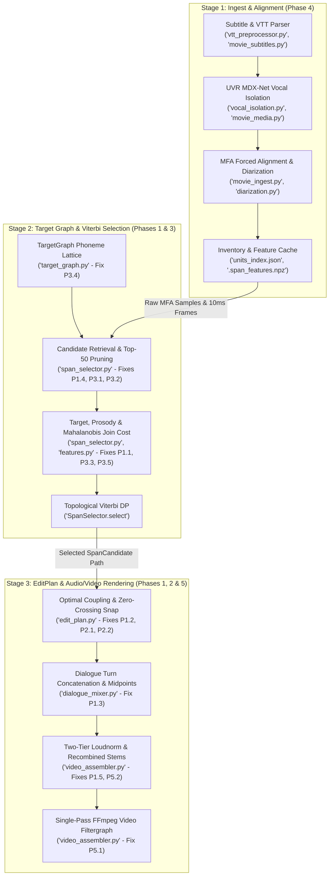
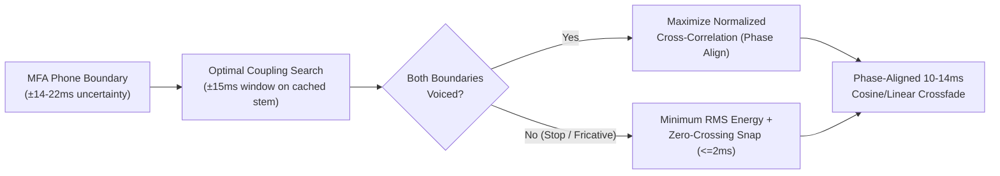

> [!IMPORTANT]
> **Scope & Cache Impact Summary**: This plan consolidates **14 verified bugs and algorithmic bottlenecks** across the `sentences` source-preserving video/dialogue mixer. **Phases 1, 2, and 3 (11 of 14 fixes) operate 100% at mix/render time** on existing `units_index.json`, `.span_features.npz`, and separated FLAC/WAV vocal stems—requiring **zero MFA re-alignment and zero vocal re-separation** for already-ingested movies.

## 1. Architecture & Remediation Topology



### Cache Invalidation Matrix Across Phases

| Phase | Target Modules | Fixes Covered | Re-Run Vocal Separation? | Re-Run MFA Alignment? | Rebuild `units_index.json`? |
| :--- | :--- | :--- | :--- | :--- | :--- |
| **Phase 1 (P0)** | `dialogue_mixer.py`, `edit_plan.py`, `span_selector.py`, `run_mixer.py` | Dead dialogue join cost, broken `continuation` butt-joins, `concat_edit_plans` A/V drift & loudnorm, whole-word bleed collars, duplicate `finalize_edit_plan` | **No** | **No** | **No** (Mix-time only) |
| **Phase 2 (P0)** | `span_selector.py`, `edit_plan.py`, `video_assembler.py` | Replace blind 12–45 ms collars with Optimal Coupling ($\pm 15\text{ ms}$ cross-correlation lag search), zero-crossing snap ($\le 2\text{ ms}$), diphone midpoint subwords | **No** | **No** | **No** (Mix-time only) |
| **Phase 3 (P1)** | `span_selector.py`, `features.py`, `prosody_guide.py`, `target_graph.py` | Pre-DP continuation preservation, per-phone cost scaling & speaker median duration z-score, Mahalanobis 15 ms boundary MFCCs, `pyin` voiced F0 slope regression, `ProsodyGuide` & lattice context fixes | **No** | **No** | **No** (Reuses cached 10 ms `.span_features.npz` frames) |
| **Phase 4 (P2)** | `media_time.py`, `contracts.py`, `movie_ingest.py`, `vtt_preprocessor.py`, `diarization.py` | `RationalTime(0)` fix, `avg_frame_rate` & `codec_delay_samples`, minor-character voice checks, short-clip FLAC slicing & neural VAD | **No** | **Movies: No**<br/>**Short clips: Yes** (only if fixing `-ss` seek drift) | **Yes** (~2–5s fast rebuild from cached `.TextGrid`s) |
| **Phase 5 (P2)** | `video_assembler.py`, `run_mixer.py`, `tools/quality_check.py`, `tools/listen_verify.py` | Single-pass FFmpeg filtergraph, post-loudnorm silence fade ramp, CLI manifest collision & early speaker check, spectral-flux click detector | **No** | **No** | **No** (Render/eval time only) |

---

## 2. Phase 1 (P0): Immediate Correctness, Continuity & A/V Sync Fixes

All Phase 1 fixes are **strictly mix-time** and fix silent algorithmic bypasses or waveform/timeline corruption.

### Fix P1.1: Wire `feature_extractor` in Multi-Speaker Dialogue Mixing
- **Location**: `src/dialogue_mixer.py:495-501`, `src/span_selector.py:1222`, `src/features.py:406`
- **Root Cause**: `render_dialogue_scene` instantiates `selector = SpanSelector(merged_inv, lexicon)` (`line 495`) and calls `selector.select(g, speaker_id=spk)` (`line 501`) without passing `feature_extractor`. Consequently, `_get_candidate_boundary_feature` returns `None` and `compute_join_cost` returns a flat fallback penalty of `1.5` for every non-contiguous transition in every dialogue scene.
- **Implementation**:
  ```python
  # src/dialogue_mixer.py (around lines 494-503)
  from features import ContinuousFeatureExtractor
  feature_extractor = ContinuousFeatureExtractor(sr=16000)
  selector = SpanSelector(merged_inv, lexicon)
  ...
  spans = selector.select(
      g,
      speaker_id=spk,
      feature_extractor=feature_extractor,
  )
  ```

### Fix P1.2: Fix Collar-Trimmed `continuation` Logic in `build_edit_plan`
- **Location**: `src/edit_plan.py:314-323, 402-409` vs. `src/span_selector.py:1164-1167`
- **Root Cause**: When boundary collars trim `start_sample` or `end_sample` on two consecutive events from the same source, `SpanSelector.is_source_continuation` (`span_selector.py:1164`) checks `last_ev.successor_id == first_next_ev_id and prev_span.end_sample == next_span.start_sample` (evaluating to `False`). However, `build_edit_plan` (`edit_plan.py:318`) uses `or`:
  ```python
  if prev_span.end_sample == next_span.start_sample or (
      last_ev and next_span.event_ids and last_ev.successor_id == next_span.event_ids[0]
  ):
      is_cont = True
  ```
  Because `or` succeeds on `successor_id` even when samples were excised between `prev_span.end_sample` and `next_span.start_sample`, `edit_plan.py` marks the transition as `"continuation"` with `overlap_samples = 0` and `fade_samples = 0` (`lines 322, 403-409`), hard-butting the two waveforms across a 12–90 ms excised gap with zero crossfade.
- **Implementation**:
  Require exact sample abutment (`and`) in `src/edit_plan.py:318` so any collar-trimmed pair receives a standard crossfaded splice:
  ```python
  # src/edit_plan.py:318
  if prev_span.end_sample == next_span.start_sample and (
      last_ev is not None
      and bool(next_span.event_ids)
      and last_ev.successor_id == next_span.event_ids[0]
  ):
      is_cont = True
  ```

### Fix P1.3: Preserve Overlap Video Midpoints & Scene Loudnorm in `concat_edit_plans`
- **Location**: `src/dialogue_mixer.py:76, 131-145, 502-518` and `run_mixer.py:2262`
- **Root Cause**:
  1. Single-turn `build_edit_plan` (`src/edit_plan.py:454-485`) partitions video frames at the midpoint of each 14 ms audio crossfade (`midpoint = next_seg.output_start_sample + (ov // 2)`) so $\sum \text{video\_frame\_count} = \text{total\_video\_frames}$. When `concat_edit_plans` (`src/dialogue_mixer.py:131-145`) shifts segments into `combined_plan`, it overwrites `video_start_frame` and `video_frame_count` from raw `new_start` and `new_end` (which overlap by 14 ms), double-counting video frames at every crossfade and causing cumulative A/V sync drift.
  2. `concat_edit_plans` copies `metadata=dict(first.metadata)` (`line 76`) and `render_dialogue_scene` never runs `finalize_edit_plan` on `combined_plan` (`line 517`), so Pass-2 EBU R128 loudnorm scales the entire multi-speaker scene using Pass-1 integrated loudness measured on Turn 1 alone.
  3. `build_edit_plan` already calls `finalize_edit_plan` at `src/edit_plan.py:503`, so calling `finalize_edit_plan` again at `run_mixer.py:2262` and `dialogue_mixer.py:511` renders a full temporary master WAV and runs FFmpeg `loudnorm` Pass-1 twice per mix.
- **Implementation**:
  1. In `src/edit_plan.py:123`, add `finalize: bool = True` to `build_edit_plan` (pass `finalize=False` when building per-turn plans in `dialogue_mixer.py:502`, and remove the redundant `finalize_edit_plan` call in `run_mixer.py:2262`).
  2. In `src/dialogue_mixer.py:131-145`, re-apply the exact midpoint partitioning loop from `src/edit_plan.py:454-485` across `combined_segs` and `combined_transitions` rather than computing `v_start`/`v_end` from raw overlapped `new_start`/`new_end`.
  3. Call `finalize_edit_plan(combined_plan, merged_inv, normalize_loudness=normalize_loudness)` once on `combined_plan` at `src/dialogue_mixer.py:517`.

### Fix P1.4: Apply Whole-Word Bleed Trimming (Until Replaced by Optimal Coupling in Phase 2)
- **Location**: `src/span_selector.py:472-502`
- **Root Cause**: `_retrieve_word_candidates` calls `r_bleed_cost, l_bleed_cost = _compute_word_bleed(wo, s_rate)` (`line 472`) and adds the penalty to `quality_cost`, but unlike `_retrieve_phrase_candidates` (`lines 287, 298`), `_retrieve_subword_candidates` (`lines 653, 674`), and `_retrieve_phone_candidates` (`lines 858, 873`), it never trims `w_start_sample` or `w_end_sample` (`lines 493-494`).
- **Implementation**: Record `entry_variant_samples` and `exit_variant_samples` on `SpanCandidate` (`src/contracts.py:297-298`) and resolve them via Phase 2 Optimal Coupling rather than mutating `start_sample` / `end_sample` destructively during candidate retrieval.

---

## 3. Phase 2 (P0): Optimal Coupling, Zero-Crossing Snaps & Diphone Midpoints

This phase eliminates the root cause of robotic clicks, comb filtering, and chopped consonants while strictly preserving the project's **non-generative, zero-vocoder invariant** (no pitch/time stretching).



### Fix P2.1: Replace Blind Sample Collars with Optimal Coupling & Zero-Crossing Alignment
- **Location**: `src/span_selector.py:269-322, 646-675, 851-874`, `src/edit_plan.py:310-445`, `src/video_assembler.py:580-630`
- **Root Cause**:
  - Up to four sequential collars (`12ms` stop guard + `15ms` right bleed + `12ms` pred stop guard + `20ms/45ms` left bleed) stack in `span_selector.py`, whittling short subwords and phones down to `< 30 ms` without inspecting the waveform.
  - Neither `edit_plan.py` nor `video_assembler.py` performs zero-crossing detection or phase alignment; fixed 14 ms linear crossfades across out-of-phase periodic vowel waveforms cause comb-filtering dips, and non-overlapped edges click.
- **Implementation**:
  1. **Remove blind sample mutation in `span_selector.py`**: Keep `start_sample` and `end_sample` at the aligned boundaries during DP (retaining the coarticulation cost penalties so DP still prefers compatible phonetic contexts).
  2. **Add `refine_splice_boundary(out_pcm, in_pcm, sr, max_shift_ms=15.0)` in `src/edit_plan.py`**:
     - For **overlapped transitions (`overlap_samples > 0`)**: Search lag offsets $(\delta_{\text{out}}, \delta_{\text{in}}) \in [-15\text{ ms}, +15\text{ ms}]$ maximizing normalized cross-correlation:
       $$R(\delta_{\text{out}}, \delta_{\text{in}}) = \frac{\sum_{n=0}^{L-1} x_{\text{out}}[n + \delta_{\text{out}}] \cdot x_{\text{in}}[n + \delta_{\text{in}}]}{\sqrt{\sum x_{\text{out}}^2 \sum x_{\text{in}}^2 + \epsilon}}$$
       This aligns pitch periods across the crossfade (WSOLA-style optimal coupling, Black & Taylor 1997) without altering playback rate or pitch.
     - For **unvoiced / plosive boundaries and segment outer edges**: Snap cut indices to the nearest upward-going zero crossing within $\pm 2\text{ ms}$ (`96 samples` at 48 kHz) inside the lowest-energy 5 ms valley preceding a stop burst.

### Fix P2.2: Diphone Midpoint Indexing for Sub-Word Fallbacks
- **Location**: `src/span_selector.py:63-80, 560-715`
- **Root Cause**: `_subword_map` slices subwords at exact phone boundaries (`ev_chain[0].start_sample` to `ev_chain[-1].end_sample`), where formant transitions and coarticulation are steepest.
- **Implementation**:
  When two subword or phone spans join inside a synthesized word (`curr.target_node_end == succ.target_node_start` within the same target word and `curr.end_phone == succ.start_phone` or matching vowel core), allow midpoint transitions at `(shared_ev.start_sample + shared_ev.end_sample) // 2` where formants are stationary.

---

## 4. Phase 3 (P1): Selection DP Pruning, Cost Normalization & Prosody Math

All Phase 3 fixes operate in memory on existing `units_index.json` and `.span_features.npz` files.

### Fix P3.1: Exempt Natural Continuations from Pre-DP Top-50 Truncation
- **Location**: `src/span_selector.py:461, 625, 832`
- **Root Cause**: `_retrieve_word_candidates` (`line 461`), `_retrieve_subword_candidates` (`line 625`), and `_retrieve_phone_candidates` (`line 832`) sort candidates by unary `target_cost + quality_cost` and truncate to `self.max_candidates_per_span` (`50`) *before* Viterbi runs. In movie inventories (`3,600+` words), contiguous next-word or next-phone continuations (`trans_cost = 0.0`) get pruned if their unary score ranks `#51+`.
- **Implementation**:
  After collecting raw candidates across all graph spans in `retrieve_candidates` (`src/span_selector.py:1228-1268`), run a lightweight pass collecting all `event_ids[0]` and `successor_id` links present in adjacent node pools, mark any candidate that forms a contiguous `successor_id` chain with an adjacent span as **exempt from truncation**, and apply `[:self.max_candidates_per_span]` only to the remaining non-continuation pool.

### Fix P3.2: Per-Phone Cost Normalization & Speaker-Relative Median Duration Z-Score
- **Location**: `src/span_selector.py:338, 491, 704, 919, 1443-1445`
- **Root Cause**:
  1. `SpanSelector` has no target duration prior on words or phrases (unlike `legacy` `unit_selector.py:114-117`, which picked the median duration). In large corpora, Viterbi picks abnormally fast, mumbled instances (`8 words in 1.4s`, `plans/10_05_handoff.md:130-134`).
  2. `cand_cost = succ.target_cost + succ.quality_cost + guide_cost + reuse_penalty` (`line 1444`) is added once per span rather than scaled by phone coverage, while individual heuristic penalties (`+0.80` bleed, `+2.50` vowel floor, `+2.00` pitch slope) dwarf the `0.10` gap between `word` (`0.05`) and `phone` (`0.15`).
- **Implementation**:
  1. Precompute per-speaker median and IQR duration for each word and phone in `SpanSelector.__init__`. Add a smooth duration deviation penalty to `target_cost`:
     ```python
     # Penalize abnormally rushed (< 0.7x median) or dragged (> 1.6x median) tokens
     ratio = dur_sec / max(median_dur_sec, 0.04)
     if ratio < 0.75:
         dur_cost = 0.60 * ((0.75 - ratio) / 0.75) ** 2
     elif ratio > 1.50:
         dur_cost = 0.30 * min(2.0, (ratio - 1.50) / 1.0) ** 2
     ```
  2. Cap cumulative unary heuristic quality penalties on whole words so an intelligible whole word is never shattered into phones unless a phone splice is genuinely cleaner.

### Fix P3.3: Narrow 15–20 ms Boundary Windows & Mahalanobis MFCC Join Cost
- **Location**: `src/span_selector.py:1171-1212, 1249-1255`, `src/features.py:328-438`
- **Root Cause**:
  - `_get_candidate_boundary_feature` (`span_selector.py:1250`) averages MFCCs over a `50 ms` window (`5 frames`), and `_get_boundary_embedding` (`line 1192`) averages WavLM over `100 ms` (`1600 samples` at 16 kHz), smearing the actual boundary frame across the interior of the phone.
  - `compute_join_cost` (`features.py:417-421`) uses unweighted Euclidean distance on `mfcc_13[1:]`, which is dominated by $C_1$ (spectral tilt), and applies this penalty even when concatenating two *different* phonemes (e.g., `/T/` to `/AA1/`) that naturally have different spectra.
- **Implementation**:
  1. Shrink the boundary feature window in `_get_candidate_boundary_feature` from `0.050s` to `0.020s` (2 frames right at the splice edge).
  2. Weight MFCC differences by inverse corpus variance per coefficient (liftered/Mahalanobis distance across $C_1 \dots C_{12}$) plus $\Delta\text{MFCC}$ continuity.
  3. Apply spectral/WavLM similarity costs at full weight (`1.0`) only when joining **matching phones or vowel-to-vowel/sonorant-to-sonorant transitions**; scale spectral distance by `0.25` at natural manner boundaries (e.g., unvoiced stop/fricative into vowel) where a spectral jump is phonetically expected.

### Fix P3.4: Fix Voiced F0 Slope Regression, `ProsodyGuide` & Multi-Branch Context
- **Location**: `src/span_selector.py:988-994`, `src/prosody_guide.py:98-145`, `src/target_graph.py:290-297`
- **Root Cause**:
  1. `span_selector.py:988-994` calls unvoiced-blind `librosa.yin` and computes `f0_slope = (valid[-1] - valid[0]) / dt` from the first and last frames (which are unvoiced consonant onsets/codas).
  2. `prosody_guide.py:126` reads `getattr(cand, "pitch_semitones", None)`, which does not exist on `SpanCandidate` (`contracts.py:284-308`), making pitch-level matching dead code; `lines 98-103` map time via `start_nid / len(graph.nodes)`, which skews whenever parallel pronunciation branches exist.
  3. `target_graph.py:293-297` hardcodes cross-word `right_context_phone` / `left_context_phone` to `succs[0]` / `preds[0]`.
- **Implementation**:
  1. Compute F0 slope in `_get_candidate_acoustic_features` using linear regression (`np.polyfit(t_voiced, f0_voiced, 1)[0]`) over frames in `.span_features.npz` where `f0_confidence > 0.5` (requiring $\ge 3$ voiced frames).
  2. Populate `cand_f0_hz` from `_get_candidate_acoustic_features(cand)["f0_mean"]` in `prosody_guide.py:126`, and map guide time by **word token index + intra-word phone fraction** rather than raw `node_id / len(graph.nodes)`.
  3. In `target_graph.py:290-297`, store `right_context_phones: Set[str]` across all valid cross-word successor branches (or evaluate context affinity against the actual successor candidate's `start_phone` inside the Viterbi edge loop at `span_selector.py:1382`).

---

## 5. Phase 4 (P2): Ingest, Schema, Timebase & Diarization Fixes

### Fix P4.1: Fix `RationalTime(0)` Validation & `SourceRecord` Timebase Metadata
- **Location**: `src/contracts.py:61-82, 399`, `src/media_time.py:86-97, 181-198`
- **Root Cause**:
  - `RationalTime.validate()` (`contracts.py:61`) raises `ValueError` when `self.numerator <= 0`, breaking 0.0s rational timestamps.
  - `media_time.py:88` parses `r_frame_rate` instead of `avg_frame_rate` (corrupting VFR sources), never probes `codec_delay_samples` (`initial_padding`), and omits `decoded_video_origin_sec`.
- **Implementation**:
  - Allow `numerator >= 0` for time offsets in `RationalTime.validate()` (keeping `numerator > 0` strictly for frame rates).
  - Prefer `avg_frame_rate` when valid and positive in `media_time.py:88`, probe `initial_padding` into `codec_delay_samples`, and record `decoded_video_origin_sec` from the first video packet/frame PTS.

### Fix P4.2: Protect Minor Movie Characters (`< 5` Lines) in Voice Verification
- **Location**: `src/movie_ingest.py:60, 241, 307`
- **Root Cause**: `MIN_CENTROID_SEGMENTS = 5` skips centroid construction and voice mismatch checks for any character with fewer than 5 lines in a movie, leaving minor characters unprotected against subtitle misattribution.
- **Implementation**: Lower `MIN_CENTROID_SEGMENTS` to `2` for leave-one-out self-consistency checks (or verify minor-character lines against all major-character centroids so lines accidentally stolen from a main character are still flagged `voice_mismatch`). Rebuilding `speaker_labels.json` and `units_index.json` takes ~3 seconds from cached `voice_embeddings_vocals.npz`.

### Fix P4.3: Unify Short-Clip Chunk Slicing with Sample-Accurate FLAC/WAV Reads
- **Location**: `src/vtt_preprocessor.py:475-485`, `src/diarization.py:185-260, 689-698`
- **Root Cause**:
  - `vtt_preprocessor.py:478` runs `ffmpeg -y -ss <start_ts> -t <dur> -i <audio_input>`, performing keyframe-seeking on compressed containers and shifting MFA alignments by up to 100–500 ms.
  - `diarization.py:185-260` uses RMS percentile thresholding for turn segmentation and pads turns by up to `1.50s` into trailing silence (`lines 689-698`).
- **Implementation**:
  - Slice short-clip MFA chunks in Python via `soundfile.SoundFile.seek` on the decoded WAV/FLAC (matching `movie_ingest.py:558`).
  - Cap trailing turn padding in `diarization.py:690` to `0.15s` (down from `1.50s`) and split long turns at sliding-window WavLM-SV cosine distance peaks (`> 0.35`).

---

## 6. Phase 5 (P2): Rendering Performance, CLI Guards & Click Verification

### Fix P5.1: Replace $N$-Subprocess Video Encoding with Batched FFmpeg Filtergraph
- **Location**: `src/video_assembler.py:896-1013`
- **Root Cause**: `render_sentence_mix` spawns a separate `ffmpeg` subprocess for every segment (`slice_0000.mp4` ... `slice_NNNN.mp4`), re-opening the container and decoding from the preceding keyframe on every word or phone cut.
- **Implementation**: Group segments by source file and build a single FFmpeg `-filter_complex` graph using `trim=start=...:end=...,setpts=PTS-STARTPTS` (and `tpad` for freeze holds) concatenated via `concat=n=N:v=1:a=0`, reducing video render wall time by 60–80%.

### Fix P5.2: Apply 3 ms Cosine Fade Ramp on Post-Loudnorm Silence Re-Zeroing
- **Location**: `src/video_assembler.py:652-658`
- **Root Cause**: After two-pass EBU R128 `loudnorm`, lines 655–658 zero out `data[s_start:s_end] = 0.0` with a hard rectangular step cut, creating clicks if `loudnorm` filter ringing extends into silence boundaries.
- **Implementation**: Apply a 3 ms (`144 samples` at 48 kHz) half-cosine taper at `s_start` and `s_end` when re-zeroing silence intervals.

### Fix P5.3: Fix CLI Early Speaker Check, Alias Resolution & Manifest Subtitle Keys
- **Location**: `run_mixer.py:1096-1098, 2059-2071, 2355-2405`
- **Implementation**:
  1. Fail fast at `run_mixer.py:1096` before running vocal separation and MFA when diarization is unavailable and neither `--speaker` nor `--assume-single-speaker` is set.
  2. Resolve `--speaker` through `CharacterResolver` (`config/characters/*.json`) at `run_mixer.py:2059-2071` so `--speaker "Chancellor Palpatine"` resolves to `palpatine`.
  3. Map `.srt` to `"subtitles_srt"` and `.vtt` to `"subtitles_vtt"` in `_artifact_key` (`run_mixer.py:2359-2360`) so staging both formats does not crash publication with `ValueError: Duplicate manifest artifact key 'subtitles'` (`line 2402`).

### Fix P5.4: Add Boundary Transient / Click Detection to `tools/quality_check.py`
- **Location**: `tools/quality_check.py`
- **Implementation**: Alongside the 65 ms swallowed-word duration check and Whisper ASR verification, inspect a $\pm 5\text{ ms}$ window around each `EditPlan` transition timestamp in the rendered master WAV and flag any sample-to-sample first-difference spike $|\Delta x[n]| > 6 \sigma_{\text{local}}$ (or high-frequency spectral flux spike $> 4\text{ kHz}$) as an audible splice click.

