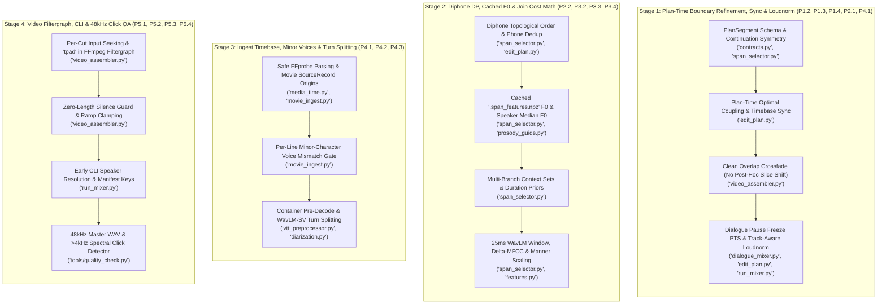

# Detailed Remediation Plan: Closing All Gaps & Regressions in `sentences`

> [!IMPORTANT]
> **Goal & Scope**: This plan provides exact, drop-in code changes to fix all **12 incomplete or buggy items** from [10_09_improvements.md](file:///usr/local/google/home/seanstappas/tmp/repos/sentences/plans/10_09_improvements.md) plus **all cross-module integration bugs** discovered during the `/swarm` audit.
> - **Stages 1, 2, and 4** operate **100% at mix/render/QA time** (zero MFA re-alignment, zero vocal re-separation, zero `units_index.json` rebuilds).
> - **Stage 3** updates ingest/diarization logic; for already-ingested movies, updating `SourceRecord` timebase fields and minor-character voice verification takes ~3 seconds from cached `.TextGrid` and `voice_embeddings_vocals.npz` files.

---

## Architecture & Execution Topology



---

## Stage 1: Plan-Time Boundary Refinement, Sync & Loudnorm (`P1.2`, `P1.3`, `P1.4`, `P2.1`, `P4.1`)

### Why Stage 1 Must Come First
Currently, `refine_splice_boundary` is dead in [edit_plan.py](file:///usr/local/google/home/seanstappas/tmp/repos/sentences/src/edit_plan.py#L122-L273) and is called post-hoc inside `render_master_pcm` ([video_assembler.py](file:///usr/local/google/home/seanstappas/tmp/repos/sentences/src/video_assembler.py#L629-L677)), where:
1. Shifting `next_slice` by `shift_in` after segment durations are frozen forces `np.pad(..., mode="edge")` (`line 667`), injecting up to **15 ms (720 samples) of constant DC flatline** at segment tails.
2. Overwriting `master_audio[fade_end:end_update]` (`line 676`) while `segment_slices` caches the padded slice causes a **phase jump / sample discontinuity** at the next transition.
3. `_s_out` (unvoiced zero-crossing snap on outgoing tails) is thrown away (`line 629`), non-overlapped cuts never snap to zero crossings, `entry_variant_samples`/`exit_variant_samples` (`P1.4`) are never read, and `video_source_pts_sec` ignores both `shift_in` and `codec_delay_samples` (`P4.1`).

Moving boundary refinement into `build_edit_plan` fixes all six issues simultaneously: `source_start_sample` and `source_end_sample` are adjusted on the source audio **before** computing `resampled_duration`, `output_start_sample`, and `video_source_pts_sec`, so `render_master_pcm` simply crossfades the already-aligned slices with zero post-hoc shifting or padding.

---

### Step 1.1: Fix Split-Brain `is_source_continuation` (`P1.2`)
- **File**: [src/span_selector.py](file:///usr/local/google/home/seanstappas/tmp/repos/sentences/src/span_selector.py#L1440-L1464)
- **Bug**: `build_edit_plan` ([edit_plan.py:468-476](file:///usr/local/google/home/seanstappas/tmp/repos/sentences/src/edit_plan.py#L468-L476)) requires `span.end_sample == next_span.start_sample and successor_id == next_span.event_ids[0]`, whereas `SpanSelector.is_source_continuation` uses `or` (returning `True` even if samples do not abut, or if samples abut without event linkage).
- **Change in `src/span_selector.py:1440-1464`**:
  ```python
  def is_source_continuation(self, pred: SpanCandidate, curr: SpanCandidate) -> bool:
      """
      True only if curr immediately follows pred in the source recording without cuts.
      Requires both physical sample abutment and event successor linkage (when event_ids exist).
      """
      if pred.source_content_id != curr.source_content_id:
          return False

      if pred.start_sample == curr.start_sample and pred.end_sample == curr.end_sample:
          return False

      if pred.end_sample != curr.start_sample:
          return False

      if pred.event_ids and curr.event_ids:
          last_ev = self.inv.events.get(pred.event_ids[-1])
          first_ev = self.inv.events.get(curr.event_ids[0])
          if not (last_ev and first_ev and last_ev.successor_id == first_ev.event_id):
              return False

      return True
  ```
- **Also update `src/span_selector.py:1121-1144`** (`retrieve_candidates` continuation pre-DP index):
  In `lines 1141-1143`, instead of unioning `exit_sample_map` and `exit_event_map` with `or`, require `pred.end_sample == succ.start_sample` when filtering `matching_preds`:
  ```python
  for pred in matching_preds:
      if pred.candidate_id == succ.candidate_id:
          continue
      if pred.end_sample != succ.start_sample:
          continue
  ```

---

### Step 1.2: Wire `entry/exit_variant_samples` (`P1.4`), `refine_splice_boundary` (`P2.1`), and `codec_delay_samples` (`P4.1`) in `build_edit_plan`
- **Files**:
  - [src/contracts.py](file:///usr/local/google/home/seanstappas/tmp/repos/sentences/src/contracts.py#L316-L338)
  - [src/edit_plan.py](file:///usr/local/google/home/seanstappas/tmp/repos/sentences/src/edit_plan.py#L122-L662)
  - [src/video_assembler.py](file:///usr/local/google/home/seanstappas/tmp/repos/sentences/src/video_assembler.py#L603-L677)

1. **Add `entry_variant_samples` and `exit_variant_samples` to `PlanSegment` in `src/contracts.py:337`**:
   ```python
   freeze_video: bool = False
   realized_phones: List[str] = field(default_factory=list)
   entry_variant_samples: int = 0
   exit_variant_samples: int = 0
   ```

2. **Allow two-sided lag search (`shift_out <= 0`, `shift_in >= 0`) in `refine_splice_boundary` (`src/edit_plan.py:228-273`)**:
   Currently, voiced mode hardcodes `shift_out = 0` and only searches `in_1d[lag : lag + l_eval]`. Update voiced mode so that if `out_1d` includes an `exit_variant_samples` collar tail (or $\pm 7.5\text{ ms}$ window), it searches `(lag_out, lag_in)` or snaps outgoing boundary to an upward zero-crossing first, then finds the phase-matching `best_lag` in `in_1d`:
   ```python
   # Snap outgoing cut to nearest upward zero-crossing within <= 2ms of nominal end
   max_snap = max(1, int(round(0.002 * sr)))
   shift_out = 0
   for i in range(n_out - 1, max(1, n_out - max_snap) - 1, -1):
       if out_1d[i - 1] <= 0.0 < out_1d[i]:
           shift_out = i - n_out  # <= 0
           break
   out_trimmed = out_1d[: n_out + shift_out] if shift_out < 0 else out_1d
   # Then align incoming phase over the crossfade window l_eval against out_trimmed[-l_eval:]
   ref_out = out_trimmed[-l_eval:]
   ```
   *(Note: Previously `ref_out = out_1d[:l_eval]` correlated against the **start** of `out_1d`, which only worked when the caller passed `prev_slice[-fade_len:]` of exact length `fade_len`. Taking `out_trimmed[-l_eval:]` ensures `ref_out` is always the terminal crossfade window right at the outgoing cut!)*

3. **Resolve sample bounds & timebase offsets inside `build_edit_plan` (`src/edit_plan.py:461-535`)**:
   Before the `for i, span in enumerate(selected_spans):` loop (`line 461`), run a lightweight boundary refinement pass over `selected_spans` that:
   - Applies `span.entry_variant_samples` / `span.exit_variant_samples` at non-continuation boundaries when bleed collars were flagged during candidate retrieval (clamping so `end_sample - start_sample >= int(0.030 * native_sr)`).
   - Calls `refine_splice_boundary` on the native source audio windows around each non-continuation splice (both overlapped transitions and hard/pause splices, plus outer utterance edges using `is_unvoiced=True`), adjusting `span_starts[i]` and `span_ends[i]` in native samples **before** computing `resampled_duration`.
   - Computes `source_pts` (`src/edit_plan.py:493`, and `325, 409, 423`) with `codec_delay_samples` and container stream origin offsets (`P4.1`):
     ```python
     def _source_sample_to_video_pts(sample_idx: int, src_rec: SourceRecord) -> float:
         sr = src_rec.native_sample_rate
         effective_sample = max(0, sample_idx - getattr(src_rec, "codec_delay_samples", 0))
         audio_sec = samples_to_seconds(effective_sample, sr) + getattr(src_rec, "decoded_audio_origin_sec", 0.0)
         video_origin = getattr(src_rec, "decoded_video_origin_sec", 0.0)
         return max(0.0, audio_sec - video_origin)
     ```
     Replace `samples_to_seconds(span.start_sample, native_sr)` at `lines 325, 409, 423, 493` with `_source_sample_to_video_pts(...)`.

4. **Simplify `render_master_pcm` overlap loop in `src/video_assembler.py:603-677`**:
   Remove the post-hoc `refine_splice_boundary` call and the `if head_idx_start > 0:` body-overwrite + `np.pad(mode="edge")` block (`lines 614-677`), leaving a pure, artifact-free crossfade of the pre-aligned slices:
   ```python
   # src/video_assembler.py:603-658
   for trans in plan.transitions:
       if trans.transition_type == "overlap" and trans.overlap_samples > 0:
           from_seg = plan.segments[trans.from_segment_index]
           to_seg = plan.segments[trans.to_segment_index]
           fade_start = max(0, to_seg.output_start_sample)
           fade_end = min(total_samples, from_seg.output_end_sample)
           fade_len = fade_end - fade_start
           if fade_len > 0:
               prev_slice = segment_slices.get(trans.from_segment_index)
               next_slice = segment_slices.get(trans.to_segment_index)
               if prev_slice is not None and next_slice is not None:
                   p_tail = prev_slice[-fade_len:]
                   n_head = next_slice[:fade_len]
                   if is_stereo:
                       prev_tail = p_tail if len(p_tail) >= fade_len else np.pad(p_tail, ((fade_len - len(p_tail), 0), (0, 0)))
                       next_head = n_head if len(n_head) >= fade_len else np.pad(n_head, ((0, fade_len - len(n_head)), (0, 0)))
                   else:
                       prev_tail = p_tail if len(p_tail) >= fade_len else np.pad(p_tail, (fade_len - len(p_tail), 0))
                       next_head = n_head if len(n_head) >= fade_len else np.pad(n_head, (0, fade_len - len(n_head)))
                   fade_out = np.linspace(1.0, 0.0, fade_len, dtype=np.float32)
                   fade_in = np.linspace(0.0, 1.0, fade_len, dtype=np.float32)
                   if is_stereo:
                       fade_out = fade_out[:, np.newaxis]
                       fade_in = fade_in[:, np.newaxis]
                   master_audio[fade_start:fade_end] = (prev_tail * fade_out) + (next_head * fade_in)
   ```

---

### Step 1.3: Fix Dialogue Pause Freeze PTS, Pause Transition Type & Track-Aware Loudnorm (`P1.3`)
- **Files**:
  - [src/dialogue_mixer.py](file:///usr/local/google/home/seanstappas/tmp/repos/sentences/src/dialogue_mixer.py#L88-L126)
  - [src/edit_plan.py](file:///usr/local/google/home/seanstappas/tmp/repos/sentences/src/edit_plan.py#L286-L287)
  - [run_mixer.py](file:///usr/local/google/home/seanstappas/tmp/repos/sentences/run_mixer.py#L2246-L2263)

1. **Fix conversational pause freeze PTS & transition type in `src/dialogue_mixer.py:88-126`**:
   - At `line 112`, `video_source_pts_sec=prev_seg.video_source_pts_sec` freezes the **first** frame of `prev_seg` instead of its **last** frame (compare `edit_plan.py:374`).
   - At `line 121`, `transition_type="continuation"` is semantically wrong for a synthetic silence pause segment; use `"pause"`.
   ```python
   # src/dialogue_mixer.py:89-123
   prev_seg = combined_segments[-1]
   p_start = current_sample
   p_end = p_start + pause_samples
   p_start_frame = cumulative_frame_ceiling(p_start, sr, fps)
   p_end_frame = cumulative_frame_ceiling(p_end, sr, fps)
   freeze_pts = prev_seg.video_source_pts_sec + (float(prev_seg.duration_samples) / float(sr))
   pause_seg = PlanSegment(
       segment_index=seg_idx,
       source_content_id="silence",
       speaker_id=prev_seg.speaker_id,
       source_start_sample=0,
       source_end_sample=pause_samples,
       output_start_sample=p_start,
       output_end_sample=p_end,
       target_text="[pause]",
       target_phones=["sil"],
       span_type="pause",
       source_video_path=prev_seg.source_video_path,
       gain_db=0.0,
       fade_in_samples=0,
       fade_out_samples=0,
       is_silence=True,
       video_start_frame=p_start_frame,
       video_frame_count=max(0, p_end_frame - p_start_frame),
       video_source_pts_sec=freeze_pts,
       freeze_video=True,
       realized_phones=[],
   )
   combined_segments.append(pause_seg)
   combined_transitions.append(PlanTransition(
       transition_index=trans_idx,
       from_segment_index=prev_seg.segment_index,
       to_segment_index=seg_idx,
       transition_type="pause",
       overlap_samples=0,
   ))
   ```
   *(Also note `max(0, p_end_frame - p_start_frame)` instead of `max(1, ...)` at line 111 so frame totals never exceed `total_frames` before midpoint partitioning.)*

2. **Also adjust `video_source_pts_sec` for overlap midpoints in `concat_edit_plans` (`src/dialogue_mixer.py:201-208`)**:
   In `build_edit_plan` (`edit_plan.py:637-640`), `seg.video_source_pts_sec` is shifted by `(v_start - seg.output_start_sample) / sr`. Because `concat_edit_plans` (`dialogue_mixer.py:201-208`) recomputes `v_start` on segments that were already finalized or non-finalized in `build_edit_plan`, ensure `video_source_pts_sec` is not double-shifted (compute `v_start` offset only if not already applied, or store unshifted `base_source_pts_sec`).

3. **Pass `audio_track` to `finalize_edit_plan` so Pass-1 and Pass-2 EBU R128 match (`src/edit_plan.py:286, 660, 664-671, 720-730, 869`)**:
   - Add `audio_track: str = "combined"` parameter to `build_edit_plan` (`line 286`) and `finalize_edit_plan` (`line 664`).
   - In `finalize_edit_plan` Step 1 (`lines 723-728`), when `audio_track in ("vocals", "isolated", "recombined")` and `src_rec.cached_vocal_pcm_path` exists, measure speech segment RMS on `src_rec.cached_vocal_pcm_path` rather than `cached_pcm_path` (which contains background music/explosions).
   - In `finalize_edit_plan` Step 2 (`line 869`), pass `audio_track=effective_analysis_track` (where `"both"`/`"all"` defaults to `"vocals"` if vocal stems exist, else `"combined"`) into `render_master_pcm(plan, str(analysis_wav), normalize_loudness=False, audio_track=effective_analysis_track)`.
   - Pass `audio_track=audio_track` at `src/dialogue_mixer.py:556` and `getattr(args, "audio_track", "combined")` at `run_mixer.py:2246`.

---

## Stage 2: Diphone DP, Cached F0 & Join Cost Math (`P2.2`, `P3.2`, `P3.3`, `P3.4`)

### Step 2.1: Fix Diphone Midpoint Topological Deadlock, Phone Exclusion & Duplicate Boundary Phones (`P2.2`)
- **Files**:
  - [src/span_selector.py](file:///usr/local/google/home/seanstappas/tmp/repos/sentences/src/span_selector.py#L71-L122)
  - [src/span_selector.py](file:///usr/local/google/home/seanstappas/tmp/repos/sentences/src/span_selector.py#L1660-L1712)

1. **Fix single-phone exclusion and topological expansion order in `SpanSelector.select` (`src/span_selector.py:1663-1698`)**:
   - **Why `phone -> subword` is dead today**: At node `u`, `curr` (`[u, u]`, a single phone) can transition via diphone midpoint to `d_succ` (`[u, u+k]`, a subword starting at `u`). Both are in `cands_by_start[u]`. Because subwords are added to `candidates` before phones (`line 911` vs `line 1106`), `d_succ` appears *before* `curr` in `cands_by_start[u]`, and `reachable` (`line 1668`) is frozen before iterating.
   - **Why `subword -> phone` is dead today**: `line 1686` checks `d_succ.target_node_end > d_succ.target_node_start`, which is `False` for every single-phone candidate (`start == end`).
   - **Replacement for `src/span_selector.py:1663-1712`**:
     ```python
     # Topological DP forward pass across target phoneme nodes
     for node_id in range(len(graph.nodes)):
         curr_cands = cands_by_start.get(node_id, [])
         if not curr_cands:
             continue

         # Sort single-node candidates (target_node_end == target_node_start) BEFORE multi-node
         # candidates so phone [u, u] -> subword [u, u+k] diphone transitions at node u
         # populate dp[d_succ] before d_succ is expanded in this same node_id iteration.
         curr_cands_ordered = sorted(
             curr_cands,
             key=lambda c: (0 if c.target_node_end == c.target_node_start else 1, c.target_node_end),
         )

         for curr in curr_cands_ordered:
             if curr.candidate_id not in dp:
                 continue
             curr_cost = dp[curr.candidate_id]
             next_target_nodes = node_succs.get(curr.target_node_end, [])
             candidates_to_eval: List[Tuple[SpanCandidate, bool]] = []
             for nxt_node in next_target_nodes:
                 for succ in cands_by_start.get(nxt_node, []):
                     candidates_to_eval.append((succ, False))

             # Fix P2.2: Diphone joins inside synthesized words (subword<->subword, subword->phone, phone->subword)
             # Require at least one of (curr, d_succ) to span >1 node so [u, u] -> [u, u] self-loops cannot occur.
             if curr.span_type in ("subword", "phone"):
                 curr_is_multi = curr.target_node_end > curr.target_node_start
                 curr_node = graph.nodes[curr.target_node_end] if curr.target_node_end < len(graph.nodes) else None
                 p_curr_last = strip_phone_stress(curr.realized_phones[-1]) if curr.realized_phones else (curr_node.base_phone if curr_node else "")
                 for d_succ in cands_by_start.get(curr.target_node_end, []):
                     succ_is_multi = d_succ.target_node_end > d_succ.target_node_start
                     if (
                         d_succ.candidate_id != curr.candidate_id
                         and (curr_is_multi or succ_is_multi)
                         and d_succ.span_type in ("subword", "phone")
                     ):
                         d_node = graph.nodes[d_succ.target_node_start] if d_succ.target_node_start < len(graph.nodes) else None
                         if (
                             curr_node is not None
                             and d_node is not None
                             and curr_node.token_index == d_node.token_index
                         ):
                             p_succ_first = strip_phone_stress(d_succ.realized_phones[0]) if d_succ.realized_phones else d_node.base_phone
                             if p_curr_last and p_curr_last == p_succ_first:
                                 candidates_to_eval.append((d_succ, True))
     ```
   - **Also fix the `NoneType` crash risk at `src/span_selector.py:1704-1708`**:
     ```python
     c_last_ev = self.inv.events.get(curr.event_ids[-1]) if curr.event_ids else None
     s_first_ev = self.inv.events.get(succ.event_ids[0]) if succ.event_ids else None
     same_donor_word = (
         c_last_ev is not None
         and s_first_ev is not None
         and c_last_ev.word_occurrence_id is not None
         and c_last_ev.word_occurrence_id == s_first_ev.word_occurrence_id
     )
     ```

2. **Deduplicate shared boundary node `u` in `apply_diphone_midpoint_transitions` (`src/span_selector.py:106-122`)**:
   - Remove the tautological `and not (base_curr in VOWEL_PHONES and base_succ in VOWEL_PHONES and base_curr == base_succ)` on `line 106` (simplify to `if base_curr != base_succ: continue`).
   - When `curr` and `succ` share `curr.target_node_end == succ.target_node_start`, trim the shared node from the multi-node side's `covered_nodes` (or `succ.covered_nodes[1:]` when `len(succ.covered_nodes) > 1`, else `curr.covered_nodes[:-1]`) so `build_edit_plan` (`src/edit_plan.py:495`) does not emit the boundary phoneme twice in `PlanSegment.target_phones`.

---

### Step 2.2: Use Cached `.span_features.npz` in `_get_candidate_acoustic_features` & Populate `speaker_median_f0` (`P3.4`)
- **Files**:
  - [src/span_selector.py](file:///usr/local/google/home/seanstappas/tmp/repos/sentences/src/span_selector.py#L209-L211)
  - [src/span_selector.py](file:///usr/local/google/home/seanstappas/tmp/repos/sentences/src/span_selector.py#L1195-L1289)

1. **Populate `self.speaker_median_f0` and `self.global_median_f0` in `SpanSelector.__init__` (`src/span_selector.py:209-211`)**:
   - Load precomputed `.span_features.npz` or `.features.npz` for each `src_rec` in `self.inv.sources.values()` (caching the loaded numpy dict in `self._preloaded_tracks[source_id]`).
   - For each eligible `WordOccurrence` in `self.inv.words.values()`, slice `f0` and `voiced_probs` across `[start_frame:end_frame]` where `voiced_flag & (voiced_probs > 0.5) & (f0 >= 80) & (f0 <= 500)`, accumulate per `wo.speaker_id`, and set:
     ```python
     self.speaker_median_f0 = {spk: float(np.median(vals)) for spk, vals in spk_f0_vals.items() if vals}
     self.global_median_f0 = float(np.median(all_f0_vals)) if all_f0_vals else 150.0
     ```
   - In `src/span_selector.py:489` and `1181`, replace `self.global_median_f0` with:
     ```python
     ref_f0 = self.speaker_median_f0.get(c.speaker_id, self.global_median_f0)
     c.pitch_semitones = float(12.0 * np.log2(feat.f0_mean / max(50.0, ref_f0)))
     ```

2. **Read `self._preloaded_tracks` / `self._feature_tracks` first in `_get_candidate_acoustic_features` (`src/span_selector.py:1195-1289`)**:
   - Before touching disk with `sf.read` or calling `librosa.pyin`, check if `source_content_id` has cached tracks in `self._preloaded_tracks` or `getattr(self, "_feature_tracks", {})` (or load `span_features_path(pcm_path)` once into `self._preloaded_tracks[source_content_id]`).
   - If cached tracks exist and `not tracks.get("lazy")`:
     ```python
     hop = int(tracks.get("hop_length", 160))
     tr_sr = int(tracks.get("sr", 16000))
     native_sr = src_rec.native_sample_rate or 48000
     s_frame = max(0, int(round((start_sample / float(native_sr)) * tr_sr / hop)))
     e_frame = min(int(tracks["n_frames"]), int(round((end_sample / float(native_sr)) * tr_sr / hop)))
     if e_frame > s_frame:
         rms_slice = tracks["rms"][s_frame:e_frame]
         f0_slice = tracks["f0"][s_frame:e_frame]
         vf_slice = tracks["voiced_flag"][s_frame:e_frame]
         vp_slice = tracks["voiced_probs"][s_frame:e_frame]
         rms_val = float(np.sqrt(np.mean(rms_slice ** 2))) if len(rms_slice) > 0 else 0.0
         valid_pts = [
             (idx * (hop / float(tr_sr)), float(f))
             for idx, (vf, vp, f) in enumerate(zip(vf_slice, vp_slice, f0_slice))
             if vf and vp > 0.5 and f is not None and not np.isnan(f) and 80.0 <= f <= 500.0
         ]
         if len(valid_pts) >= 3:
             t_v = np.array([pt[0] for pt in valid_pts], dtype=float)
             f_v = np.array([pt[1] for pt in valid_pts], dtype=float)
             f0_slope = float(np.polyfit(t_v, f_v, 1)[0])
             f0_mean = float(np.mean(f_v))
         elif len(valid_pts) > 0:
             f0_slope = 0.0
             f0_mean = float(np.mean([pt[1] for pt in valid_pts]))
         else:
             f0_slope, f0_mean = 0.0, 0.0
         if rms_val > 0.0 or f0_mean > 0.0:
             res = AcousticMetrics(f0_slope, rms_val, f0_mean)
             self._acoustic_metrics_cache[cache_key] = res
             return res
     ```
   - This turns thousands of per-candidate `sf.read` + `librosa.resample` + `librosa.pyin` calls into microsecond numpy array slices.

3. **Pass Multi-Branch `left_context_phones` / `right_context_phones` Sets in `src/span_selector.py`**:
   - At `src/span_selector.py:452`:
     ```python
     end_r_set = getattr(end_node, "right_context_phones", None) or {end_node.right_context_phone}
     if end_node.is_phrase_final or "sil" in end_r_set:
     ```
   - At `src/span_selector.py:630, 664`:
     ```python
     target_l_phones = getattr(start_node, "left_context_phones", None) or ({start_node.left_context_phone} if start_node.left_context_phone else set())
     target_l_bases = {strip_phone_stress(p) for p in target_l_phones if p}
     if pred_base in ("P", "T", "K", "B", "D", "G") and not (target_l_bases & {"P", "T", "K", "B", "D", "G"}):
     ```
   - At `src/span_selector.py:738-739, 757, 862`:
     ```python
     target_l_phone = getattr(graph.nodes[sub_nodes[0]], "left_context_phones", None) or graph.nodes[sub_nodes[0]].left_context_phone
     target_r_phone = getattr(graph.nodes[sub_nodes[-1]], "right_context_phones", None) or graph.nodes[sub_nodes[-1]].right_context_phone
     ```
     (and check `"sil" in target_r_phone` at `line 757` and `target_l_bases` at `line 862`).
   - At `src/span_selector.py:960-961, 977, 1053`:
     ```python
     target_l_phone = getattr(node, "left_context_phones", None) or node.left_context_phone
     target_r_phone = getattr(node, "right_context_phones", None) or node.right_context_phone
     ```
     (and check `"sil" in target_r_phone` at `line 977` and `target_l_bases` at `line 1053`).

---

### Step 2.3: Fix Duration Priors, Eligibility Filtering & Per-Phone Cost Normalization (`P3.2`)
- **File**: [src/span_selector.py](file:///usr/local/google/home/seanstappas/tmp/repos/sentences/src/span_selector.py#L170-L227)
1. **Filter ineligible words/events when computing speaker medians (`lines 173-202`)**:
   - In `line 173`, add `if not getattr(wo, "is_eligible", True): continue`.
   - In `line 192`, add `if getattr(ev, "kind", "") != "phone" or not getattr(ev, "is_eligible", True): continue`.
2. **Use speaker phone/word medians for subwords (`lines 734-737`) and phrases (`lines 409-416`)**:
   - In `src/span_selector.py:734-737` (subwords):
     ```python
     expected_dur = sum(
         self._get_speaker_phone_median_duration(
             speaker_id, graph.nodes[nid].phone, graph.nodes[nid].duration_prior_sec or 0.10
         )
         for nid in sub_nodes if nid < len(graph.nodes)
     )
     ```
   - In `src/span_selector.py:409-413` (phrases):
     ```python
     expected_phrase_dur = sum(
         self._get_speaker_median_duration(speaker_id, tok, 0.25)
         for tok in phrase_tokens
     )
     ```
3. **Cap subword/phone bleed penalties (`lines 903, 1098`)**:
   - In `line 903` (subwords), cap `heur_sub = min(0.65, swallow_cost + flap_penalty + r_bl_cost + l_bl_cost + coda_penalty)` so a multi-phone subword is not penalized more harshly than individual phones.

---

### Step 2.4: Narrow WavLM Boundary Window, Add $\Delta\text{MFCC}$ Continuity & Fix Manner Scaling (`P3.3`)
- **Files**:
  - [src/span_selector.py](file:///usr/local/google/home/seanstappas/tmp/repos/sentences/src/span_selector.py#L1646-L1660)
  - [src/contracts.py](file:///usr/local/google/home/seanstappas/tmp/repos/sentences/src/contracts.py#L221-L236)
  - [src/features.py](file:///usr/local/google/home/seanstappas/tmp/repos/sentences/src/features.py#L372-L491)

1. **Shrink WavLM boundary window from 100 ms (`4800` samples) to 25 ms in `src/span_selector.py:1646-1660`**:
   ```python
   def _get_tail_emb(cand: SpanCandidate) -> Any:
       if cand.candidate_id not in emb_exit_cache:
           src_rec = self.inv.sources.get(cand.source_content_id)
           sr = src_rec.native_sample_rate if src_rec and src_rec.native_sample_rate > 0 else 48000
           t_len = min(cand.end_sample - cand.start_sample, int(round(0.025 * sr)))
           emb_exit_cache[cand.candidate_id] = self._get_boundary_embedding(
               cand.source_content_id, cand.end_sample - t_len, cand.end_sample, wavlm_backend
           )
       return emb_exit_cache[cand.candidate_id]

   def _get_head_emb(cand: SpanCandidate) -> Any:
       if cand.candidate_id not in emb_entry_cache:
           src_rec = self.inv.sources.get(cand.source_content_id)
           sr = src_rec.native_sample_rate if src_rec and src_rec.native_sample_rate > 0 else 48000
           h_len = min(cand.end_sample - cand.start_sample, int(round(0.025 * sr)))
           emb_entry_cache[cand.candidate_id] = self._get_boundary_embedding(
               cand.source_content_id, cand.start_sample, cand.start_sample + h_len, wavlm_backend
           )
       return emb_entry_cache[cand.candidate_id]
   ```

2. **Add `delta_mfcc_13` to `FeatureRecord` (`src/contracts.py:233`) and `get_window_features` (`src/features.py:372-386`)**:
   - In `contracts.py:233`: `delta_mfcc_13: List[float] = field(default_factory=list)`.
   - In `features.py:372-375`:
     ```python
     mfcc_slice = tracks["mfcc"][:, start_frame:end_frame]
     avg_mfcc = [float(x) for x in np.mean(mfcc_slice, axis=1)] if mfcc_slice.shape[1] > 0 else [0.0] * 13
     if mfcc_slice.shape[1] >= 2:
         delta_mfcc = [float(x) for x in (mfcc_slice[:, -1] - mfcc_slice[:, 0])]
     elif start_frame > 0 and start_frame < tracks["mfcc"].shape[1]:
         delta_mfcc = [float(x) for x in (tracks["mfcc"][:, start_frame] - tracks["mfcc"][:, start_frame - 1])]
     else:
         delta_mfcc = [0.0] * 13
     ```

3. **Fix `compute_manner_scale` and `compute_join_cost` in `src/features.py:413-491`**:
   - In `compute_manner_scale` (`lines 413-431`):
     - Return `1.0` for identical phones or `vowel <-> vowel` / `sonorant <-> sonorant`.
     - Return `0.75` for resonant `vowel <-> sonorant` transitions (where formants are continuous and spectral mismatches are audible!).
     - Return `0.50` for same-voicing stops/fricatives, and `0.25` across natural manner jumps (e.g., stop/fricative $\leftrightarrow$ vowel).
   - In `compute_join_cost` (`lines 466-490`):
     - Guard MFCC length: `k_len = min(len(m1), len(m2), 12)`.
     - Include $\Delta\text{MFCC}$ slope continuity when both `feat_exit.delta_mfcc_13` and `feat_entry.delta_mfcc_13` are non-empty.
     - Guard `feat_exit.f0_hz > 0 and feat_entry.f0_hz > 0` before `math.log2(f2 / f1)` (`line 478`).
     - Scale the voicing-state mismatch penalty by `manner_scale` (`cost += 0.25 * manner_scale` at `line 489`) so natural voiceless-consonant-to-vowel transitions are not penalized as errors.

---

## Stage 3: Ingest Timebase, Minor-Character Voice Checks & Diarization (`P4.1`, `P4.2`, `P4.3`)

### Step 3.1: Harden `media_time.py` & Wire `SourceRecord` Timebase in `movie_ingest.py` (`P4.1`)
- **Files**:
  - [src/media_time.py](file:///usr/local/google/home/seanstappas/tmp/repos/sentences/src/media_time.py#L86-L119)
  - [src/media_time.py](file:///usr/local/google/home/seanstappas/tmp/repos/sentences/src/media_time.py#L253-L258)
  - [src/movie_ingest.py](file:///usr/local/google/home/seanstappas/tmp/repos/sentences/src/movie_ingest.py#L838-L866)

1. **Safe FFprobe float & framerate parsing in `src/media_time.py:86-119`**:
   ```python
   def _safe_float(val: Any, default: float = 0.0) -> float:
       if val is None or val == "N/A" or val == "":
           return default
       try:
           res = float(val)
           return res if math.isfinite(res) else default
       except (ValueError, TypeError):
           return default
   ```
   - Use `_safe_float` on `duration` and `start_time` (`lines 100-108`).
   - In `lines 97-99`, wrap `RationalTime.from_str(r_fps_str)` in a `try` block checking `candidate.numerator > 0 and candidate.denominator > 0`, falling back to `RationalTime(30000, 1001)`.
   - In `frame_index_to_samples` (`line 254`), guard:
     ```python
     if fps.numerator <= 0:
         return 0
     ```

2. **Populate `decoded_audio_origin_sec`, `decoded_video_origin_sec`, and `codec_delay_samples` in `src/movie_ingest.py:851-865`**:
   ```python
   pad_val = audio_stream.get("initial_padding") or audio_stream.get("start_pad") or 0
   try:
       codec_delay = int(pad_val)
   except (ValueError, TypeError):
       codec_delay = 0
   src_rec = SourceRecord(
       content_id=source_id,
       source_path=str(v),
       native_sample_rate=48000,
       native_channels=2,
       selected_audio_stream=int(audio_stream.get("index", 1)),
       selected_video_stream=int(video.get("index", 0)),
       decoded_audio_origin_sec=_safe_float(audio_stream.get("start_time", 0.0)),
       decoded_video_origin_sec=_safe_float(video.get("start_time", 0.0)),
       codec_delay_samples=codec_delay,
       video_fps=fps.to_dict(),
       ...
   ```

---

### Step 3.2: Fix Minor-Character Voice Mismatch Gate in `movie_ingest.py` (`P4.2`)
- **File**: [src/movie_ingest.py](file:///usr/local/google/home/seanstappas/tmp/repos/sentences/src/movie_ingest.py#L327-L395)
- **Root Cause of Current Bug**:
  1. Line 337 (`other_vecs = [v for v in spk_vecs if not np.array_equal(v, e)]`) uses array value equality rather than index exclusion.
  2. Line 380 (`req_margin = min(threshold, MIN_CONFIDENT_MARGIN)`) evaluates to `0.05` whenever `threshold >= 0.05` (which line 359 guarantees!).
  3. Line 387 (`all_match = len(spk_matches_best) == len(spk_lines)`) requires **every line** of a 2–4 line character across the whole movie to match the *same* major character before flagging any single stolen line.
- **Replacement for `src/movie_ingest.py:378-395`**:
  ```python
  else:
      # Minor character (< MIN_CENTROID_SEGMENTS lines) evaluated against major-character centroids:
      # Flag an individual line as voice_mismatch if it strongly matches a major character's centroid
      # AND (for 2-4 line speakers) is closer to that major character than to the speaker's other lines
      # by at least MISMATCH_MARGIN.
      req_margin = max(threshold, MIN_CONFIDENT_MARGIN) if threshold is not None else MIN_CONFIDENT_MARGIN
      spk_line_count = counts.get(r.label or "", 0)
      beats_own = (own_sim <= 0.0) if spk_line_count <= 1 else ((best_sim - own_sim) >= MISMATCH_MARGIN)
      strong = (
          best != r.label
          and threshold is not None
          and best_sim >= MIN_CONFIDENT_SIMILARITY
          and margin >= req_margin
          and beats_own
      )
  ```

---

### Step 3.3: Pre-Decode Video Containers in `vtt_preprocessor.py` & Add WavLM-SV Turn Splitting in `diarization.py` (`P4.3`)
- **Files**:
  - [src/vtt_preprocessor.py](file:///usr/local/google/home/seanstappas/tmp/repos/sentences/src/vtt_preprocessor.py#L459-L466)
  - [src/diarization.py](file:///usr/local/google/home/seanstappas/tmp/repos/sentences/src/diarization.py#L460-L488)

1. **Eliminate `ffmpeg -ss` keyframe drift on video containers in `src/vtt_preprocessor.py:459-466`**:
   When `resolved_audio_src` is `None` (e.g., `isolate_vocals=False`), `audio_input` is `v_path` (`.mp4`/`.mkv`), which `sf.SoundFile` cannot open directly. Extract a single full-file 16 kHz mono WAV into `out_dir / "_full_source_16k.wav"` once before the chunk loop and open that with `sf.SoundFile`:
   ```python
   audio_input = resolved_audio_src if resolved_audio_src else str(v_path)
   sf_handle: Optional[sf.SoundFile] = None
   temp_full_wav: Optional[Path] = None
   try:
       sf_handle = sf.SoundFile(audio_input)
   except Exception:
       temp_full_wav = out_dir / "_full_source_16k.wav"
       cmd_full = [
           "ffmpeg", "-y", "-i", str(audio_input),
           "-vn", "-ar", "16000", "-ac", "1", "-c:a", "pcm_s16le",
           str(temp_full_wav),
       ]
       if subprocess.run(cmd_full, stdout=subprocess.DEVNULL, stderr=subprocess.DEVNULL).returncode == 0 and temp_full_wav.exists():
           try:
               sf_handle = sf.SoundFile(str(temp_full_wav))
           except Exception:
               sf_handle = None
   ```
   (And unlink `temp_full_wav` in the `finally:` block after closing `sf_handle`.)

2. **Add sliding-window WavLM-SV cosine-distance turn splitting (`> 0.35`) in `src/diarization.py:460-475`**:
   Add helper method `_split_turns_by_embedding_change(self, data: np.ndarray, sr: int, turns: List[Tuple[float, float]], win_sec: float = 1.2, hop_sec: float = 0.4, split_cos_dist: float = 0.35) -> List[Tuple[float, float]]` on `SpeakerDiarizer` and call it at `line 472` (`turns = self._split_turns_by_embedding_change(data, sr, turns)`):
   - For any turn with duration $\ge 2.4\text{ s}$, slide two adjacent windows $[t - W, t]$ and $[t, t + W]$ with step `hop_sec`.
   - Compute L2-normalized `extract_embedding` vectors $e_L(t), e_R(t)$ and cosine distance $d(t) = 1.0 - \text{dot}(e_L(t), e_R(t))$.
   - Split the turn at local maxima $t^*$ where $d(t^*) > 0.35$ and both resulting sub-turns are $\ge \text{self.min\_turn\_duration}$.

---

## Stage 4: Video Filtergraph, CLI Guards & 48 kHz Click QA (`P5.1`, `P5.2`, `P5.3`, `P5.4`)

### Step 4.1: Fix FFmpeg Filtergraph Buffer Starvation, Frame Drift & Leaked `_holds` (`P5.1`)
- **File**: [src/video_assembler.py](file:///usr/local/google/home/seanstappas/tmp/repos/sentences/src/video_assembler.py#L967-L1065)
- **Root Causes**:
  1. Re-using a single `-i <movie.mp4>` input (`source_input_map`) across non-chronological `trim` filters forces FFmpeg to buffer every frame between the earliest and latest cut in RAM, triggering `Buffer queue overflow` or hanging.
  2. `trim=start=...:duration=...` without `end_frame` or `-frames:v` can emit `frame_count ± 1` frames per cut.
  3. `holds_dir = out_mp4.parent / f"{out_mp4.stem}_holds"` (`lines 990, 1078`) is created in the output directory and never deleted when `keep_temp=False`.
- **Changes in `src/video_assembler.py:967-1080`**:
  1. Move `holds_dir = temp_dir / "holds"` inside `temp_dir` (at both `line 990` and `line 1078`) so `shutil.rmtree(temp_dir)` at `line 1245` automatically cleans it up.
  2. In the batched filtergraph loop (`lines 975-1041`), pass a dedicated fast-seek input per segment (`-ss {start_pts:.6f} -t {dur_sec + 0.25:.6f} -i {seg.source_video_path}`) instead of sharing `source_input_map` across non-chronological cuts, and use exact frame trimming (`fps={fps_str},trim=end_frame={frame_count},setpts=PTS-STARTPTS,{scale_pad},tpad=stop_mode=clone:stop=-1,trim=end_frame={frame_count},format=yuv420p[v{k}]`).
  3. Add `timeout=300` to `subprocess.run(cmd_batch, capture_output=True, timeout=300)` at `line 1059` (and chunk into batches of $\le 40$ segments if `len(active_segments) > 40` so OS open-file limits are never exceeded).

---

### Step 4.2: Guard Zero-Length Silences & Overlapping Ramps in Post-Loudnorm Taper (`P5.2`)
- **File**: [src/video_assembler.py](file:///usr/local/google/home/seanstappas/tmp/repos/sentences/src/video_assembler.py#L705-L730)
- **Replacement for `src/video_assembler.py:709-729`**:
  ```python
  for idx_sil, sil_seg in enumerate(silence_segs):
      s_start = max(0, min(len(data), sil_seg.output_start_sample))
      s_end = max(0, min(len(data), sil_seg.output_end_sample))
      if s_end <= s_start:
          continue  # Skip 0-sample <gap:0ms> markers so speech is not notched
      prev_sil_end = silence_segs[idx_sil - 1].output_end_sample if idx_sil > 0 else 0
      next_sil_start = silence_segs[idx_sil + 1].output_start_sample if idx_sil + 1 < len(silence_segs) else len(data)
      if s_start > 0 and ramp_len > 0:
          r_start = max(0, prev_sil_end, s_start - ramp_len)
          l_in = s_start - r_start
          if l_in > 0:
              fade = 0.5 * (1.0 + np.cos(np.linspace(0, np.pi, l_in, dtype=np.float32)))
              if data.ndim > 1:
                  fade = fade[:, np.newaxis]
              data[r_start:s_start] *= fade
      data[s_start:s_end] = 0.0
      if s_end < len(data) and ramp_len > 0:
          r_end = min(len(data), next_sil_start, s_end + ramp_len)
          l_out = r_end - s_end
          if l_out > 0:
              fade = 0.5 * (1.0 - np.cos(np.linspace(0, np.pi, l_out, dtype=np.float32)))
              if data.ndim > 1:
                  fade = fade[:, np.newaxis]
              data[s_end:r_end] *= fade
  ```

---

### Step 4.3: Fix Unfixed CLI Code Paths in `run_mixer.py` (`P5.3`)
- **File**: [run_mixer.py](file:///usr/local/google/home/seanstappas/tmp/repos/sentences/run_mixer.py#L1915-L2610)
1. **Fail fast when diarization is unavailable in `mix`/`auto` (`run_mixer.py:1923-1925`)**:
   Replace `print("[!] Warning: Diarization backend unavailable...")` at `line 1924` with `parser.error(...)` (matching `ingest_sources` at `lines 1097-1103`).
2. **Resolve `--speaker` aliases through `CharacterResolver` *before* cache discovery (`run_mixer.py:2012-2030`)**:
   Extract a helper `_resolve_character_alias(speaker_arg: str) -> List[str]` returning `[speaker_arg, resolved_id]` (from `config/characters/*.json`), and at `lines 2013-2017` query `find_cached_inventories_for_speaker` across all candidate IDs so `run_mixer.py mix --speaker "Chancellor Palpatine"` finds cached `palpatine` inventories without requiring `--video`.
3. **Fix legacy `_artifact_key` and prevent duplicate key collisions (`run_mixer.py:2375-2388, 2598-2609`)**:
   - Update `lines 2601-2602` in the legacy selector branch to return `"subtitles_srt"` for `.srt` and `"subtitles_vtt"` for `.vtt` (matching `lines 2378-2381`).
   - At `lines 2422-2427` (and the legacy equivalent), if `key in manifest_info["artifacts"]`, disambiguate with `key = f"{sf_item.stem}_{key}"` before raising.

---

### Step 4.4: Upgrade `detect_splice_clicks` in `tools/quality_check.py` (`P5.4`)
- **File**: [tools/quality_check.py](file:///usr/local/google/home/seanstappas/tmp/repos/sentences/tools/quality_check.py#L29-L96)
- **Changes**:
  1. **Prefer 48 kHz master `.wav`**: If `audio_path.suffix.lower() != ".wav"`, check `cand_wav = audio_path.with_suffix(".wav")`; if `cand_wav.exists()`, read `cand_wav` via `sf.read` at full 48 kHz sample rate (or decode via `ffmpeg -ar 48000`) instead of `extract_audio_16k(audio_path)`.
  2. **Check both `fade_start` and `fade_end`**: For each transition, inspect `to_seg["output_start_sample"]` AND (when `trans.get("overlap_samples", 0) > 0`) `from_seg["output_end_sample"]`.
  3. **Exclude the $\pm 5\text{ ms}$ click window from $\sigma_{\text{local}}$**:
     ```python
     bg_left = np.diff(data[s_min:w_start]) if w_start - s_min >= 2 else np.zeros(0, dtype=np.float32)
     bg_right = np.diff(data[w_end:s_max]) if s_max - w_end >= 2 else np.zeros(0, dtype=np.float32)
     bg_diff = np.concatenate([bg_left, bg_right])
     sigma_local = float(np.std(bg_diff)) + 1e-6 if len(bg_diff) >= 4 else float(np.std(np.diff(data[s_min:s_max]))) + 1e-6
     ```
  4. **Add $> 4\text{ kHz}$ high-frequency spectral flux check**:
     High-pass `data[s_min:s_max]` at $4\text{ kHz}$ (using `scipy.signal.butter(4, 4000.0 / (0.5 * sr), btype="high")` + `sosfiltfilt` when `sr > 10000`), and flag a click if either `spike_ratio > sigma_threshold and max_diff > 0.03` OR the $> 4\text{ kHz}$ RMS energy inside `[w_start:w_end]` exceeds $8 \times$ the surrounding background $> 4\text{ kHz}$ RMS energy (with peak $> 0.015$).

---

### Step 4.5: Additional Cleanup Fixes in `dialogue_mixer.py` & `edit_plan.py`
1. **Consecutive identical words in ASS subtitles ([src/dialogue_mixer.py:257-264](file:///usr/local/google/home/seanstappas/tmp/repos/sentences/src/dialogue_mixer.py#L257-L264))**:
   - In `_extract_plan_words`, only merge `elif lbl == curr_word:` when `s.span_type in ("subword", "phone")` and the previous segment was also a sub-word fragment (`prev_span_type in ("subword", "phone")`), so repeated whole words (`"no no"`, `"that that"`) are emitted as separate words.
2. **Guarantee `attempt_dir` cleanup on subtitle burn failure ([src/dialogue_mixer.py:560-606](file:///usr/local/google/home/seanstappas/tmp/repos/sentences/src/dialogue_mixer.py#L560-L606))**:
   - Wrap lines `563-604` in `try: ... finally: shutil.rmtree(attempt_dir, ignore_errors=True)`.
3. **Fast polyphase resampling in `finalize_edit_plan` ([src/edit_plan.py:748-754](file:///usr/local/google/home/seanstappas/tmp/repos/sentences/src/edit_plan.py#L748-L754))**:
   - Replace inside-the-loop `import librosa; librosa.resample(...)` with `scipy.signal.resample_poly(chunk, plan.project_sample_rate // g, native_rate // g, axis=0)`.

---

## Verification Checklist (When You Run Fixes)
1. **Unit & Contract Tests**: Run `pytest` across `tests/` to verify `RationalTime(0)`, `SpanSelector`, `EditPlan`, and `video_assembler` invariants.
2. **Single-Speaker & Multi-Speaker Dialogue Render**:
   - Verify `_get_candidate_acoustic_features` hits `.span_features.npz` without calling `librosa.pyin`.
   - Run `tools/quality_check.py` on the rendered `.mp4` / `.wav` and confirm `click_detection.passed == True` at 48 kHz.
   - Verify `sum(s.video_frame_count for s in plan.segments) == plan.total_video_frames` and that conversational pauses freeze the **last** frame of the speaker's turn.

