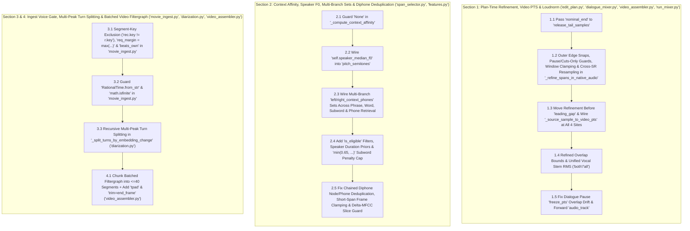

# Remediation Plan: Closing the Remaining 25 Gaps in `sentences` (`HEAD 31dfa6a`)

> [!IMPORTANT]
> **Scope & Verification**: Every `Target` and `Replacement` block below has been verified verbatim against `HEAD` (`31dfa6a`) of `/usr/local/google/home/seanstappas/tmp/repos/sentences` and validated via `ast.parse` and cross-module dataflow checks by `@verifier`.



---

## Section 1: Plan-Time Boundary Refinement, Video PTS & Loudnorm

### 1.1 Add `nominal_end` Parameter to `release_tail_samples`
- **File**: [edit_plan.py](file:///usr/local/google/home/seanstappas/tmp/repos/sentences/src/edit_plan.py#L43-L62)
- **Why**: `release_tail_samples` currently reads raw `span.end_sample` instead of the refined `span_nominal_end` (`refined_ends[i]`).

**Target** ([edit_plan.py](file:///usr/local/google/home/seanstappas/tmp/repos/sentences/src/edit_plan.py#L43-L62)):
```python
def release_tail_samples(span: SpanCandidate, inventory: InventoryIndex, tail_sec: float) -> int:
    """
    Native samples to extend a cut past its last aligned phone when that phone is followed
    by aligned silence. Forced alignment tends to end word-final consonants (f, s, th, t)
    early, so a hard cut at the boundary clips their release. The tail stays a guard short
    of whatever follows the silence.
    """
    if tail_sec <= 0 or not span.event_ids:
        return 0
    last = inventory.events.get(span.event_ids[-1])
    if last is None or last.kind != "phone" or span.end_sample < last.end_sample - 1:
        return 0
    succ = inventory.events.get(last.successor_id) if last.successor_id else None
    if succ is None or succ.kind != "silence":
        return 0
    src = inventory.sources.get(span.source_content_id)
    sr = src.native_sample_rate if src and src.native_sample_rate else 48000
    room = succ.end_sample - max(succ.start_sample, span.end_sample) - int(round(RELEASE_GUARD_SEC * sr))
    return max(0, min(int(round(tail_sec * sr)), room))
```

**Replacement**:
```python
def release_tail_samples(
    span: SpanCandidate,
    inventory: InventoryIndex,
    tail_sec: float,
    nominal_end: Optional[int] = None,
) -> int:
    """
    Native samples to extend a cut past its last aligned phone when that phone is followed
    by aligned silence. Forced alignment tends to end word-final consonants (f, s, th, t)
    early, so a hard cut at the boundary clips their release. The tail stays a guard short
    of whatever follows the silence.
    """
    if tail_sec <= 0 or not span.event_ids:
        return 0
    last = inventory.events.get(span.event_ids[-1])
    end_s = nominal_end if nominal_end is not None else span.end_sample
    if last is None or last.kind != "phone" or end_s < last.end_sample - 1:
        return 0
    succ = inventory.events.get(last.successor_id) if last.successor_id else None
    if succ is None or succ.kind != "silence":
        return 0
    src = inventory.sources.get(span.source_content_id)
    sr = src.native_sample_rate if src and src.native_sample_rate else 48000
    room = succ.end_sample - max(succ.start_sample, end_s) - int(round(RELEASE_GUARD_SEC * sr))
    return max(0, min(int(round(tail_sec * sr)), room))
```

---

### 1.2 Fix `_refine_spans_in_native_audio`: Outer Edges, Pause/Cuts-Only Guards, Window Clamping & Cross-SR Resampling
- **File**: [edit_plan.py](file:///usr/local/google/home/seanstappas/tmp/repos/sentences/src/edit_plan.py#L298-L411)
- **Why**:
  1. Outer utterance edges (`span_starts[0]` and `span_ends[-1]`) were never snapped to upward zero-crossings (`is_unvoiced=True`).
  2. Spans separated by punctuation pauses / explicit gaps or rendered under `rendering_mode == "cuts-only"` were falsely run through voiced phase correlation (`is_unvoiced=False`).
  3. Continuation guards at lines 340, 346, and 362 did not check `successor_id == next_span.event_ids[0]`.
  4. `read_st_curr` was not clamped to `span_starts[i]`, `read_en_next` was not clamped to `span_ends[i + 1]` / file frame bounds, and differing source sample rates (`curr_sr != next_sr`) were passed unresampled into `refine_splice_boundary`.

**Target** ([edit_plan.py](file:///usr/local/google/home/seanstappas/tmp/repos/sentences/src/edit_plan.py#L298-L411)):
```python
def _refine_spans_in_native_audio(
    selected_spans: List[SpanCandidate],
    inventory: InventoryIndex,
    tail_sec: float = 0.0,
) -> Tuple[List[int], List[int]]:
    """
    Refines boundary sample offsets in native source audio prior to EditPlan construction.
    Gracefully skips refinement if source media or cached PCM files do not exist on disk (mock-safe).
    """
    span_starts = [s.start_sample for s in selected_spans]
    span_ends = [s.end_sample for s in selected_spans]

    # Quick check if files exist on disk for all referenced sources
    can_refine = True
    src_paths: Dict[str, str] = {}
    for span in selected_spans:
        src_rec = inventory.sources.get(span.source_content_id)
        if not src_rec:
            can_refine = False
            break
        p = src_rec.cached_pcm_path or src_rec.source_path
        if not p or not Path(p).exists():
            can_refine = False
            break
        src_paths[span.source_content_id] = p

    if not can_refine or len(selected_spans) == 0:
        return span_starts, span_ends

    # Apply variant samples when flagged during candidate retrieval
    for i, span in enumerate(selected_spans):
        src_rec = inventory.sources[span.source_content_id]
        native_sr = src_rec.native_sample_rate or 48000
        min_len = int(round(0.030 * native_sr))

        entry_v = getattr(span, "entry_variant_samples", 0) or 0
        exit_v = getattr(span, "exit_variant_samples", 0) or 0

        # Only apply entry/exit collar trimming on non-continuations
        is_cont_pred = False
        if i > 0:
            pred = selected_spans[i - 1]
            if pred.source_content_id == span.source_content_id and pred.end_sample == span.start_sample:
                is_cont_pred = True

        is_cont_succ = False
        if i < len(selected_spans) - 1:
            succ = selected_spans[i + 1]
            if succ.source_content_id == span.source_content_id and span.end_sample == succ.start_sample:
                is_cont_succ = True

        new_st = span_starts[i] + (entry_v if not is_cont_pred else 0)
        new_en = span_ends[i] - (exit_v if not is_cont_succ else 0)
        if new_en - new_st >= min_len:
            span_starts[i] = new_st
            span_ends[i] = new_en

    # Perform boundary refinement between adjacent cuts
    stop_fric = ("P", "T", "K", "B", "D", "G", "S", "SH", "F", "TH", "CH")
    for i in range(len(selected_spans) - 1):
        curr_span = selected_spans[i]
        next_span = selected_spans[i + 1]

        # Natural continuations require no boundary modification
        if curr_span.source_content_id == next_span.source_content_id and span_ends[i] == span_starts[i + 1]:
            continue

        p_curr = src_paths.get(curr_span.source_content_id)
        p_next = src_paths.get(next_span.source_content_id)
        if not p_curr or not p_next:
            continue

        try:
            curr_sr = inventory.sources[curr_span.source_content_id].native_sample_rate or 48000
            next_sr = inventory.sources[next_span.source_content_id].native_sample_rate or 48000
            # Read boundary slices: ~25ms before cut and ~35ms after cut
            win_curr = int(round(0.025 * curr_sr))
            win_next = int(round(0.035 * next_sr))

            curr_en = span_ends[i]
            next_st = span_starts[i + 1]

            read_st_curr = max(0, curr_en - win_curr)
            read_en_next = next_st + win_next

            audio_curr, _ = sf.read(p_curr, start=read_st_curr, stop=curr_en)
            audio_next, _ = sf.read(p_next, start=next_st, stop=read_en_next)

            if len(audio_curr) < 16 or len(audio_next) < 16:
                continue

            is_unv = False
            last_p = curr_span.realized_phones[-1].rstrip("012") if getattr(curr_span, "realized_phones", None) else ""
            first_p = next_span.realized_phones[0].rstrip("012") if getattr(next_span, "realized_phones", None) else ""
            if last_p in stop_fric or last_p == "sil" or first_p in stop_fric or first_p == "sil":
                is_unv = True

            shift_out, shift_in = refine_splice_boundary(
                audio_curr, audio_next, sr=curr_sr, max_shift_ms=15.0, is_unvoiced=is_unv
            )

            # Apply shifts while respecting minimum segment lengths
            min_len_curr = int(round(0.030 * curr_sr))
            min_len_next = int(round(0.030 * next_sr))

            if shift_out < 0 and (span_ends[i] + shift_out - span_starts[i]) >= min_len_curr:
                span_ends[i] += shift_out
            if shift_in > 0 and (span_ends[i + 1] - (span_starts[i + 1] + shift_in)) >= min_len_next:
                span_starts[i + 1] += shift_in
        except Exception:
            continue

    return span_starts, span_ends
```

**Replacement**:
```python
def _refine_spans_in_native_audio(
    selected_spans: List[SpanCandidate],
    inventory: InventoryIndex,
    tail_sec: float = 0.0,
    graph: Optional[TargetGraph] = None,
    rendering_mode: str = "source-derived",
    overlap_duration_ms: float = 14.0,
) -> Tuple[List[int], List[int]]:
    """
    Refines boundary sample offsets in native source audio prior to EditPlan construction.
    Gracefully skips refinement if source media or cached PCM files do not exist on disk (mock-safe).
    """
    span_starts = [s.start_sample for s in selected_spans]
    span_ends = [s.end_sample for s in selected_spans]

    # Quick check if files exist on disk for all referenced sources
    can_refine = True
    src_paths: Dict[str, str] = {}
    for span in selected_spans:
        src_rec = inventory.sources.get(span.source_content_id)
        if not src_rec:
            can_refine = False
            break
        p = src_rec.cached_pcm_path or src_rec.source_path
        if not p or not Path(p).exists():
            can_refine = False
            break
        src_paths[span.source_content_id] = p

    if not can_refine or len(selected_spans) == 0:
        return span_starts, span_ends

    # Apply variant samples when flagged during candidate retrieval
    for i, span in enumerate(selected_spans):
        src_rec = inventory.sources[span.source_content_id]
        native_sr = src_rec.native_sample_rate or 48000
        min_len = int(round(0.030 * native_sr))

        entry_v = getattr(span, "entry_variant_samples", 0) or 0
        exit_v = getattr(span, "exit_variant_samples", 0) or 0

        # Only apply entry/exit collar trimming on non-continuations
        is_cont_pred = False
        if i > 0:
            pred = selected_spans[i - 1]
            if pred.source_content_id == span.source_content_id and pred.end_sample == span.start_sample:
                if not (pred.event_ids and span.event_ids):
                    is_cont_pred = True
                else:
                    p_last_ev = inventory.events.get(pred.event_ids[-1])
                    s_first_ev = inventory.events.get(span.event_ids[0])
                    if p_last_ev and s_first_ev and p_last_ev.successor_id == s_first_ev.event_id:
                        is_cont_pred = True

        is_cont_succ = False
        if i < len(selected_spans) - 1:
            succ = selected_spans[i + 1]
            if succ.source_content_id == span.source_content_id and span.end_sample == succ.start_sample:
                if not (span.event_ids and succ.event_ids):
                    is_cont_succ = True
                else:
                    c_last_ev = inventory.events.get(span.event_ids[-1])
                    s_first_ev = inventory.events.get(succ.event_ids[0])
                    if c_last_ev and s_first_ev and c_last_ev.successor_id == s_first_ev.event_id:
                        is_cont_succ = True

        new_st = span_starts[i] + (entry_v if not is_cont_pred else 0)
        new_en = span_ends[i] - (exit_v if not is_cont_succ else 0)
        if new_en - new_st >= min_len:
            span_starts[i] = new_st
            span_ends[i] = new_en

    # Refine outer utterance leading edge (span_starts[0]) to upward zero-crossing
    first_span = selected_spans[0]
    p_first = src_paths.get(first_span.source_content_id)
    if p_first:
        try:
            first_sr = inventory.sources[first_span.source_content_id].native_sample_rate or 48000
            st_0 = span_starts[0]
            info_first = sf.info(p_first)
            en_0 = min(info_first.frames, span_ends[0], st_0 + int(round(0.025 * first_sr)))
            if en_0 > st_0:
                head_audio, _ = sf.read(p_first, start=st_0, stop=en_0)
                if len(head_audio) >= 16:
                    _, shift_head = refine_splice_boundary(
                        np.zeros(len(head_audio), dtype=np.float32), head_audio, sr=first_sr, max_shift_ms=2.0, is_unvoiced=True
                    )
                    min_len_0 = int(round(0.030 * first_sr))
                    if shift_head > 0 and (span_ends[0] - (span_starts[0] + shift_head)) >= min_len_0:
                        span_starts[0] += shift_head
        except Exception:
            pass

    # Perform boundary refinement between adjacent cuts
    stop_fric = ("P", "T", "K", "B", "D", "G", "S", "SH", "F", "TH", "CH")
    for i in range(len(selected_spans) - 1):
        curr_span = selected_spans[i]
        next_span = selected_spans[i + 1]

        # Natural continuations require no boundary modification
        if curr_span.source_content_id == next_span.source_content_id and span_ends[i] == span_starts[i + 1]:
            if not (curr_span.event_ids and next_span.event_ids):
                continue
            c_ev = inventory.events.get(curr_span.event_ids[-1])
            n_ev = inventory.events.get(next_span.event_ids[0])
            if c_ev and n_ev and c_ev.successor_id == n_ev.event_id:
                continue

        p_curr = src_paths.get(curr_span.source_content_id)
        p_next = src_paths.get(next_span.source_content_id)
        if not p_curr or not p_next:
            continue

        try:
            curr_sr = inventory.sources[curr_span.source_content_id].native_sample_rate or 48000
            next_sr = inventory.sources[next_span.source_content_id].native_sample_rate or 48000

            # Detect whether this boundary is a pause or cuts-only splice
            has_pause = False
            if graph and hasattr(graph, "nodes") and curr_span.covered_nodes and next_span.covered_nodes:
                c_last_node = graph.nodes[curr_span.covered_nodes[-1]]
                n_first_node = graph.nodes[next_span.covered_nodes[0]]
                if c_last_node.token_index != n_first_node.token_index and c_last_node.is_word_final:
                    explicit = c_last_node.token_index in getattr(graph, "explicit_gaps", {})
                    p_pause = graph.punctuation_pauses.get(c_last_node.token_index, 0.0)
                    if explicit or p_pause > 0.0:
                        has_pause = True

            # If separated by pause or rendering cuts-only, use unvoiced zero-crossing snaps on both edges
            is_unv = (rendering_mode == "cuts-only") or has_pause
            if not is_unv:
                last_p = curr_span.realized_phones[-1].rstrip("012") if getattr(curr_span, "realized_phones", None) else ""
                first_p = next_span.realized_phones[0].rstrip("012") if getattr(next_span, "realized_phones", None) else ""
                if not last_p and graph and curr_span.covered_nodes and curr_span.covered_nodes[-1] < len(graph.nodes):
                    last_p = getattr(graph.nodes[curr_span.covered_nodes[-1]], "base_phone", "") or graph.nodes[curr_span.covered_nodes[-1]].phone.rstrip("012")
                if not first_p and graph and next_span.covered_nodes and next_span.covered_nodes[0] < len(graph.nodes):
                    first_p = getattr(graph.nodes[next_span.covered_nodes[0]], "base_phone", "") or graph.nodes[next_span.covered_nodes[0]].phone.rstrip("012")
                if last_p in stop_fric or last_p == "sil" or first_p in stop_fric or first_p == "sil":
                    is_unv = True

            # Window lengths: align evaluation window to crossfade duration + lag range
            win_curr = int(round(max(0.016, (overlap_duration_ms + 2.0) / 1000.0) * curr_sr))
            win_next = int(round(max(0.029, (overlap_duration_ms + 15.0) / 1000.0) * next_sr))

            curr_en = span_ends[i]
            next_st = span_starts[i + 1]

            info_next = sf.info(p_next)
            read_st_curr = max(span_starts[i], curr_en - win_curr)
            read_en_next = min(info_next.frames, span_ends[i + 1], next_st + win_next)

            if curr_en <= read_st_curr or read_en_next <= next_st:
                continue

            audio_curr, _ = sf.read(p_curr, start=read_st_curr, stop=curr_en)
            audio_next, _ = sf.read(p_next, start=next_st, stop=read_en_next)

            if len(audio_curr) < 16 or len(audio_next) < 16:
                continue

            # Resample audio_next if native sample rates differ
            if curr_sr != next_sr:
                import scipy.signal
                g_sr = math.gcd(curr_sr, next_sr)
                audio_next_resampled = scipy.signal.resample_poly(audio_next, curr_sr // g_sr, next_sr // g_sr, axis=0)
                shift_out, shift_in_resampled = refine_splice_boundary(
                    audio_curr, audio_next_resampled, sr=curr_sr, max_shift_ms=15.0, is_unvoiced=is_unv
                )
                shift_in = int(round(shift_in_resampled * float(next_sr) / float(curr_sr)))
            else:
                shift_out, shift_in = refine_splice_boundary(
                    audio_curr, audio_next, sr=curr_sr, max_shift_ms=15.0, is_unvoiced=is_unv
                )

            # Apply shifts while respecting minimum segment lengths
            min_len_curr = int(round(0.030 * curr_sr))
            min_len_next = int(round(0.030 * next_sr))

            if shift_out < 0 and (span_ends[i] + shift_out - span_starts[i]) >= min_len_curr:
                span_ends[i] += shift_out
            if shift_in > 0 and (span_ends[i + 1] - (span_starts[i + 1] + shift_in)) >= min_len_next:
                span_starts[i + 1] += shift_in
        except Exception:
            continue

    # Refine outer utterance trailing edge (span_ends[-1]) to upward zero-crossing
    last_span = selected_spans[-1]
    p_last = src_paths.get(last_span.source_content_id)
    if p_last:
        try:
            last_sr = inventory.sources[last_span.source_content_id].native_sample_rate or 48000
            en_last = span_ends[-1]
            st_last = max(span_starts[-1], en_last - int(round(0.025 * last_sr)))
            if en_last > st_last:
                tail_audio, _ = sf.read(p_last, start=st_last, stop=en_last)
                if len(tail_audio) >= 16:
                    shift_tail, _ = refine_splice_boundary(
                        tail_audio, np.zeros(len(tail_audio), dtype=np.float32), sr=last_sr, max_shift_ms=2.0, is_unvoiced=True
                    )
                    min_len_last = int(round(0.030 * last_sr))
                    if shift_tail < 0 and (span_ends[-1] + shift_tail - span_starts[-1]) >= min_len_last:
                        span_ends[-1] += shift_tail
        except Exception:
            pass

    return span_starts, span_ends
```

---

### 1.3 Move Boundary Refinement Before `leading_gap` & Wire `_source_sample_to_video_pts` at All Remaining Sites
- **File**: [edit_plan.py](file:///usr/local/google/home/seanstappas/tmp/repos/sentences/src/edit_plan.py#L453-L625)

**Target** ([edit_plan.py](file:///usr/local/google/home/seanstappas/tmp/repos/sentences/src/edit_plan.py#L453-L625)):
```python
    # Check for leading gap (boundary index -1)
    leading_gap = getattr(graph, "explicit_gaps", {}).get(-1, lead_in_sec)
    if leading_gap > 0.0 and selected_spans:
        first_span = selected_spans[0]
        first_src_rec = inventory.sources[first_span.source_content_id]
        pause_samples = int(round(leading_gap * project_sample_rate))
        p_start = current_output_sample
        p_end = p_start + pause_samples

        p_start_frame = cumulative_frame_ceiling(p_start, project_sample_rate, video_fps)
        p_end_frame = cumulative_frame_ceiling(p_end, project_sample_rate, video_fps)
        p_source_pts = samples_to_seconds(first_span.start_sample, first_src_rec.native_sample_rate)

        pause_seg = PlanSegment(
            segment_index=seg_idx,
            source_content_id="silence",
            speaker_id=first_span.speaker_id,
            source_start_sample=0,
            source_end_sample=pause_samples,
            output_start_sample=p_start,
            output_end_sample=p_end,
            target_text="[pause]",
            target_phones=["sil"],
            span_type="pause",
            source_video_path=first_src_rec.source_path,
            is_silence=True,
            freeze_video=True,
            video_start_frame=p_start_frame,
            video_frame_count=p_end_frame - p_start_frame,
            video_source_pts_sec=p_source_pts,
        )
        segments.append(pause_seg)
        seg_idx += 1
        current_output_sample = p_end

        transitions.append(PlanTransition(
            transition_index=len(transitions),
            from_segment_index=pause_seg.segment_index,
            to_segment_index=seg_idx,
            transition_type="hard_splice",
            overlap_samples=0,
        ))

    speech_index: Optional[_SpeechIndex] = None
    tail_sec = release_tail_sec if rendering_mode != "cuts-only" else 0.0
    end_fade = int(round(SEGMENT_END_FADE_SEC * project_sample_rate))

    def pause_seconds(token_index: int) -> float:
        explicit_gaps = getattr(graph, "explicit_gaps", {})
        if token_index in explicit_gaps:
            return explicit_gaps[token_index]
        if rendering_mode == "cuts-only" or pause_style == "off":
            return 0.0
        return graph.punctuation_pauses.get(token_index, 0.0)

    def emit_pause(prev_seg: PlanSegment, pause_sec: float, explicit: bool) -> PlanSegment:
        """Appends pause segment(s) after prev_seg; returns the last one."""
        nonlocal seg_idx, current_output_sample, speech_index
        pause_samples = int(round(pause_sec * project_sample_rate))
        last_seg = prev_seg
        freeze_pts = prev_seg.video_source_pts_sec + float(prev_seg.duration_samples) / float(project_sample_rate)

        src_rec = inventory.sources.get(prev_seg.source_content_id)
        if pause_style == "continue" and not explicit and not prev_seg.is_silence and src_rec is not None:
            sr = src_rec.native_sample_rate or project_sample_rate
            want = int(round(pause_sec * sr))
            start = prev_seg.source_end_sample
            if speech_index is None:
                speech_index = _SpeechIndex(inventory)
            guard = int(round(CONTINUE_SPEECH_GUARD_SEC * sr))
            free = max(0, speech_index.free_after(prev_seg.source_content_id, start, want + guard) - guard)
            free = min(free, _voice_free_samples(src_rec, start, want, prev_seg.source_start_sample, prev_seg.source_end_sample))
            total_src = int(round((src_rec.audio_duration_sec or 0.0) * sr))
            if total_src > 0:
                free = min(free, max(0, total_src - start))
            cont = min(free, want)
            if cont >= int(round(CONTINUE_MIN_SEC * sr)):
                cont_proj = int(round(cont * project_sample_rate / float(sr)))
                c_start = current_output_sample
                c_end = c_start + cont_proj
                c_seg = PlanSegment(
                    segment_index=seg_idx,
                    source_content_id=prev_seg.source_content_id,
                    speaker_id=prev_seg.speaker_id,
                    source_start_sample=start,
                    source_end_sample=start + cont,
                    output_start_sample=c_start,
                    output_end_sample=c_end,
                    target_text="[pause]",
                    target_phones=["sil"],
                    span_type=CONTINUE_SPAN_TYPE,
                    source_video_path=prev_seg.source_video_path,
                    fade_out_samples=min(end_fade, cont_proj),
                    video_start_frame=cumulative_frame_ceiling(c_start, project_sample_rate, video_fps),
                    video_frame_count=0,
                    video_source_pts_sec=samples_to_seconds(start, sr),
                )
                segments.append(c_seg)
                transitions.append(PlanTransition(
                    transition_index=len(transitions),
                    from_segment_index=prev_seg.segment_index,
                    to_segment_index=c_seg.segment_index,
                    transition_type="continuation",
                    overlap_samples=0,
                ))
                seg_idx += 1
                current_output_sample = c_end
                last_seg = c_seg
                pause_samples = max(0, pause_samples - cont_proj)
                freeze_pts = samples_to_seconds(start + cont, sr)

        if pause_samples <= 0 and last_seg is not prev_seg:
            return last_seg
        p_start = current_output_sample
        p_end = p_start + pause_samples
        p_start_frame = cumulative_frame_ceiling(p_start, project_sample_rate, video_fps)
        p_end_frame = cumulative_frame_ceiling(p_end, project_sample_rate, video_fps)
        pause_seg = PlanSegment(
            segment_index=seg_idx,
            source_content_id="silence",
            speaker_id=prev_seg.speaker_id,
            source_start_sample=0,
            source_end_sample=pause_samples,
            output_start_sample=p_start,
            output_end_sample=p_end,
            target_text="[pause]",
            target_phones=["sil"],
            span_type="pause",
            source_video_path=prev_seg.source_video_path,
            is_silence=True,
            freeze_video=True,
            video_start_frame=p_start_frame,
            video_frame_count=p_end_frame - p_start_frame,  # may be 0 for <gap:0ms>
            video_source_pts_sec=freeze_pts,
        )
        segments.append(pause_seg)
        transitions.append(PlanTransition(
            transition_index=len(transitions),
            from_segment_index=last_seg.segment_index,
            to_segment_index=pause_seg.segment_index,
            transition_type="pause",
            overlap_samples=0,
        ))
        seg_idx += 1
        current_output_sample = p_end
        return pause_seg

    # Step 0: Plan-Time Boundary Refinement across native audio windows (mock-safe)
    refined_starts, refined_ends = _refine_spans_in_native_audio(selected_spans, inventory, tail_sec)

    for i, span in enumerate(selected_spans):
        src_rec = inventory.sources[span.source_content_id]
        native_sr = src_rec.native_sample_rate
        next_span = selected_spans[i + 1] if i < len(selected_spans) - 1 else None

        span_start = refined_starts[i]
        span_nominal_end = refined_ends[i]

        # Determine if the next span is a natural continuation of this one
        is_cont = False
        if next_span is not None and span.source_content_id == next_span.source_content_id:
            if (
                span.end_sample == next_span.start_sample
                and span_nominal_end == refined_starts[i + 1]
                and span.event_ids
                and next_span.event_ids
                and inventory.events.get(span.event_ids[-1]) is not None
                and inventory.events[span.event_ids[-1]].successor_id == next_span.event_ids[0]
            ):
                is_cont = True

        tail = 0 if is_cont else release_tail_samples(span, inventory, tail_sec)
        span_end = span_nominal_end + tail
```

**Replacement**:
```python
    tail_sec = release_tail_sec if rendering_mode != "cuts-only" else 0.0

    # Step 0: Plan-Time Boundary Refinement across native audio windows (mock-safe)
    refined_starts, refined_ends = _refine_spans_in_native_audio(
        selected_spans,
        inventory,
        tail_sec=tail_sec,
        graph=graph,
        rendering_mode=rendering_mode,
        overlap_duration_ms=overlap_duration_ms,
    )

    # Check for leading gap (boundary index -1)
    leading_gap = getattr(graph, "explicit_gaps", {}).get(-1, lead_in_sec)
    if leading_gap > 0.0 and selected_spans:
        first_span = selected_spans[0]
        first_src_rec = inventory.sources[first_span.source_content_id]
        pause_samples = int(round(leading_gap * project_sample_rate))
        p_start = current_output_sample
        p_end = p_start + pause_samples

        p_start_frame = cumulative_frame_ceiling(p_start, project_sample_rate, video_fps)
        p_end_frame = cumulative_frame_ceiling(p_end, project_sample_rate, video_fps)
        p_source_pts = _source_sample_to_video_pts(refined_starts[0], first_src_rec)

        pause_seg = PlanSegment(
            segment_index=seg_idx,
            source_content_id="silence",
            speaker_id=first_span.speaker_id,
            source_start_sample=0,
            source_end_sample=pause_samples,
            output_start_sample=p_start,
            output_end_sample=p_end,
            target_text="[pause]",
            target_phones=["sil"],
            span_type="pause",
            source_video_path=first_src_rec.source_path,
            is_silence=True,
            freeze_video=True,
            video_start_frame=p_start_frame,
            video_frame_count=p_end_frame - p_start_frame,
            video_source_pts_sec=p_source_pts,
        )
        segments.append(pause_seg)
        seg_idx += 1
        current_output_sample = p_end

        transitions.append(PlanTransition(
            transition_index=len(transitions),
            from_segment_index=pause_seg.segment_index,
            to_segment_index=seg_idx,
            transition_type="hard_splice",
            overlap_samples=0,
        ))

    speech_index: Optional[_SpeechIndex] = None
    end_fade = int(round(SEGMENT_END_FADE_SEC * project_sample_rate))

    def pause_seconds(token_index: int) -> float:
        explicit_gaps = getattr(graph, "explicit_gaps", {})
        if token_index in explicit_gaps:
            return explicit_gaps[token_index]
        if rendering_mode == "cuts-only" or pause_style == "off":
            return 0.0
        return graph.punctuation_pauses.get(token_index, 0.0)

    def emit_pause(prev_seg: PlanSegment, pause_sec: float, explicit: bool) -> PlanSegment:
        """Appends pause segment(s) after prev_seg; returns the last one."""
        nonlocal seg_idx, current_output_sample, speech_index
        pause_samples = int(round(pause_sec * project_sample_rate))
        last_seg = prev_seg

        src_rec = inventory.sources.get(prev_seg.source_content_id)
        if prev_seg.is_silence:
            freeze_pts = prev_seg.video_source_pts_sec
        elif src_rec is not None:
            freeze_pts = _source_sample_to_video_pts(prev_seg.source_end_sample, src_rec)
        else:
            freeze_pts = prev_seg.video_source_pts_sec + (float(prev_seg.duration_samples) / float(project_sample_rate))

        if pause_style == "continue" and not explicit and not prev_seg.is_silence and src_rec is not None:
            sr = src_rec.native_sample_rate or project_sample_rate
            want = int(round(pause_sec * sr))
            start = prev_seg.source_end_sample
            if speech_index is None:
                speech_index = _SpeechIndex(inventory)
            guard = int(round(CONTINUE_SPEECH_GUARD_SEC * sr))
            free = max(0, speech_index.free_after(prev_seg.source_content_id, start, want + guard) - guard)
            free = min(free, _voice_free_samples(src_rec, start, want, prev_seg.source_start_sample, prev_seg.source_end_sample))
            total_src = int(round((src_rec.audio_duration_sec or 0.0) * sr))
            if total_src > 0:
                free = min(free, max(0, total_src - start))
            cont = min(free, want)
            if cont >= int(round(CONTINUE_MIN_SEC * sr)):
                cont_proj = int(round(cont * project_sample_rate / float(sr)))
                c_start = current_output_sample
                c_end = c_start + cont_proj
                c_seg = PlanSegment(
                    segment_index=seg_idx,
                    source_content_id=prev_seg.source_content_id,
                    speaker_id=prev_seg.speaker_id,
                    source_start_sample=start,
                    source_end_sample=start + cont,
                    output_start_sample=c_start,
                    output_end_sample=c_end,
                    target_text="[pause]",
                    target_phones=["sil"],
                    span_type=CONTINUE_SPAN_TYPE,
                    source_video_path=prev_seg.source_video_path,
                    fade_out_samples=min(end_fade, cont_proj),
                    video_start_frame=cumulative_frame_ceiling(c_start, project_sample_rate, video_fps),
                    video_frame_count=0,
                    video_source_pts_sec=_source_sample_to_video_pts(start, src_rec),
                )
                segments.append(c_seg)
                transitions.append(PlanTransition(
                    transition_index=len(transitions),
                    from_segment_index=prev_seg.segment_index,
                    to_segment_index=c_seg.segment_index,
                    transition_type="continuation",
                    overlap_samples=0,
                ))
                seg_idx += 1
                current_output_sample = c_end
                last_seg = c_seg
                pause_samples = max(0, pause_samples - cont_proj)
                freeze_pts = _source_sample_to_video_pts(start + cont, src_rec)

        if pause_samples <= 0 and last_seg is not prev_seg:
            return last_seg
        p_start = current_output_sample
        p_end = p_start + pause_samples
        p_start_frame = cumulative_frame_ceiling(p_start, project_sample_rate, video_fps)
        p_end_frame = cumulative_frame_ceiling(p_end, project_sample_rate, video_fps)
        pause_seg = PlanSegment(
            segment_index=seg_idx,
            source_content_id="silence",
            speaker_id=prev_seg.speaker_id,
            source_start_sample=0,
            source_end_sample=pause_samples,
            output_start_sample=p_start,
            output_end_sample=p_end,
            target_text="[pause]",
            target_phones=["sil"],
            span_type="pause",
            source_video_path=prev_seg.source_video_path,
            is_silence=True,
            freeze_video=True,
            video_start_frame=p_start_frame,
            video_frame_count=p_end_frame - p_start_frame,  # may be 0 for <gap:0ms>
            video_source_pts_sec=freeze_pts,
        )
        segments.append(pause_seg)
        transitions.append(PlanTransition(
            transition_index=len(transitions),
            from_segment_index=last_seg.segment_index,
            to_segment_index=pause_seg.segment_index,
            transition_type="pause",
            overlap_samples=0,
        ))
        seg_idx += 1
        current_output_sample = p_end
        return pause_seg

    for i, span in enumerate(selected_spans):
        src_rec = inventory.sources[span.source_content_id]
        native_sr = src_rec.native_sample_rate
        next_span = selected_spans[i + 1] if i < len(selected_spans) - 1 else None

        span_start = refined_starts[i]
        span_nominal_end = refined_ends[i]

        # Determine if the next span is a natural continuation of this one
        is_cont = False
        if next_span is not None and span.source_content_id == next_span.source_content_id:
            if span.end_sample == next_span.start_sample and span_nominal_end == refined_starts[i + 1]:
                if not (span.event_ids and next_span.event_ids):
                    is_cont = True
                else:
                    last_ev = inventory.events.get(span.event_ids[-1])
                    first_ev = inventory.events.get(next_span.event_ids[0])
                    if last_ev and first_ev and last_ev.successor_id == first_ev.event_id:
                        is_cont = True

        tail = 0 if is_cont else release_tail_samples(span, inventory, tail_sec, nominal_end=span_nominal_end)
        span_end = span_nominal_end + tail
```

---

### 1.4 Use Refined Bounds in `next_resampled_dur` & Unify Vocal Stem RMS for `"both"` / `"all"`
- **File**: [edit_plan.py](file:///usr/local/google/home/seanstappas/tmp/repos/sentences/src/edit_plan.py#L716-L720) and [edit_plan.py](file:///usr/local/google/home/seanstappas/tmp/repos/sentences/src/edit_plan.py#L872-L877)

**Target 1** ([edit_plan.py](file:///usr/local/google/home/seanstappas/tmp/repos/sentences/src/edit_plan.py#L716-L720)):
```python
                        next_src_rec = inventory.sources.get(next_span.source_content_id)
                        next_sr = next_src_rec.native_sample_rate if next_src_rec and next_src_rec.native_sample_rate > 0 else project_sample_rate
                        next_resampled_dur = int(round(float(next_span.end_sample - next_span.start_sample) * project_sample_rate / float(next_sr)))
                        max_overlap = min(resampled_duration // 5, next_resampled_dur // 5)
```

**Replacement 1**:
```python
                        next_src_rec = inventory.sources.get(next_span.source_content_id)
                        next_sr = next_src_rec.native_sample_rate if next_src_rec and next_src_rec.native_sample_rate > 0 else project_sample_rate
                        next_resampled_dur = int(round(float(refined_ends[i + 1] - refined_starts[i + 1]) * project_sample_rate / float(next_sr)))
                        max_overlap = min(resampled_duration // 5, next_resampled_dur // 5)
```

**Target 2** ([edit_plan.py](file:///usr/local/google/home/seanstappas/tmp/repos/sentences/src/edit_plan.py#L872-L877)):
```python
        if src_rec:
            # When audio_track is vocals or recombined, prefer vocal stem if available
            if audio_track in ("vocals", "isolated", "recombined") and getattr(src_rec, "cached_vocal_pcm_path", None):
                if Path(src_rec.cached_vocal_pcm_path).exists():
                    src_path = src_rec.cached_vocal_pcm_path
```

**Replacement 2**:
```python
        if src_rec:
            # When audio_track is vocals, recombined, both, or all, prefer vocal stem if available
            effective_rms_track = "vocals" if audio_track in ("both", "all") else audio_track
            if effective_rms_track in ("vocals", "isolated", "recombined") and getattr(src_rec, "cached_vocal_pcm_path", None):
                if Path(src_rec.cached_vocal_pcm_path).exists():
                    src_path = src_rec.cached_vocal_pcm_path
```

---

### 1.5 Fix Dialogue Pause `freeze_pts` Overlap Drift & Forward `audio_track`
- **Files**:
  - [dialogue_mixer.py](file:///usr/local/google/home/seanstappas/tmp/repos/sentences/src/dialogue_mixer.py#L16-L17)
  - [dialogue_mixer.py](file:///usr/local/google/home/seanstappas/tmp/repos/sentences/src/dialogue_mixer.py#L88-L96)
  - [dialogue_mixer.py](file:///usr/local/google/home/seanstappas/tmp/repos/sentences/src/dialogue_mixer.py#L546-L555)
  - [video_assembler.py](file:///usr/local/google/home/seanstappas/tmp/repos/sentences/src/video_assembler.py#L829-L831)
  - [run_mixer.py](file:///usr/local/google/home/seanstappas/tmp/repos/sentences/run_mixer.py#L1078)

**Target 1** ([dialogue_mixer.py](file:///usr/local/google/home/seanstappas/tmp/repos/sentences/src/dialogue_mixer.py#L16-L17)):
```python
from contracts import EditPlan, PlanSegment, PlanTransition, RationalTime
from edit_plan import build_edit_plan, finalize_edit_plan
```

**Replacement 1**:
```python
from contracts import EditPlan, PlanSegment, PlanTransition, RationalTime
from edit_plan import _source_sample_to_video_pts, build_edit_plan, finalize_edit_plan
```

**Target 2** ([dialogue_mixer.py](file:///usr/local/google/home/seanstappas/tmp/repos/sentences/src/dialogue_mixer.py#L88-L96)):
```python
        # Conversational pause between dialogue turns
        if p_idx > 0 and pause_samples > 0 and combined_segments:
            prev_seg = combined_segments[-1]
            p_start = current_sample
            p_end = p_start + pause_samples
            p_start_frame = cumulative_frame_ceiling(p_start, sr, fps)
            p_end_frame = cumulative_frame_ceiling(p_end, sr, fps)
            freeze_pts = prev_seg.video_source_pts_sec + (float(prev_seg.duration_samples) / float(sr))
```

**Replacement 2**:
```python
        # Conversational pause between dialogue turns
        if p_idx > 0 and pause_samples > 0 and combined_segments:
            prev_seg = combined_segments[-1]
            p_start = current_sample
            p_end = p_start + pause_samples
            p_start_frame = cumulative_frame_ceiling(p_start, sr, fps)
            p_end_frame = cumulative_frame_ceiling(p_end, sr, fps)
            if prev_seg.is_silence:
                freeze_pts = prev_seg.video_source_pts_sec
            else:
                src_rec = combined_sources.get(prev_seg.source_content_id)
                if src_rec:
                    freeze_pts = _source_sample_to_video_pts(prev_seg.source_end_sample, src_rec)
                else:
                    freeze_pts = prev_seg.video_source_pts_sec + (float(prev_seg.duration_samples) / float(sr))
```

**Target 3** ([dialogue_mixer.py](file:///usr/local/google/home/seanstappas/tmp/repos/sentences/src/dialogue_mixer.py#L546-L555)):
```python
        plan = build_edit_plan(
            spans,
            g,
            inventory_index,
            project_sample_rate=48000,
            video_fps=fps,
            pause_style="continue",
            release_tail_sec=0.100,
            finalize=False,
        )
```

**Replacement 3**:
```python
        plan = build_edit_plan(
            spans,
            g,
            inventory_index,
            project_sample_rate=48000,
            video_fps=fps,
            pause_style="continue",
            release_tail_sec=0.100,
            finalize=False,
            audio_track=audio_track,
        )
```

**Target 4** ([video_assembler.py](file:///usr/local/google/home/seanstappas/tmp/repos/sentences/src/video_assembler.py#L829-L831)):
```python
    from edit_plan import finalize_edit_plan
    finalize_edit_plan(plan, normalize_loudness=normalize_loudness)
    return render_sentence_mix(
```

**Replacement 4**:
```python
    from edit_plan import finalize_edit_plan
    finalize_edit_plan(plan, normalize_loudness=normalize_loudness, audio_track=audio_track)
    return render_sentence_mix(
```

**Target 5** ([run_mixer.py](file:///usr/local/google/home/seanstappas/tmp/repos/sentences/run_mixer.py#L1078), [run_mixer.py](file:///usr/local/google/home/seanstappas/tmp/repos/sentences/run_mixer.py#L1919), [run_mixer.py](file:///usr/local/google/home/seanstappas/tmp/repos/sentences/run_mixer.py#L2284), [run_mixer.py](file:///usr/local/google/home/seanstappas/tmp/repos/sentences/run_mixer.py#L2329), [run_mixer.py](file:///usr/local/google/home/seanstappas/tmp/repos/sentences/run_mixer.py#L2565)):
- Change fallback default strings `"raw"` / `"combined"` in `getattr(args, "audio_track", ...)` at lines `1078`, `1919`, `2284`, `2329`, and `2565` to `"recombined"`.

---

## Section 2: Context Affinity, Speaker F0, Multi-Branch Sets & Diphone Deduplication

### 2.1 Guard `None` in `_compute_context_affinity`
- **File**: [span_selector.py](file:///usr/local/google/home/seanstappas/tmp/repos/sentences/src/span_selector.py#L1453-L1456)

**Target**:
```python
        target_left_set = {target_left_phone} if isinstance(target_left_phone, str) else set(target_left_phone)
        target_left_bases = {strip_phone_stress(p) for p in target_left_set if p}
        target_right_set = {target_right_phone} if isinstance(target_right_phone, str) else set(target_right_phone)
        target_right_bases = {strip_phone_stress(p) for p in target_right_set if p}
```

**Replacement**:
```python
        target_left_set = {target_left_phone} if isinstance(target_left_phone, str) else (set(target_left_phone) if target_left_phone is not None else set())
        target_left_bases = {strip_phone_stress(p) for p in target_left_set if p}
        target_right_set = {target_right_phone} if isinstance(target_right_phone, str) else (set(target_right_phone) if target_right_phone is not None else set())
        target_right_bases = {strip_phone_stress(p) for p in target_right_set if p}
```

---

### 2.2 Wire `self.speaker_median_f0` for Candidate `pitch_semitones`
- **File**: [span_selector.py](file:///usr/local/google/home/seanstappas/tmp/repos/sentences/src/span_selector.py#L539-L541) and [span_selector.py](file:///usr/local/google/home/seanstappas/tmp/repos/sentences/src/span_selector.py#L1232-L1236)

**Target 1** ([span_selector.py](file:///usr/local/google/home/seanstappas/tmp/repos/sentences/src/span_selector.py#L539-L541)):
```python
                        p_feat = self._get_candidate_acoustic_features(first_wo.source_content_id, phrase_start_sample, phrase_end_sample)
                        p_f0 = p_feat.f0_mean if p_feat.f0_mean > 0 else None
                        p_pitch = float(12.0 * np.log2(p_f0 / max(50.0, self.global_median_f0))) if p_f0 else None
```

**Replacement 1**:
```python
                        p_feat = self._get_candidate_acoustic_features(first_wo.source_content_id, phrase_start_sample, phrase_end_sample)
                        p_f0 = p_feat.f0_mean if p_feat.f0_mean > 0 else None
                        ref_f0 = self.speaker_median_f0.get(first_wo.speaker_id, self.global_median_f0)
                        p_pitch = float(12.0 * np.log2(p_f0 / max(50.0, ref_f0))) if p_f0 else None
```

**Target 2** ([span_selector.py](file:///usr/local/google/home/seanstappas/tmp/repos/sentences/src/span_selector.py#L1232-L1236)):
```python
                feat = self._get_candidate_acoustic_features(c.source_content_id, c.start_sample, c.end_sample)
                if feat.f0_mean > 0:
                    c.cand_f0_hz = feat.f0_mean
                    c.pitch_semitones = float(12.0 * np.log2(feat.f0_mean / max(50.0, self.global_median_f0)))
```

**Replacement 2**:
```python
                feat = self._get_candidate_acoustic_features(c.source_content_id, c.start_sample, c.end_sample)
                if feat.f0_mean > 0:
                    c.cand_f0_hz = feat.f0_mean
                    ref_f0 = self.speaker_median_f0.get(c.speaker_id, self.global_median_f0)
                    c.pitch_semitones = float(12.0 * np.log2(feat.f0_mean / max(50.0, ref_f0)))
```

---

### 2.3 Wire Multi-Branch `left_context_phones` / `right_context_phones` Sets Across Retrieval & Bleed Checks
- **File**: [span_selector.py](file:///usr/local/google/home/seanstappas/tmp/repos/sentences/src/span_selector.py#L503-L1107)

**Target 1 — Phrases** ([span_selector.py](file:///usr/local/google/home/seanstappas/tmp/repos/sentences/src/span_selector.py#L503-L505)):
```python
                        end_node = graph.nodes[covered[-1]]
                        if end_node.is_phrase_final or end_node.right_context_phone == "sil":
```

**Replacement 1**:
```python
                        end_node = graph.nodes[covered[-1]]
                        end_r_set = getattr(end_node, "right_context_phones", None) or ({end_node.right_context_phone} if end_node.right_context_phone else set())
                        if end_node.is_phrase_final or "sil" in end_r_set or end_node.right_context_phone == "sil":
```

**Target 2 — Words** ([span_selector.py](file:///usr/local/google/home/seanstappas/tmp/repos/sentences/src/span_selector.py#L681-L683) and [span_selector.py](file:///usr/local/google/home/seanstappas/tmp/repos/sentences/src/span_selector.py#L715-L718)):
```python
                word_branch_cands: List[SpanCandidate] = []
                target_l_phone = start_node.left_context_phone
                for wo, r_c, r_phones in valid_branch_candidates_and_costs:
```
```python
                                pred_base = getattr(pred_ev, "base_phone", "") or strip_phone_stress(pred_ev.label)
                                target_l_base = strip_phone_stress(target_l_phone) if target_l_phone else ""
                                if pred_base in ("P", "T", "K", "B", "D", "G") and target_l_base not in ("P", "T", "K", "B", "D", "G"):
                                    entry_variant = max(entry_variant, int(round(0.012 * srate)))
```

**Replacement 2**:
```python
                word_branch_cands: List[SpanCandidate] = []
                target_l_phones = getattr(start_node, "left_context_phones", None) or ({start_node.left_context_phone} if start_node.left_context_phone else set())
                target_l_bases = {strip_phone_stress(p) for p in target_l_phones if p}
                for wo, r_c, r_phones in valid_branch_candidates_and_costs:
```
```python
                                pred_base = getattr(pred_ev, "base_phone", "") or strip_phone_stress(pred_ev.label)
                                if pred_base in ("P", "T", "K", "B", "D", "G") and not (target_l_bases & {"P", "T", "K", "B", "D", "G"}):
                                    entry_variant = max(entry_variant, int(round(0.012 * srate)))
```

**Target 3 — Subwords** ([span_selector.py](file:///usr/local/google/home/seanstappas/tmp/repos/sentences/src/span_selector.py#L790-L810) and [span_selector.py](file:///usr/local/google/home/seanstappas/tmp/repos/sentences/src/span_selector.py#L913-L916)):
```python
                        target_l_phone = graph.nodes[sub_nodes[0]].left_context_phone
                        target_r_phone = graph.nodes[sub_nodes[-1]].right_context_phone

                        end_node = graph.nodes[sub_nodes[-1]]
                        start_node = graph.nodes[sub_nodes[0]]
```
```python
                            if (end_node.is_phrase_final or end_node.right_context_phone == "sil") and e_i_it == len(evs_all):
```
```python
                                    pred_base = getattr(pred_ev, "base_phone", "") or strip_phone_stress(pred_ev.label)
                                    target_l_base = strip_phone_stress(target_l_phone) if target_l_phone else ""
                                    if pred_base in ("P", "T", "K", "B", "D", "G") and target_l_base not in ("P", "T", "K", "B", "D", "G"):
                                        entry_variant = max(entry_variant, int(round(0.012 * s_rate)))
```

**Replacement 3**:
```python
                        target_l_phone = getattr(graph.nodes[sub_nodes[0]], "left_context_phones", None) or graph.nodes[sub_nodes[0]].left_context_phone
                        target_r_phone = getattr(graph.nodes[sub_nodes[-1]], "right_context_phones", None) or graph.nodes[sub_nodes[-1]].right_context_phone
                        target_l_phones = getattr(graph.nodes[sub_nodes[0]], "left_context_phones", None) or ({graph.nodes[sub_nodes[0]].left_context_phone} if graph.nodes[sub_nodes[0]].left_context_phone else set())
                        target_l_bases = {strip_phone_stress(p) for p in target_l_phones if p}
                        end_node = graph.nodes[sub_nodes[-1]]
                        start_node = graph.nodes[sub_nodes[0]]
                        end_r_set = getattr(end_node, "right_context_phones", None) or ({end_node.right_context_phone} if end_node.right_context_phone else set())
```
```python
                            if (end_node.is_phrase_final or "sil" in end_r_set or end_node.right_context_phone == "sil") and e_i_it == len(evs_all):
```
```python
                                    pred_base = getattr(pred_ev, "base_phone", "") or strip_phone_stress(pred_ev.label)
                                    if pred_base in ("P", "T", "K", "B", "D", "G") and not (target_l_bases & {"P", "T", "K", "B", "D", "G"}):
                                        entry_variant = max(entry_variant, int(round(0.012 * s_rate)))
```

**Target 4 — Phones** ([span_selector.py](file:///usr/local/google/home/seanstappas/tmp/repos/sentences/src/span_selector.py#L1012-L1030) and [span_selector.py](file:///usr/local/google/home/seanstappas/tmp/repos/sentences/src/span_selector.py#L1104-L1107)):
```python
            target_l_phone = node.left_context_phone
            target_r_phone = node.right_context_phone
```
```python
                if node.is_phrase_final or node.right_context_phone == "sil":
```
```python
                        pred_base = getattr(pred_ev, "base_phone", "") or strip_phone_stress(pred_ev.label)
                        target_l_base = strip_phone_stress(target_l_phone) if target_l_phone else ""
                        if pred_base in ("P", "T", "K", "B", "D", "G") and target_l_base not in ("P", "T", "K", "B", "D", "G"):
                            entry_variant = max(entry_variant, int(round(0.012 * sr)))
```

**Replacement 4**:
```python
            target_l_phone = getattr(node, "left_context_phones", None) or node.left_context_phone
            target_r_phone = getattr(node, "right_context_phones", None) or node.right_context_phone
            target_l_phones = getattr(node, "left_context_phones", None) or ({node.left_context_phone} if node.left_context_phone else set())
            target_l_bases = {strip_phone_stress(p) for p in target_l_phones if p}
            node_r_set = getattr(node, "right_context_phones", None) or ({node.right_context_phone} if node.right_context_phone else set())
```
```python
                if node.is_phrase_final or "sil" in node_r_set or node.right_context_phone == "sil":
```
```python
                        pred_base = getattr(pred_ev, "base_phone", "") or strip_phone_stress(pred_ev.label)
                        if pred_base in ("P", "T", "K", "B", "D", "G") and not (target_l_bases & {"P", "T", "K", "B", "D", "G"}):
                            entry_variant = max(entry_variant, int(round(0.012 * sr)))
```

---

### 2.4 Eligibility Filtering, Speaker Duration Medians & Subword Penalty Cap (`P3.2`)
- **File**: [span_selector.py](file:///usr/local/google/home/seanstappas/tmp/repos/sentences/src/span_selector.py#L154-L205), [span_selector.py](file:///usr/local/google/home/seanstappas/tmp/repos/sentences/src/span_selector.py#L461-L464), [span_selector.py](file:///usr/local/google/home/seanstappas/tmp/repos/sentences/src/span_selector.py#L786-L789), and [span_selector.py](file:///usr/local/google/home/seanstappas/tmp/repos/sentences/src/span_selector.py#L940-L958)

**Target 1 — Eligibility Filters** ([span_selector.py](file:///usr/local/google/home/seanstappas/tmp/repos/sentences/src/span_selector.py#L154-L155), [span_selector.py](file:///usr/local/google/home/seanstappas/tmp/repos/sentences/src/span_selector.py#L183-L184), [span_selector.py](file:///usr/local/google/home/seanstappas/tmp/repos/sentences/src/span_selector.py#L201-L203)):
```python
        for wo in self.inv.words.values():
            if wo.realized_phones:
```
```python
        for wo in self.inv.words.values():
            srec = self.inv.sources.get(wo.source_content_id)
```
```python
        for ev in self.inv.events.values():
            if getattr(ev, "kind", "") != "phone":
                continue
```

**Replacement 1**:
```python
        for wo in self.inv.words.values():
            if not getattr(wo, "is_eligible", True):
                continue
            if wo.realized_phones:
```
```python
        for wo in self.inv.words.values():
            if not getattr(wo, "is_eligible", True):
                continue
            srec = self.inv.sources.get(wo.source_content_id)
```
```python
        for ev in self.inv.events.values():
            if getattr(ev, "kind", "") != "phone" or not getattr(ev, "is_eligible", True):
                continue
```

**Target 2 — Phrase Duration Priors** ([span_selector.py](file:///usr/local/google/home/seanstappas/tmp/repos/sentences/src/span_selector.py#L461-L464)):
```python
                        expected_phrase_dur = sum(
                            graph.nodes[nid].duration_prior_sec or 0.10
                            for nid in covered if nid < len(graph.nodes)
                        )
```

**Replacement 2**:
```python
                        expected_phrase_dur = sum(
                            self._get_speaker_median_duration(speaker_id, tok, 0.25)
                            for tok in phrase_tokens
                        )
```

**Target 3 — Subword Duration Priors** ([span_selector.py](file:///usr/local/google/home/seanstappas/tmp/repos/sentences/src/span_selector.py#L786-L789)):
```python
                        expected_dur = sum(
                            graph.nodes[nid].duration_prior_sec or 0.10
                            for nid in sub_nodes if nid < len(graph.nodes)
                        )
```

**Replacement 3**:
```python
                        expected_dur = sum(
                            self._get_speaker_phone_median_duration(
                                speaker_id, graph.nodes[nid].phone, graph.nodes[nid].duration_prior_sec or 0.10
                            )
                            for nid in sub_nodes if nid < len(graph.nodes)
                        )
```

**Target 4 — Subword Bleed Cap** ([span_selector.py](file:///usr/local/google/home/seanstappas/tmp/repos/sentences/src/span_selector.py#L940-L958)):
```python
                            c = SpanCandidate(
                                candidate_id=f"cand_subword_{cand_id_counter:05d}",
                                target_node_start=sub_nodes[0],
                                target_node_end=sub_nodes[-1],
                                covered_nodes=sub_nodes,
                                source_content_id=wo.source_content_id,
                                speaker_id=wo.speaker_id,
                                start_sample=sub_start_sample,
                                end_sample=sub_end_sample,
                                event_ids=[e.event_id for e in sub_evs],
                                span_type="subword",
                                matched_word=f"{wo.word_normalized}[{matched_phones_str}]",
                                entry_variant_samples=entry_variant,
                                exit_variant_samples=exit_variant,
                                target_cost=base_target_cost + bias_adj + r_cost + dur_cost + ctx_cost + swallow_cost + flap_penalty + r_bl_cost + l_bl_cost + coda_penalty + franken_penalty,
                                quality_cost=0.0,
                                realized_phones=[e.label for e in sub_evs],
                            )
```

**Replacement 4**:
```python
                            heur_sub = min(0.65, swallow_cost + flap_penalty + r_bl_cost + l_bl_cost + coda_penalty)
                            c = SpanCandidate(
                                candidate_id=f"cand_subword_{cand_id_counter:05d}",
                                target_node_start=sub_nodes[0],
                                target_node_end=sub_nodes[-1],
                                covered_nodes=sub_nodes,
                                source_content_id=wo.source_content_id,
                                speaker_id=wo.speaker_id,
                                start_sample=sub_start_sample,
                                end_sample=sub_end_sample,
                                event_ids=[e.event_id for e in sub_evs],
                                span_type="subword",
                                matched_word=f"{wo.word_normalized}[{matched_phones_str}]",
                                entry_variant_samples=entry_variant,
                                exit_variant_samples=exit_variant,
                                target_cost=base_target_cost + bias_adj + r_cost + dur_cost + ctx_cost + heur_sub + franken_penalty,
                                quality_cost=0.0,
                                realized_phones=[e.label for e in sub_evs],
                            )
```

---

### 2.5 Chained Diphone Deduplication, Short-Span Frame Clamping & Delta-MFCC Slice Guard
- **Files**:
  - [span_selector.py](file:///usr/local/google/home/seanstappas/tmp/repos/sentences/src/span_selector.py#L118-L131)
  - [span_selector.py](file:///usr/local/google/home/seanstappas/tmp/repos/sentences/src/span_selector.py#L1275-L1277)
  - [features.py](file:///usr/local/google/home/seanstappas/tmp/repos/sentences/src/features.py#L428-L445)
  - [features.py](file:///usr/local/google/home/seanstappas/tmp/repos/sentences/src/features.py#L492-L498)

**Target 1 — Chained Diphone Deduplication** ([span_selector.py](file:///usr/local/google/home/seanstappas/tmp/repos/sentences/src/span_selector.py#L118-L131)):
```python
            # Deduplicate shared boundary node across the diphone join so realized_phones/target_phones
            # don't repeat the phoneme twice in the EditPlan
            curr_cov = list(new_spans[k].covered_nodes)
            succ_cov = list(new_spans[k + 1].covered_nodes)
            if curr.target_node_end == succ.target_node_start:
                if len(succ_cov) > 1:
                    succ_cov = succ_cov[1:]
                elif len(curr_cov) > 1:
                    curr_cov = curr_cov[:-1]

            if curr.start_sample < mid_curr <= ev_curr.end_sample:
                new_spans[k] = dataclasses.replace(new_spans[k], end_sample=mid_curr, covered_nodes=curr_cov)

            if ev_succ.start_sample <= mid_succ < succ.end_sample:
                new_spans[k + 1] = dataclasses.replace(new_spans[k + 1], start_sample=mid_succ, covered_nodes=succ_cov)
```

**Replacement 1**:
*(Note: Checking `if len(curr_cov) > 1:` BEFORE `elif len(succ_cov) > 1:` ensures that in a 3-span chain `[0, 1] -> [1, 2] -> [2]`, iteration `k=0` trims `curr` to `[0]` and preserves `succ` as `[1, 2]` for iteration `k=1`, yielding `[0], [1], [2]` with no empty `covered_nodes`.)*
```python
            # Deduplicate shared boundary node across the diphone join so realized_phones/target_phones
            # don't repeat the phoneme twice in the EditPlan
            curr_cov = list(new_spans[k].covered_nodes)
            succ_cov = list(new_spans[k + 1].covered_nodes)
            curr_rp = list(new_spans[k].realized_phones) if new_spans[k].realized_phones else []
            succ_rp = list(new_spans[k + 1].realized_phones) if new_spans[k + 1].realized_phones else []
            if curr.target_node_end == succ.target_node_start:
                if len(curr_cov) > 1:
                    curr_cov = curr_cov[:-1]
                    if len(curr_rp) > 1:
                        curr_rp = curr_rp[:-1]
                elif len(succ_cov) > 1:
                    succ_cov = succ_cov[1:]
                    if len(succ_rp) > 1:
                        succ_rp = succ_rp[1:]

            if curr.start_sample < mid_curr <= ev_curr.end_sample:
                new_spans[k] = dataclasses.replace(
                    new_spans[k],
                    end_sample=mid_curr,
                    covered_nodes=curr_cov,
                    realized_phones=curr_rp,
                )

            if ev_succ.start_sample <= mid_succ < succ.end_sample:
                new_spans[k + 1] = dataclasses.replace(
                    new_spans[k + 1],
                    start_sample=mid_succ,
                    covered_nodes=succ_cov,
                    realized_phones=succ_rp,
                )
```

**Target 2 — Ultra-Short Span Frame Clamping** ([span_selector.py](file:///usr/local/google/home/seanstappas/tmp/repos/sentences/src/span_selector.py#L1275-L1277)):
```python
            s_frame = max(0, int(round((start_sample / float(native_sr)) * tr_sr / hop)))
            e_frame = min(int(tracks["n_frames"]), int(round((end_sample / float(native_sr)) * tr_sr / hop)))
            if e_frame > s_frame:
```

**Replacement 2**:
```python
            s_frame = max(0, int(round((start_sample / float(native_sr)) * tr_sr / hop)))
            e_frame = min(int(tracks["n_frames"]), max(s_frame + 1, int(round((end_sample / float(native_sr)) * tr_sr / hop))))
            if e_frame > s_frame:
```

**Target 3 — Delta-MFCC Slice Length Guard & Docstring Alignment** ([features.py](file:///usr/local/google/home/seanstappas/tmp/repos/sentences/src/features.py#L428-L434) and [features.py](file:///usr/local/google/home/seanstappas/tmp/repos/sentences/src/features.py#L492-L498)):
*(Note: `tests/test_empirical_p3_adversarial.py:506-512` explicitly asserts `compute_manner_scale(s1, s2) == 1.0` for within-class stop-stop / fricative-fricative pairs, so we keep `return 1.0` for `m1 == m2` and align the docstring.)*
```python
            # Include delta-MFCC slope continuity if available
            if feat_exit.delta_mfcc_13 and feat_entry.delta_mfcc_13:
                d1 = np.array(feat_exit.delta_mfcc_13[1 : k_len + 1], dtype=float)
                d2 = np.array(feat_entry.delta_mfcc_13[1 : k_len + 1], dtype=float)
                d_dist = float(np.linalg.norm(d1 - d2) / (np.linalg.norm(d1) + np.linalg.norm(d2) + 1e-6))
                dist = 0.7 * dist + 0.3 * d_dist
```

**Replacement 3**:
```python
            # Include delta-MFCC slope continuity if available
            if feat_exit.delta_mfcc_13 and feat_entry.delta_mfcc_13:
                k_delta = min(len(feat_exit.delta_mfcc_13) - 1, len(feat_entry.delta_mfcc_13) - 1, k_len)
                if k_delta > 0:
                    d1 = np.array(feat_exit.delta_mfcc_13[1 : k_delta + 1], dtype=float)
                    d2 = np.array(feat_entry.delta_mfcc_13[1 : k_delta + 1], dtype=float)
                    d_dist = float(np.linalg.norm(d1 - d2) / (np.linalg.norm(d1) + np.linalg.norm(d2) + 1e-6))
                    dist = 0.7 * dist + 0.3 * d_dist
```

---

## Section 3 & 4: Ingest Voice Gate, Multi-Peak Turn Splitting & Batched Video Filtergraph

### 3.1 Fix Minor-Character Voice Mismatch Gate (`other_vecs`, `req_margin`, `beats_own`)
- **File**: [movie_ingest.py](file:///usr/local/google/home/seanstappas/tmp/repos/sentences/src/movie_ingest.py#L336-L405)

**Target 1** ([movie_ingest.py](file:///usr/local/google/home/seanstappas/tmp/repos/sentences/src/movie_ingest.py#L336-L344)):
```python
            spk_vecs = by_spk.get(r.label or "", [])
            other_vecs = [v for v in spk_vecs if not np.array_equal(v, e)]
            if other_vecs:
                m_other = np.mean(np.stack(other_vecs), axis=0)
                own_sim = float(e @ (m_other / (np.linalg.norm(m_other) + 1e-9)))
            else:
                own_sim = 0.0
            r.voice_own_sim = round(own_sim, 4)
            scored.append((r, best, best_sim, own_sim, best_sim - second))
```

**Replacement 1**:
```python
            other_vecs = [emb[rec.key] for rec in named if rec.label == r.label and rec.key != r.key]
            if other_vecs:
                m_other = np.mean(np.stack(other_vecs), axis=0)
                own_sim = float(e @ (m_other / (np.linalg.norm(m_other) + 1e-9)))
            else:
                own_sim = 0.0
            r.voice_own_sim = round(own_sim, 4)
            scored.append((r, best, best_sim, own_sim, best_sim - second))
```

**Target 2** ([movie_ingest.py](file:///usr/local/google/home/seanstappas/tmp/repos/sentences/src/movie_ingest.py#L378-L405)):
```python
            # Minor character (< MIN_CENTROID_SEGMENTS lines) evaluated against major-character centroids
            spk_lines = [rec for rec in named if rec.label == r.label]
            req_margin = min(threshold, MIN_CONFIDENT_MARGIN) if threshold is not None else MIN_CONFIDENT_MARGIN

            if len(spk_lines) <= 1:
                strong = (
                    best != r.label
                    and threshold is not None
                    and best_sim >= MIN_CONFIDENT_SIMILARITY
                    and margin >= req_margin
                )
            else:
                confident_matches = [
                    getattr(rec, "voice_best", None)
                    for rec in spk_lines
                    if getattr(rec, "voice_sim", 0.0) >= MIN_CONFIDENT_SIMILARITY
                    and getattr(rec, "voice_margin", 0.0) >= req_margin
                ]
                unanimous_major = len(confident_matches) == len(spk_lines) and len(set(confident_matches)) == 1 and confident_matches[0] == best

                strong = (
                    best != r.label
                    and threshold is not None
                    and best_sim >= MIN_CONFIDENT_SIMILARITY
                    and margin >= req_margin
                    and unanimous_major
                )
```

**Replacement 2**:
```python
            # Minor character (< MIN_CENTROID_SEGMENTS lines) evaluated against major-character centroids
            spk_lines = [rec for rec in named if rec.label == r.label]
            req_margin = max(threshold, MIN_CONFIDENT_MARGIN) if threshold is not None else MIN_CONFIDENT_MARGIN

            if len(spk_lines) <= 1:
                strong = (
                    best != r.label
                    and threshold is not None
                    and best_sim >= MIN_CONFIDENT_SIMILARITY
                    and margin >= req_margin
                )
            else:
                confident_matches = [
                    getattr(rec, "voice_best", None)
                    for rec in spk_lines
                    if getattr(rec, "voice_sim", 0.0) >= MIN_CONFIDENT_SIMILARITY
                    and getattr(rec, "voice_margin", 0.0) >= req_margin
                ]
                unanimous_major = (
                    len(confident_matches) == len(spk_lines)
                    and len(set(confident_matches)) == 1
                    and confident_matches[0] == best
                )
                beats_own = (best_sim - own_sim) >= MISMATCH_MARGIN

                strong = (
                    best != r.label
                    and threshold is not None
                    and best_sim >= MIN_CONFIDENT_SIMILARITY
                    and margin >= req_margin
                    and unanimous_major
                    and beats_own
                )
```

---

### 3.2 Guard `RationalTime.from_str` & `math.isfinite` in `movie_ingest.py`
- **File**: [movie_ingest.py](file:///usr/local/google/home/seanstappas/tmp/repos/sentences/src/movie_ingest.py#L859-L874)

**Target**:
```python
    if fps is None:
        fps = RationalTime.from_str(video.get("r_frame_rate", "24000/1001"))
    pad_val = audio_stream.get("initial_padding") or audio_stream.get("start_pad") or 0
    try:
        codec_delay = int(pad_val)
    except (ValueError, TypeError):
        codec_delay = 0

    def _safe_flt(val: Any) -> float:
        if val is None or val == "N/A" or val == "":
            return 0.0
        try:
            return float(val)
        except Exception:
            return 0.0
```

**Replacement**:
```python
    if fps is None:
        r_fps_str = video.get("r_frame_rate", "24000/1001")
        if r_fps_str and r_fps_str != "0/0":
            try:
                cand_r = RationalTime.from_str(r_fps_str)
                if cand_r.numerator > 0 and cand_r.denominator > 0:
                    fps = cand_r
            except Exception:
                pass
    if fps is None:
        fps = RationalTime(24000, 1001)

    pad_val = audio_stream.get("initial_padding") or audio_stream.get("start_pad") or 0
    try:
        codec_delay = int(pad_val)
    except (ValueError, TypeError):
        codec_delay = 0

    def _safe_flt(val: Any) -> float:
        if val is None or val == "N/A" or val == "":
            return 0.0
        try:
            import math
            res = float(val)
            return res if math.isfinite(res) else 0.0
        except (ValueError, TypeError):
            return 0.0
```

---

### 3.3 Recursive Multi-Peak Turn Splitting in `_split_turns_by_embedding_change`
- **File**: [diarization.py](file:///usr/local/google/home/seanstappas/tmp/repos/sentences/src/diarization.py#L261-L315)

**Target**:
```python
    def _split_turns_by_embedding_change(
        self,
        data: np.ndarray,
        sr: int,
        turns: List[Tuple[float, float]],
        win_sec: float = 1.2,
        hop_sec: float = 0.4,
        split_cos_dist: float = 0.35,
    ) -> List[Tuple[float, float]]:
        """
        Splits long candidate speech turns (>= 2.4s) at local cosine distance peaks of sliding-window embeddings.
        """
        refined_turns: List[Tuple[float, float]] = []
        for t_start, t_end in turns:
            dur = t_end - t_start
            if dur < 2.4:
                refined_turns.append((t_start, t_end))
                continue

            # Slide window pair [t - win, t] and [t, t + win]
            curr_split_start = t_start
            best_t = None
            max_dist = 0.0

            t_cur = t_start + win_sec
            while t_cur <= t_end - win_sec:
                s_left = int(round((t_cur - win_sec) * sr))
                e_left = int(round(t_cur * sr))
                s_right = int(round(t_cur * sr))
                e_right = int(round((t_cur + win_sec) * sr))

                if e_right <= len(data):
                    v_l = self.extract_embedding(data[s_left:e_left], sr)
                    v_r = self.extract_embedding(data[s_right:e_right], sr)
                    norm_l = float(np.linalg.norm(v_l))
                    norm_r = float(np.linalg.norm(v_r))
                    if norm_l > 1e-6 and norm_r > 1e-6:
                        sim = float(np.dot(v_l, v_r) / (norm_l * norm_r))
                    else:
                        sim = 1.0
                    dist = 1.0 - max(-1.0, min(1.0, sim))
                    if dist > split_cos_dist and dist > max_dist:
                        if (t_cur - curr_split_start) >= self.min_turn_duration and (t_end - t_cur) >= self.min_turn_duration:
                            max_dist = dist
                            best_t = t_cur

                t_cur += hop_sec

            if best_t is not None:
                refined_turns.append((t_start, best_t))
                refined_turns.append((best_t, t_end))
            else:
                refined_turns.append((t_start, t_end))

        return refined_turns
```

**Replacement**:
```python
    def _split_turns_by_embedding_change(
        self,
        data: np.ndarray,
        sr: int,
        turns: List[Tuple[float, float]],
        win_sec: float = 1.2,
        hop_sec: float = 0.4,
        split_cos_dist: float = 0.35,
    ) -> List[Tuple[float, float]]:
        """
        Splits long candidate speech turns (>= 2.4s) at local cosine distance peaks of sliding-window embeddings.
        Recursively splits across multiple speaker transitions until no further valid split points remain.
        """
        def _split_single_turn(t_start: float, t_end: float, depth: int = 0) -> List[Tuple[float, float]]:
            dur = t_end - t_start
            if dur < (2.0 * win_sec) or depth >= 4:
                return [(t_start, t_end)]

            best_t = None
            max_dist = 0.0

            t_cur = t_start + win_sec
            while t_cur <= t_end - win_sec:
                s_left = int(round((t_cur - win_sec) * sr))
                e_left = int(round(t_cur * sr))
                s_right = int(round(t_cur * sr))
                e_right = int(round((t_cur + win_sec) * sr))

                if e_right <= len(data):
                    v_l = self.extract_embedding(data[s_left:e_left], sr)
                    v_r = self.extract_embedding(data[s_right:e_right], sr)
                    norm_l = float(np.linalg.norm(v_l))
                    norm_r = float(np.linalg.norm(v_r))
                    if norm_l > 1e-6 and norm_r > 1e-6:
                        sim = float(np.dot(v_l, v_r) / (norm_l * norm_r))
                    else:
                        sim = 1.0
                    dist = 1.0 - max(-1.0, min(1.0, sim))
                    if dist > split_cos_dist and dist > max_dist:
                        if (t_cur - t_start) >= self.min_turn_duration and (t_end - t_cur) >= self.min_turn_duration:
                            max_dist = dist
                            best_t = t_cur

                t_cur += hop_sec

            if best_t is not None:
                left_turns = _split_single_turn(t_start, best_t, depth + 1)
                right_turns = _split_single_turn(best_t, t_end, depth + 1)
                return left_turns + right_turns
            return [(t_start, t_end)]

        refined_turns: List[Tuple[float, float]] = []
        for t_start, t_end in turns:
            refined_turns.extend(_split_single_turn(t_start, t_end))
        return refined_turns
```

---

### 4.1 Add Batch Chunking (`<= 40` Segments) + `tpad` & `trim=end_frame` in `_render_scene_video`
- **File**: [video_assembler.py](file:///usr/local/google/home/seanstappas/tmp/repos/sentences/src/video_assembler.py#L922-L1016)

**Target**:
```python
    try:
        batched_success = False
        active_segments = [(idx, seg) for idx, seg in enumerate(plan.segments) if seg.video_frame_count > 0]

        if active_segments:
            try:
                input_args: List[str] = []
                filter_chains: List[str] = []
                out_labels: List[str] = []
                current_in_idx = 0
                can_batch = True

                holds_dir = temp_dir / "holds"
                holds_dir.mkdir(parents=True, exist_ok=True)

                for k, (idx, seg) in enumerate(active_segments):
                    frame_count = seg.video_frame_count
                    dur_sec = frame_count * (fps.denominator / float(fps.numerator))
                    is_freeze = getattr(seg, "freeze_video", False) or seg.is_silence or seg.span_type == "pause"
                    has_valid_source = bool(
                        seg.source_video_path
                        and Path(seg.source_video_path).exists()
                        and _has_video_stream(seg.source_video_path)
                    )

                    if is_freeze:
                        freeze_img = holds_dir / f"hold_{idx:04d}.png"
                        extracted = False
                        if freeze_img.exists() and freeze_img.stat().st_size > 0:
                            extracted = True
                        elif has_valid_source:
                            cmd_extract = [
                                "ffmpeg", "-y",
                                "-ss", f"{seg.video_source_pts_sec:.6f}",
                                "-i", str(seg.source_video_path),
                                "-frames:v", "1",
                                "-q:v", "1",
                                str(freeze_img),
                            ]
                            res = subprocess.run(cmd_extract, capture_output=True)
                            if res.returncode == 0 and freeze_img.exists() and freeze_img.stat().st_size > 0:
                                extracted = True
                        if not extracted:
                            can_batch = False
                            break
                        input_args.extend(["-loop", "1", "-framerate", fps_str, "-t", f"{dur_sec:.6f}", "-i", str(freeze_img)])
                        filter_chains.append(f"[{current_in_idx}:v]fps={fps_str},{scale_pad},format=yuv420p[v{k}]")
                        out_labels.append(f"[v{k}]")
                        current_in_idx += 1
                    elif has_valid_source:
                        start_pts = seg.video_source_pts_sec
                        # Dedicated per-cut seek input to prevent memory buffer queue overflow in FFmpeg
                        input_args.extend(["-ss", f"{start_pts:.6f}", "-t", f"{dur_sec + 0.25:.6f}", "-i", str(seg.source_video_path)])
                        filter_chains.append(
                            f"[{current_in_idx}:v]fps={fps_str},trim=end_frame={frame_count},"
                            f"setpts=PTS-STARTPTS,{scale_pad},format=yuv420p[v{k}]"
                        )
                        out_labels.append(f"[v{k}]")
                        current_in_idx += 1
                    else:
                        is_audio_only = (
                            not seg.source_video_path
                            or getattr(plan, "metadata", {}).get("visual_policy") == "audio-only"
                        )
                        if is_audio_only:
                            input_args.extend(["-f", "lavfi", "-t", f"{dur_sec:.6f}", "-i", f"color=c=black:s={out_w}x{out_h}:r={fps_str}"])
                            filter_chains.append(f"[{current_in_idx}:v]format=yuv420p[v{k}]")
                            out_labels.append(f"[v{k}]")
                            current_in_idx += 1
                        else:
                            can_batch = False
                            break

                if can_batch and out_labels:
                    print(f"[*] Rendering {len(active_segments)} video cuts in single-pass FFmpeg filtergraph...")
                    concat_filter = "".join(out_labels) + f"concat=n={len(out_labels)}:v=1:a=0[outv]"
                    full_filtergraph = ";".join(filter_chains) + ";" + concat_filter
                    cmd_batch = [
                        "ffmpeg", "-y",
                        *input_args,
                        "-filter_complex", full_filtergraph,
                        "-map", "[outv]",
                        "-c:v", "libx264",
                        "-preset", "veryfast",
                        "-crf", "18",
                        *COLOR_TAGS,
                        "-r", fps_str,
                        "-an",
                        str(temp_concat_video),
                    ]
                    res_batch = subprocess.run(cmd_batch, capture_output=True, timeout=300)
                    if res_batch.returncode == 0 and temp_concat_video.exists() and temp_concat_video.stat().st_size > 0:
                        batched_success = True
            except Exception:
                batched_success = False
```

**Replacement**:
```python
    try:
        batched_success = False
        active_segments = [(idx, seg) for idx, seg in enumerate(plan.segments) if seg.video_frame_count > 0]

        if active_segments:
            try:
                holds_dir = temp_dir / "holds"
                holds_dir.mkdir(parents=True, exist_ok=True)

                BATCH_CHUNK_SIZE = 40
                segment_batches = [
                    active_segments[i : i + BATCH_CHUNK_SIZE]
                    for i in range(0, len(active_segments), BATCH_CHUNK_SIZE)
                ]
                batch_outputs: List[Path] = []
                can_batch = True

                for b_idx, batch_segs in enumerate(segment_batches):
                    input_args: List[str] = []
                    filter_chains: List[str] = []
                    out_labels: List[str] = []
                    current_in_idx = 0

                    for k, (idx, seg) in enumerate(batch_segs):
                        frame_count = seg.video_frame_count
                        dur_sec = frame_count * (fps.denominator / float(fps.numerator))
                        is_freeze = getattr(seg, "freeze_video", False) or seg.is_silence or seg.span_type == "pause"
                        has_valid_source = bool(
                            seg.source_video_path
                            and Path(seg.source_video_path).exists()
                            and _has_video_stream(seg.source_video_path)
                        )

                        if is_freeze:
                            freeze_img = holds_dir / f"hold_{idx:04d}.png"
                            extracted = False
                            if freeze_img.exists() and freeze_img.stat().st_size > 0:
                                extracted = True
                            elif has_valid_source:
                                cmd_extract = [
                                    "ffmpeg", "-y",
                                    "-ss", f"{seg.video_source_pts_sec:.6f}",
                                    "-i", str(seg.source_video_path),
                                    "-frames:v", "1",
                                    "-q:v", "1",
                                    str(freeze_img),
                                ]
                                res = subprocess.run(cmd_extract, capture_output=True)
                                if res.returncode == 0 and freeze_img.exists() and freeze_img.stat().st_size > 0:
                                    extracted = True
                            if not extracted:
                                can_batch = False
                                break
                            input_args.extend(["-loop", "1", "-framerate", fps_str, "-t", f"{dur_sec:.6f}", "-i", str(freeze_img)])
                            filter_chains.append(f"[{current_in_idx}:v]fps={fps_str},{scale_pad},trim=end_frame={frame_count},format=yuv420p[v{k}]")
                            out_labels.append(f"[v{k}]")
                            current_in_idx += 1
                        elif has_valid_source:
                            start_pts = seg.video_source_pts_sec
                            # Dedicated per-cut seek input to prevent memory buffer queue overflow in FFmpeg
                            input_args.extend(["-ss", f"{start_pts:.6f}", "-t", f"{dur_sec + 0.25:.6f}", "-i", str(seg.source_video_path)])
                            filter_chains.append(
                                f"[{current_in_idx}:v]fps={fps_str},trim=end_frame={frame_count},"
                                f"setpts=PTS-STARTPTS,{scale_pad},tpad=stop_mode=clone:stop=-1,trim=end_frame={frame_count},format=yuv420p[v{k}]"
                            )
                            out_labels.append(f"[v{k}]")
                            current_in_idx += 1
                        else:
                            is_audio_only = (
                                not seg.source_video_path
                                or getattr(plan, "metadata", {}).get("visual_policy") == "audio-only"
                            )
                            if is_audio_only:
                                input_args.extend(["-f", "lavfi", "-t", f"{dur_sec:.6f}", "-i", f"color=c=black:s={out_w}x{out_h}:r={fps_str}"])
                                filter_chains.append(f"[{current_in_idx}:v]trim=end_frame={frame_count},format=yuv420p[v{k}]")
                                out_labels.append(f"[v{k}]")
                                current_in_idx += 1
                            else:
                                can_batch = False
                                break

                    if not can_batch or not out_labels:
                        can_batch = False
                        break

                    batch_out = temp_concat_video if len(segment_batches) == 1 else temp_dir / f"batch_{b_idx:04d}.mp4"
                    concat_filter = "".join(out_labels) + f"concat=n={len(out_labels)}:v=1:a=0[outv]"
                    full_filtergraph = ";".join(filter_chains) + ";" + concat_filter
                    cmd_batch = [
                        "ffmpeg", "-y",
                        *input_args,
                        "-filter_complex", full_filtergraph,
                        "-map", "[outv]",
                        "-c:v", "libx264",
                        "-preset", "veryfast",
                        "-crf", "18",
                        *COLOR_TAGS,
                        "-r", fps_str,
                        "-an",
                        str(batch_out),
                    ]
                    res_batch = subprocess.run(cmd_batch, capture_output=True, timeout=300)
                    if res_batch.returncode == 0 and batch_out.exists() and batch_out.stat().st_size > 0:
                        batch_outputs.append(batch_out)
                    else:
                        can_batch = False
                        break

                if can_batch and len(batch_outputs) == len(segment_batches):
                    if len(batch_outputs) == 1:
                        batched_success = True
                    else:
                        batch_concat_txt = temp_dir / "batch_concat.txt"
                        with open(batch_concat_txt, "w", encoding="utf-8") as bcf:
                            for b_p in batch_outputs:
                                esc_p = str(b_p).replace("\\", "/")
                                bcf.write(f"file '{esc_p}'\n")
                        cmd_batch_concat = [
                            "ffmpeg", "-y",
                            "-f", "concat",
                            "-safe", "0",
                            "-i", str(batch_concat_txt),
                            "-c", "copy",
                            str(temp_concat_video),
                        ]
                        res_cc = subprocess.run(cmd_batch_concat, capture_output=True)
                        if res_cc.returncode == 0 and temp_concat_video.exists() and temp_concat_video.stat().st_size > 0:
                            batched_success = True
            except Exception:
                batched_success = False
```

---

## Verification Checklist After Applying Fixes
1. Run `pytest` across `tests/` (including `tests/test_p4_adversarial.py`, `tests/test_empirical_p3_adversarial.py`, and `tests/test_edit_plan.py`).
2. Confirm `_compute_context_affinity(cand_l, cand_r, None, None)` returns `0.0` without raising `TypeError`.
3. Confirm multi-speaker dialogue mixes with `> 40` active segments render via chunked FFmpeg batches without hitting open-file limits, and `sum(s.video_frame_count for s in plan.segments) == plan.total_video_frames`.


