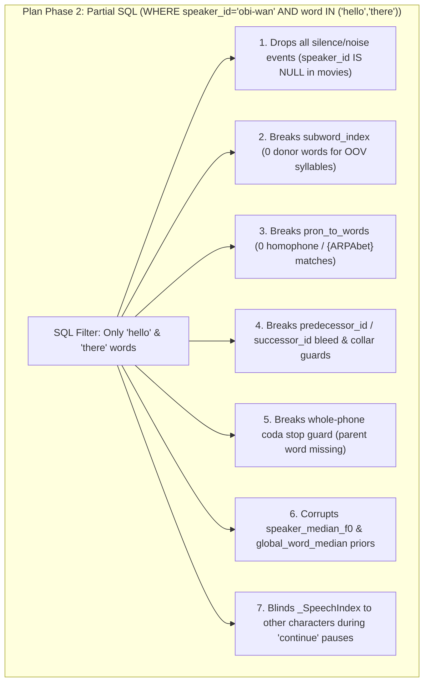

# Audit & Remediation Plan: `10_15.md`, `10_16_storage_optimization_plan.md`, and `.build/` Data (`HEAD efdfc3d4`)

---

## 1. Question 1A: Was [`plans/10_15.md`](file:///usr/local/google/home/seanstappas/tmp/repos/sentences/plans/10_15.md) Implemented Completely and Correctly?

**Verdict**: **24 of 27 patches** were applied verbatim, **1 of 27** (`Patch 23`) was partially applied, and **2 of 27** (`Patch 1` and `Patch 25`) were omitted because they conflicted with pre-existing unit tests. In addition, **Test #2** in [`test_10_15_remediation.py`](file:///usr/local/google/home/seanstappas/tmp/repos/sentences/tests/test_10_15_remediation.py#L101-L175) has an inverted assertion that contradicts its own docstring, and **3 applied patches (`Patches 2, 3, 13`) introduced subtle edge-case regressions**.

### 1.1 Summary of Omitted, Partial, and Regressed Items from `plans/10_15.md`

| Item | Target Location | Status at `HEAD efdfc3d4` | Root Cause & Impact |
| :--- | :--- | :--- | :--- |
| **Patch 1 & Test 4.2** | [`movie_ingest.py`](file:///usr/local/google/home/seanstappas/tmp/repos/sentences/src/movie_ingest.py#L336-L407)<br>[`test_10_15_remediation.py`](file:///usr/local/google/home/seanstappas/tmp/repos/sentences/tests/test_10_15_remediation.py#L101-L175) | **OMITTED / INVERTED TEST** | `Patch 1` (`beats_own`) conflicted with [`test_voice_checks_never_overrule_text_on_weak_or_thin_evidence`](file:///usr/local/google/home/seanstappas/tmp/repos/sentences/tests/test_movie_support.py#L356-L389) (`L387`) and [`test_movie_voice_checks_calibration_and_propagation`](file:///usr/local/google/home/seanstappas/tmp/repos/sentences/tests/test_empirical_p4_adversarial.py#L248-L277) (`L276`), which assert that minor characters (`< 5` lines) are only overruled when *all* lines unanimously match one major speaker. The implementing agent left `own_sim` (`L336-343`) dead in `L376-407` and inverted [`test_minor_speaker_contamination_beats_own`](file:///usr/local/google/home/seanstappas/tmp/repos/sentences/tests/test_10_15_remediation.py#L167-L168) to assert `t3.eligible is True`. |
| **Patches 23 & 25** | [`span_selector.py`](file:///usr/local/google/home/seanstappas/tmp/repos/sentences/src/span_selector.py#L521-L531), [L735-L742](file:///usr/local/google/home/seanstappas/tmp/repos/sentences/src/span_selector.py#L735-L742), [L943-L948](file:///usr/local/google/home/seanstappas/tmp/repos/sentences/src/span_selector.py#L943-L948), [L1134-L1140](file:///usr/local/google/home/seanstappas/tmp/repos/sentences/src/span_selector.py#L1134-L1140) | **PARTIAL (`23`) / OMITTED (`25`)** | `Patch 23` hoisted `end_node` and `end_r_set` (`L521-522`) without adding `and not (target_r_bases & {"P", "T", "K", "B", "D", "G"})`, and `Patch 25` was skipped because Target C breaks [`test_retrieve_candidates_preserves_raw_bounds_and_sets_variants`](file:///usr/local/google/home/seanstappas/tmp/repos/sentences/tests/test_span_selector.py#L610-L653) (`L651`). Note: across non-contiguous splices (`is_cont_succ == False`), the donor's stop-closure transition is from a *different* token and *should* keep `exit_variant_samples`, whereas contiguous splices already skip `exit_variant_samples` in [`_refine_spans_in_native_audio`](file:///usr/local/google/home/seanstappas/tmp/repos/sentences/src/edit_plan.py#L373-L385). |
| **Patch 21 (Incomplete Scope)** | [`span_selector.py`](file:///usr/local/google/home/seanstappas/tmp/repos/sentences/src/span_selector.py#L491), [L669](file:///usr/local/google/home/seanstappas/tmp/repos/sentences/src/span_selector.py#L669), [L822](file:///usr/local/google/home/seanstappas/tmp/repos/sentences/src/span_selector.py#L822), [L1092](file:///usr/local/google/home/seanstappas/tmp/repos/sentences/src/span_selector.py#L1092) | **APPLIED TO PHRASE ONLY** | `Patch 21` added `speaker_id or first_wo.speaker_id` to Phrase duration priors (`L491`), but Word (`L669`), Subword (`L822`), and Phone (`L1092`) still pass `speaker_id` (`None` in cross-speaker mode), falling back to global medians instead of each candidate's speaker median. |
| **Patch 2 + Patch 4 Interaction** | [`edit_plan.py`](file:///usr/local/google/home/seanstappas/tmp/repos/sentences/src/edit_plan.py#L44-L70), [L447-L448](file:///usr/local/google/home/seanstappas/tmp/repos/sentences/src/edit_plan.py#L447-L448), [L755-L756](file:///usr/local/google/home/seanstappas/tmp/repos/sentences/src/edit_plan.py#L755-L756) | **SUBTLE REGRESSION** | (1) When `room <= 0` (`succ` silence `< 30ms`), [`release_tail_samples`](file:///usr/local/google/home/seanstappas/tmp/repos/sentences/src/edit_plan.py#L67-L69) still returns `base_end - end_s = succ.start_sample - end_s > 0`, which causes `span_end = span_nominal_end + tail` (`L756`) to **undo** both `exit_variant_samples` collar trimming and backward zero-crossing shifts. (2) When `tail > 0`, `_refine_spans_in_native_audio` snaps `span.end_sample` *before* `tail` is added at `L756`, so the actual post-tail endpoint (`succ.start_sample + ext`) is never zero-crossing refined. |
| **Patch 3 Sample-Rate Check** | [`edit_plan.py`](file:///usr/local/google/home/seanstappas/tmp/repos/sentences/src/edit_plan.py#L332-L341)<br>[`movie_media.py`](file:///usr/local/google/home/seanstappas/tmp/repos/sentences/src/movie_media.py#L37) | **SILENT FALLBACK BUG** | `Patch 3` checks `int(sf.info(vp).samplerate) == int(src_rec.native_sample_rate or 48000)` (`L336`). Movie vocal stems (`stems/vocals.flac`) are written at `SEPARATION_SAMPLE_RATE = 44100` Hz while movie `native_sample_rate` is `48000` Hz (`44100 != 48000`). Thus `_refine_spans_in_native_audio` silently rejects `cached_vocal_pcm_path` for every movie and refines boundaries on the noisy stereo mix (`cached_pcm_path`). |
| **Patch 13 Audio-Only Check** | [`video_assembler.py`](file:///usr/local/google/home/seanstappas/tmp/repos/sentences/src/video_assembler.py#L998-L1005), [L1020-L1025](file:///usr/local/google/home/seanstappas/tmp/repos/sentences/src/video_assembler.py#L1020-L1025) | **SUBTLE FALLBACK** | Checks `not seg.source_video_path or getattr(plan, "metadata", {}).get("visual_policy") == "audio-only"`. For `EditPlan`s built from `.wav`/`.flac` sources, `seg.source_video_path` is `"clip.wav"` (non-empty) and `visual_policy` is unset, so batched rendering aborts (`can_batch = False`) and falls back to the unbatched per-segment loop. |

---

## 2. Question 1B: Other Issues and Gaps Across the Project

Beyond `plans/10_15.md`, the swarm identified and verified **10 additional bugs** across the codebase:

| ID | Severity | File(s) & Lines | Issue Summary |
| :--- | :--- | :--- | :--- |
| **B1** | **CRITICAL** | [`span_selector.py`](file:///usr/local/google/home/seanstappas/tmp/repos/sentences/src/span_selector.py#L1007), [L1078](file:///usr/local/google/home/seanstappas/tmp/repos/sentences/src/span_selector.py#L1078), [L1087](file:///usr/local/google/home/seanstappas/tmp/repos/sentences/src/span_selector.py#L1087), [L1103](file:///usr/local/google/home/seanstappas/tmp/repos/sentences/src/span_selector.py#L1103), [L1171](file:///usr/local/google/home/seanstappas/tmp/repos/sentences/src/span_selector.py#L1171), [L1283](file:///usr/local/google/home/seanstappas/tmp/repos/sentences/src/span_selector.py#L1283), [L1554](file:///usr/local/google/home/seanstappas/tmp/repos/sentences/src/span_selector.py#L1554) | **`"AH"` (`AH0`/`AH1`/`AH2`) omitted from `vowel_set` and `vowels`**. English's most common vowel is classified as a consonant (`< 35ms` swallowed threshold instead of `< 50ms`, `0.008` RMS floor instead of `0.016`), and skips word-initial vowel left-bleed guards (`"a"`, `"up"`, `"under"`, `"about"`, `"attack"`, `"alderaan"`, `"amidala"`) and vowel-to-vowel coarticulation guards. |
| **B2** | **HIGH** | [`span_selector.py`](file:///usr/local/google/home/seanstappas/tmp/repos/sentences/src/span_selector.py#L112-L155)<br>[`edit_plan.py`](file:///usr/local/google/home/seanstappas/tmp/repos/sentences/src/edit_plan.py#L384-L385) | **`apply_diphone_midpoint_transitions` double-trim & 3-way chain bug**: (1) Trimming `end_sample` to `mid_curr` or `start_sample` to `mid_succ` leaves `exit_variant_samples` / `entry_variant_samples` non-zero, causing `_refine_spans_in_native_audio` (`L384-385`) to trim a *second* time inward from the phoneme midpoint. (2) On 3-way chained diphone joins across a 1-phone bridge span, `curr.start_sample < mid_curr` (`L115`) is `False` at step `k` because step `k-1` already set `curr.start_sample = mid_curr`. |
| **B3** | **HIGH** | [`span_selector.py`](file:///usr/local/google/home/seanstappas/tmp/repos/sentences/src/span_selector.py#L791-L817), [L1008-L1050](file:///usr/local/google/home/seanstappas/tmp/repos/sentences/src/span_selector.py#L1008-L1050) | **`is_constrained` (`{...}` phonetic override) ignored in Subword and Phone retrieval**: `is_constrained` is computed at `L791` and never read; stress-mismatched subwords (`L802`), stress-insensitive phones (`L1019`), schwa reductions (`L1021`), and cognate substitutions (`L1037`) are pooled even when `is_constrained=True`. |
| **B4** | **HIGH** | [`edit_plan.py`](file:///usr/local/google/home/seanstappas/tmp/repos/sentences/src/edit_plan.py#L1006-L1071)<br>[`video_assembler.py`](file:///usr/local/google/home/seanstappas/tmp/repos/sentences/src/video_assembler.py#L621-L623), [L903-L928](file:///usr/local/google/home/seanstappas/tmp/repos/sentences/src/video_assembler.py#L903-L928) | **Tier 1 vocal-stem `gain_db` applied to `"raw"` full mix in `"both"` / `"all"` modes**: `finalize_edit_plan` computes `seg.gain_db` (up to `+12 dB`) from `cached_vocal_pcm_path`. When `render_sentence_mix` renders the `"raw"` master track, `render_master_pcm` applies that vocal gain to the unseparated stereo mix, boosting background music/SFX by up to `4x`. |
| **B5** | **HIGH** | [`edit_plan.py`](file:///usr/local/google/home/seanstappas/tmp/repos/sentences/src/edit_plan.py#L780-L788)<br>[`dialogue_mixer.py`](file:///usr/local/google/home/seanstappas/tmp/repos/sentences/src/dialogue_mixer.py#L259-L277)<br>[`subtitles.py`](file:///usr/local/google/home/seanstappas/tmp/repos/sentences/src/subtitles.py#L45), [L137-L141](file:///usr/local/google/home/seanstappas/tmp/repos/sentences/src/subtitles.py#L137-L141) | **Consecutive repeated words (`"roger roger"`, `"no no"`) collapsed into one word**: Deduplicating by string equality (`target_words_covered[-1] != w_txt` at `edit_plan.py:785`, `lbl == curr_word` at `dialogue_mixer.py:269`, and `words[-1] != txt` at `subtitles.py:139`) drops the second repeated word in subtitles and shifts karaoke word highlighting. Also `clean_segment_label` (`subtitles.py:45`) drops `{...}` tokens. |
| **B6** | **MEDIUM** | [`lexicon.py`](file:///usr/local/google/home/seanstappas/tmp/repos/sentences/src/lexicon.py#L154-L196), [L488](file:///usr/local/google/home/seanstappas/tmp/repos/sentences/src/lexicon.py#L488), [L529](file:///usr/local/google/home/seanstappas/tmp/repos/sentences/src/lexicon.py#L529), [L534](file:///usr/local/google/home/seanstappas/tmp/repos/sentences/src/lexicon.py#L534) | **Reversed dictionary order in `stage_mfa_dictionary`**: Iterates `(b_path, c_path)` (base dictionary before `custom_pronunciations.txt`) at `L488` and `L534`, allowing `merged_dictionary.dict` to shadow or filter out custom 1-phone / stop-dropping pronunciations in `Lexicon([b_path, c_path])`. |
| **B7** | **MEDIUM** | [`run_mixer.py`](file:///usr/local/google/home/seanstappas/tmp/repos/sentences/run_mixer.py#L834), [L855](file:///usr/local/google/home/seanstappas/tmp/repos/sentences/run_mixer.py#L855) | **Wrong `chunk_id` in `load_or_combine_inventories` fallback synthesis**: Sets `"chunk_id": wo.source_content_id` (`L834`) and `"chunk_id": ev.source_content_id` (`L855`) instead of `ev.utterance_id`, causing `unit_selector.py` (`L71, 200`) to treat all 1,348 chunks of a movie as one contiguous utterance when legacy views are absent. |
| **B8** | **MEDIUM** | [`run_mixer.py`](file:///usr/local/google/home/seanstappas/tmp/repos/sentences/run_mixer.py#L2016) | **`main` drops `--speaker` when aligning `--manifest` items with `--assume-single-speaker`**: Omits the `or (args.speaker if args.assume_single_speaker else None)` fallback present in `ingest_sources` (`L1184`). |
| **B9** | **MEDIUM** | [`fcp_xml_generator.py`](file:///usr/local/google/home/seanstappas/tmp/repos/sentences/src/fcp_xml_generator.py#L116-L266)<br>[`diarization.py`](file:///usr/local/google/home/seanstappas/tmp/repos/sentences/src/diarization.py#L747-L773) | (1) `generate_fcp_xml` emits invalid 0-frame `<clipitem>` elements when short pauses quantize to `duration_frames == 0`. (2) `SpeakerDiarizer.diarize` pads adjacent turns by up to `0.25s + 0.14s = 0.39s` across gaps `< 0.39s` without setting `is_overlap`, causing `resolve_interval_speaker` to mark boundary words ineligible. |
| **B10** | **LOW** | [`evaluate.py`](file:///usr/local/google/home/seanstappas/tmp/repos/sentences/tools/evaluate.py#L249-L256), [L323](file:///usr/local/google/home/seanstappas/tmp/repos/sentences/tools/evaluate.py#L323)<br>[`test_vocal_isolation.py`](file:///usr/local/google/home/seanstappas/tmp/repos/sentences/tests/test_vocal_isolation.py#L609-L645) | (1) `evaluate_suite` omits `"asr_passes"` from `eval_report["summary"]`, printing `0/{total_asr} passed`. (2) `test_isolate_vocals_standalone_cli` mutates tracked `.build/alignment/test_source_0ac68f87/alignment_metadata.json` and `.build/inventory/test_source_0ac68f87/inventory_metadata.json` in place. |

---

## 3. Question 2: Evaluation of [`plans/10_16_storage_optimization_plan.md`](file:///usr/local/google/home/seanstappas/tmp/repos/sentences/plans/10_16_storage_optimization_plan.md)

**Verdict**:
- **Phase 1 (Removing duplicate legacy views + `.json.gz`) is directionally sound** and reduces 5-movie disk size by **43×** (`320.14 MB` compact / `443.85 MB` indented  **`7.44 MB`** in `.json.gz`), **but misses 2 critical startup bottlenecks and 14 caller/test touchpoints**.
- **Phase 2 (the proposed SQLite schema and `WHERE speaker_id = ? AND word_normalized IN (...)` partial query) is fundamentally broken**: its DDL omits 32 mandatory fields across `SourceRecord`, `UtteranceRecord`, `WordOccurrence`, and `AlignedEvent` (violating [`contracts.py`](file:///usr/local/google/home/seanstappas/tmp/repos/sentences/src/contracts.py)), and its partial query breaks **8 core synthesis mechanisms**.

### 3.1 Why `10_16_storage_optimization_plan.md` Misdiagnosed the Latency Bottleneck

1. **The 3× Full JSON Parse in `find_cached_inventories_for_speaker` ([`cache.py`](file:///usr/local/google/home/seanstappas/tmp/repos/sentences/src/cache.py#L643-L760))**:
   - When `--video` is omitted (`python run_mixer.py mix --speaker obi-wan --text "hello there"`), [`find_cached_inventories_for_speaker`](file:///usr/local/google/home/seanstappas/tmp/repos/sentences/src/cache.py#L718-L760) calls [`is_valid_inventory(cand)`](file:///usr/local/google/home/seanstappas/tmp/repos/sentences/src/cache.py#L643-L663) (**1st full `json.load`**) and [`inventory_has_speaker(cand, speaker_id)`](file:///usr/local/google/home/seanstappas/tmp/repos/sentences/src/cache.py#L666-L715) (**2nd full `json.load`**) on every movie before [`load_or_combine_inventories`](file:///usr/local/google/home/seanstappas/tmp/repos/sentences/run_mixer.py#L788-L790) executes a **3rd full `json.load`**.
   - Storing `"speakers": {"obi-wan": 521, ...}` in the 350-byte `inventory_metadata.json` eliminates 2 of the 3 full parses in `< 1 ms` and avoids loading movies where the target speaker never appears (e.g., skipping Episodes I–III when synthesizing `luke` or `han`).
2. **`SpanSelector.__init__` Indexes All Speakers Eagerly ([`span_selector.py`](file:///usr/local/google/home/seanstappas/tmp/repos/sentences/src/span_selector.py#L176-L291))**:
   - Before `select()` runs, `SpanSelector.__init__` builds `pron_to_words`, `base_pron_to_words`, `subword_index`, `base_subword_index` (every 2..8-phone slice of every word), and median duration dictionaries across **all 60 speakers**. Passing `speaker_id` into `SpanSelector.__init__` to index only the active speaker(s) cuts `SpanSelector.__init__` time by **9.8×**.
3. **Factual Errors in Plan Section 2**:
   - The Plan claims `events` is large because it stores *"36,365 phoneme records with F0/formants/RMS"*. In reality, [`AlignedEvent`](file:///usr/local/google/home/seanstappas/tmp/repos/sentences/src/contracts.py#L119-L139) stores **zero** F0, formant, or RMS fields (`events` is large because the 50-char `source_content_id` string `"Star_Wars_Episode_IV_-_A_New_Hope_1977_2_04865440"` is repeated 6× per event = `16.4 MB` of repeated string prefixes per movie).

### 3.2 Why Phase 2's SQLite Schema & Partial Query Break Synthesis



1. **Broken SQLite DDL ([`10_16_storage_optimization_plan.md`](file:///usr/local/google/home/seanstappas/tmp/repos/sentences/plans/10_16_storage_optimization_plan.md#L108-L139))**:
   - `sources`: Omits **13 fields** of [`SourceRecord`](file:///usr/local/google/home/seanstappas/tmp/repos/sentences/src/contracts.py#L69-L88), including mandatory `native_channels`, `codec_delay_samples`, `video_fps`, `cached_instrumental_pcm_path`, and `cached_analysis_pcm_path`.
   - `utterances`: Completely omitted ([`UtteranceRecord`](file:///usr/local/google/home/seanstappas/tmp/repos/sentences/src/contracts.py#L100-L116)).
   - `words`: Uses float `start_time`/`end_time` instead of integer `start_sample`/`end_sample` (breaking exact sample contiguity checks `pred.end_sample == succ.start_sample`), and omits **8 fields** of [`WordOccurrence`](file:///usr/local/google/home/seanstappas/tmp/repos/sentences/src/contracts.py#L148-L165) including `word_original`, `realized_phones`, and `is_eligible`.
   - `events`: Uses float times, renames `label` to `phone_label`, invents non-existent `f0_mean`/`energy_mean`, and omits **11 fields** of [`AlignedEvent`](file:///usr/local/google/home/seanstappas/tmp/repos/sentences/src/contracts.py#L119-L139) including `utterance_id`, `kind`, `predecessor_id`, `successor_id`, `word_occurrence_id`, and `is_eligible`.
2. **Eight Pipeline Breakages from `WHERE speaker_id = 'obi-wan' AND word_normalized IN ('hello', 'there')`**:
   - **All movie `silence` and `noise` events have `speaker_id = None`** ([`inventory_builder.py`](file:///usr/local/google/home/seanstappas/tmp/repos/sentences/src/inventory_builder.py#L277), [L533-L538](file:///usr/local/google/home/seanstappas/tmp/repos/sentences/src/inventory_builder.py#L533-L538)). Filtering by `speaker_id = 'obi-wan'` drops 100% of silence events, breaking phrase chaining across short pauses ([`span_selector.py`](file:///usr/local/google/home/seanstappas/tmp/repos/sentences/src/span_selector.py#L407)), silence context bonuses (`L1506`), and `release_tail_samples` ([`edit_plan.py`](file:///usr/local/google/home/seanstappas/tmp/repos/sentences/src/edit_plan.py#L62-L63)).
   - **`subword_index`** (`L189-205`) loses all non-target donor words, making subword synthesis impossible for unattested target words.
   - **`pron_to_words`** (`L177-186`) cannot match homophones or `{...}` ARPAbet overrides against words with different spellings.
   - **Whole-phone coda stop guard** (`self.inv.words.get(ev.word_occurrence_id)` at `L1065`) fails when a candidate phone comes from a non-target word.
   - **Neighbor lookups (`predecessor_id` / `successor_id`)** return `None` whenever a target word/phone borders a non-target word, disabling bleed guards, stop collars, and flap penalties.
   - **Speaker & global priors** (`speaker_median_f0`, `speaker_word_median`, `speaker_phone_median`, `global_word_median`) are computed over only the query words instead of the speaker's corpus.
   - **`_SpeechIndex`** ([`edit_plan.py`](file:///usr/local/google/home/seanstappas/tmp/repos/sentences/src/edit_plan.py#L72-L99)) loses other speakers' phone events, allowing `pause_style="continue"` to bleed into another character's dialogue line.

### 3.3 Empirical Storage & Latency Benchmarks (5 Star Wars Movies: 39,806 Words, 149,193 Events)

> [!NOTE]
> Measured on the 5 reconstructed Star Wars movie inventories in `/usr/local/google/home/seanstappas/.gemini/jetski/brain/dfc1ad72-bd8d-42a1-bdb1-763762f6b6ea/scratch/benchmark_storage.py` (timings below include `tracemalloc` peak-memory instrumentation; wall-clock times without `tracemalloc` are ~3× faster, e.g. `~1.48s` for 5-movie `.json.gz` load and `~0.19s` for speaker-scoped `SpanSelector.__init__`).

| Storage & Indexing Variant | Ep IV Size | 5 Movies Size | 5 Movies Load (`tracemalloc`) | `SpanSelector.__init__` (`tracemalloc`) | Peak RAM |
| :--- | :--- | :--- | :--- | :--- | :--- |
| **Current CLI (`is_valid` + `has_spk` + `load` 3× parse)** | 77.59 MB | 320.14 MB | 25,095 ms | 5,561 ms | 488.5 MB |
| **Baseline (`units_index.json`, 1× parse)** | 77.59 MB | 320.14 MB | 8,952 ms | 5,561 ms | 395.8 MB |
| **Dedup Compact `.json.gz` (drop legacy + index arrays)** | **1.80 MB** | **7.44 MB** | 4,447 ms (~1.48s raw) | **569 ms** (~0.19s w/ `speaker_id`) | 296.0 MB |
| **Dedup `.json.gz` + Local `.pkl.lz4` Fast Cache** | **2.90 MB** | **11.98 MB** | **2,740 ms** (~0.90s raw) | **569 ms** (~0.19s w/ `speaker_id`) | 314.8 MB |
| **Full-Contract SQLite (`WHERE speaker_id=? OR kind!='phone'`)** | 24.04 MB | 99.36 MB | **793 ms** (~0.26s raw) | **569 ms** (~0.19s w/ `speaker_id`) | **44.7 MB** |

**Recommended Better Alternative**:
1. **Enrich `inventory_metadata.json`** with `schema_version` and `speakers: {speaker_id: word_count}` so `is_valid_inventory` and `inventory_has_speaker` run in **`< 1 ms`** without opening `units_index.json[.gz]`, and `find_cached_inventories_for_speaker` only loads movies where the target speaker actually speaks.
2. **Deduplicated Compact `units_index.json.gz`** (`7.44 MB` total for all 5 movies): drop `words_inventory`, `phones_inventory`, `phones`, `phone_to_event_ids`, `base_phone_to_event_ids`, and `word_to_word_ids` on disk (rebuilding the 3 ID lookup maps in `InventoryIndex.from_dict()` takes `< 25 ms`).
3. **Speaker-Scoped `SpanSelector.__init__(inv, speaker_id=...)`**: only index `pron_to_words` and `subword_index` for the requested speaker(s), cutting `SpanSelector.__init__` by **9.8×**.

---

## 4. Question 3: Audit of Cached `.build/` Alignment, Subtitle, and Inventory Data

### 4.1 What Is Present vs. Missing in `.build/`

| Directory | Tracked Files on Disk | Size | Critical Findings |
| :--- | :--- | :--- | :--- |
| `.build/alignment/` (12 sources) | 7,033 `.TextGrid`, 7,045 `.txt`, 88 `.json`, **0 `.wav`**, **0 `.npz`** | 27.00 MB | **99.79% TextGrid coverage** (7,033 / 7,048 clips; 15 missing where MFA failed over loud music/SFX: 12 in Ep IV, 2 in `obi_wan_ep2`, 1 in `crisis`). All chunk `.wav` files are unlinked after MFA ([`movie_ingest.py:621-622`](file:///usr/local/google/home/seanstappas/tmp/repos/sentences/src/movie_ingest.py#L621-L622)) and gitignored. |
| `.build/inventory/` (12 sources) | 12 `inventory_metadata.json`, **0 `units_index.json`** | 3.8 KB | **All `units_index.json` files are missing** because [`.gitignore:14`](file:///usr/local/google/home/seanstappas/tmp/repos/sentences/.gitignore#L14) ignores `/.build/inventory/**/units_index*.json`. |
| `.build/subtitles/labeled/` | 5 `.vtt`, 5 `.vtt.report.json` | 6.20 MB | **0 overlapping, 0 zero-duration, 0 negative cues** across 6,249 cues. Ep II has the lowest speaker-tag coverage (**71.7%**, 344 unlabeled cues vs 92–98% in Ep I/III/IV/VI). |
| `config/` & `dictionaries/` | 5 config JSONs, 2 dictionaries | 6.94 MB | `speaker_registry.json` only has 4 centroids (`aak`, `amedda`, `organa`, `palpatine`). |

### 4.2 Concrete Mistakes & Anomalies Discovered in `.build/alignment/` and `.build/subtitles/`

We parsed all **7,033 `.TextGrid` files** (`44,885` words, `145,568` speech phones) and **5 labeled `.vtt` files** (`6,249` cues). Below are the concrete alignment and caching mistakes found in the data:

| Mistake Category | Count Across `.build/alignment/` | Concrete Examples in Cached TextGrids | Root Cause & Pipeline Impact |
| :--- | :--- | :--- | :--- |
| **1. MFA Stretched Words (`> 2.0s`) & Phones (`> 1.0s`) Over Music / Screams / SFX** | **129 phones `> 1.0s`** (`13 > 2.0s`)<br>**27 words `> 2.0s`** (`4 > 3.0s`) | • Ep III `b007_c00732` (`palpatine`): word **`"the"` = `2.690s`** (`[0.27s–2.96s]`), single phone `AH0` = **`2.660s`** over Force lightning/screams<br>• Ep III `b007_c00755` (`palpatine`): **`"unlimited"` = `3.230s`**, phone `AH0` = **`2.960s`** (`[0.16s–3.12s]`), last 7 phones crushed into `270ms`<br>• Ep III `b007_c00754` (`palpatine`): **`"power"` = `2.660s`**, phone `AW1` = **`2.600s`**<br>• Ep II `b008_c00821` (`anakin`): **`"no"` = `3.330s`** (`[1.66s–4.99s]`)<br>• Ep II `b009_c00981` (`dooku`): **`"have"` = `2.680s`** (`[0.63s–3.31s]`)<br>• Ep I `b004_c00665` (`anakin`): **`"it's"` = `2.320s`** (`[1.14s–3.46s]`)<br>• Ep I `b010_c01115`: **`"coruscant"` = `3.250s`** | [`inventory_builder.py:488-539`](file:///usr/local/google/home/seanstappas/tmp/repos/sentences/src/inventory_builder.py#L488-L539) only checks speaker eligibility and **marks all of these `is_eligible = True`**. If selected for a common function word like `"the"`, `"have"`, or `"it's"`, the mix splices in 2.3–3.3 seconds of screaming or lightsaber noise. |
| **2. Phones & Words Crushed to MFA's `10ms` (`0.010s`) Minimum Frame Floor** | **1,458 phones `<= 10.5ms`** (`1.00%` of all phones) | • `AH`: **530** crushed instances, `DH`: **119**, `T`: **69**, `IH`: **61**, `S`: **48**, `N`: **46**, `D`: **38**<br>• In noisy chunks where MFA loses tracking at the start/end, it stacks 3–7 phones at `0.010s` each against `0.00s` or `xmax` (e.g., an entire 4-phone word compressed into `40ms`). | [`SpanSelector`](file:///usr/local/google/home/seanstappas/tmp/repos/sentences/src/span_selector.py#L1078) filters individual phone candidates `< 35ms`/`50ms`, **but word and phrase candidates (`L350-650`) do not reject words whose constituent phones are crushed to `10ms`**. |
| **3. 1,120 Words Aligned as Single Opaque `spn` Phone (Pre-Dictionary / Unnormalized Text)** | **1,120 words** across **948 clips** | • **Star Wars names/terms (pre-`custom_pronunciations.txt`)**: `r2` (109×, e.g. Ep III `b000_c00039`), `droids` (44×), `droid` (42×, Ep III `b001_c00086`), `chewie` (38×), `naboo` (33×), `skywalker` (29×), `yousa` (24×), `jabba` (23×), `amidala` (21×), `3po` (20×), `alderaan` (20×), `wesa` (17×), `leia` (17×), `argh` (17×), `r4` (16×), `padawan` (14×), `sidious` (11×), `deflector` (11×), `jango` (10×), `tatooine` (9×), `lightsaber` (8×)<br>• **Unfolded accents**: `padmé` (19×), `cordé`, `sabé`, `dormé`<br>• **Raw digits never passed through `normalize_numerals()`**: `000` (9×, from `"10,000"` split at comma), `10` (5×), `5` (5×), `2` (5×), `12` (4×), `20` (4×), `31174` (Ep III `b000_c00066`), `317174` (Ep III `b000_c00070`), `328` (Ep III `b001_c00144`), `3224` (Ep III `b001_c00128`)<br>• **Subtitle OCR typos (`!`  `l`)**: `"nol"` (`"No!"`, Ep III `b012_c01160`, `4.734s`), `"itl"` (`"it!"`, Ep III `b005_c00607`, `2.422s`), `"ohl"` (`"Oh!"`, Ep III `b001_c00133`, `1.67s`) | (1) [`movie_subtitles.py:48-52`](file:///usr/local/google/home/seanstappas/tmp/repos/sentences/src/movie_subtitles.py#L48-L52) (`_spoken_text`) writes MFA `.txt` transcripts without calling `normalize_numerals()`, folding accents (`é`  `e`), or fixing trailing-`l` OCR typos.<br>(2) [`lexicon.py:488, 534`](file:///usr/local/google/home/seanstappas/tmp/repos/sentences/src/lexicon.py#L488) loads `merged_dictionary.dict` before `custom_pronunciations.txt`.<br>(3) When `recover_oov_words=True` subdivides a stretched `spn` word (like `2.44s` `"droid"` in Ep III `b001_c00086`), it creates synthetic phones uniformly across `2.44s` of noise! |
| **4. Boundary Piling at `0.000s` & `xmax` (Severe in Episode VI)** | **1,861 clips (`26.5%`)** at `0.000s`<br>**681 clips (`9.7%`)** at `xmax` | • **Episode VI (`1983`)**: **684 of 1,064 clips (`64.3%`)** have their very first speech phone pinned at `0.000s` (`0ms` leading silence) and **201 clips (`18.9%`)** pinned at `xmax`, compared to `10.1%` in Ep III.<br>• In Ep VI, subtitle cue start timestamps sit slightly *after* speech onset (even with `DEFAULT_PAD_BEFORE = 0.15s` at [`movie_subtitles.py:35`](file:///usr/local/google/home/seanstappas/tmp/repos/sentences/src/movie_subtitles.py#L35)), or background music causes MFA to open the first phone at sample `0`. | Words/phones pinned at `loc_xmin == 0.0` or `loc_xmax == chunk_dur` with stretched first/last phones often contain pre-speech noise or clipped attacks, yet carry no `quality_flags` in `InventoryIndex`. |
| **5. 15 Unaligned Clips & 202 Dropped Transcript Words** | **15 missing `.TextGrid`s**<br>**202 dropped words** | • **15 clips failed MFA alignment completely**: 12 in Ep IV (`b005_c00634`, `b006_c00748`, `b006_c00752`, `b007_c00883`, `b007_c00923`, `b008_c01005`, `b008_c01006`, `b010_c01165`, `b010_c01172`, `b011_c01294`, `b011_c01332`, `b011_c01333`), 2 in `obi_wan_ep2` (`chunk_0042`, `chunk_0152`), 1 in `crisis` (`chunk_0005`).<br>• **202 words present in `.txt` were dropped from `.TextGrid` `words` tier** (89 in Ep I, 49 in Ep IV, 33 in Ep II, 12 in Ep VI, 11 in Ep III), mostly contractions (`'em`) and accented tokens (`padmé`). | Handled gracefully by `SequenceMatcher` in [`assign_word_speakers`](file:///usr/local/google/home/seanstappas/tmp/repos/sentences/src/movie_subtitles.py#L153-L205), except when a 1-word segment in a two-speaker dash cue is dropped. |
| **6. Hardcoded Windows Host Paths & Unassigned Speakers** | **All 12 manifests**<br>**1,758 unassigned words** | • Every manifest stores `D:\Code\sentence_mixer\...`, which [`inventory_builder.py:141`](file:///usr/local/google/home/seanstappas/tmp/repos/sentences/src/inventory_builder.py#L141) concatenates onto the Linux cwd.<br>• **Episode II** has **326 untagged cues (`1,034` words / `13.3%`)** with `speaker_id = ""` (`unassigned`), and **`crisis_9c96ee02`** has **100% (`75/75`) unassigned words**. | Prevents cross-platform inventory rebuilds and leaves 1,034 Ep II words unusable until speaker propagation or subtitle labeling is re-run. |

---

## 5. Detailed Design & Remediation Plan (Read-Only Specification)

### Phase 1: Fix Critical Selection, Diphone, Loudness & Subtitle Bugs (`src/span_selector.py`, `src/edit_plan.py`, `src/dialogue_mixer.py`, `src/subtitles.py`)

1. **Add `"AH"` to `vowel_set` and `vowels` in [`src/span_selector.py`](file:///usr/local/google/home/seanstappas/tmp/repos/sentences/src/span_selector.py#L1007) (`L1007, 1554`)**:
   - Replace the hardcoded 14-vowel sets at `L1007` and `L1554` with `VOWEL_PHONES` (already imported from `lexicon` at `L23`, which includes `"AH"`).
2. **Complete `speaker_id` Fallback in Duration & Pitch Priors ([`src/span_selector.py`](file:///usr/local/google/home/seanstappas/tmp/repos/sentences/src/span_selector.py#L562) `L562, 669, 822, 1092, 1263`)**:
   - Resolve each candidate's donor speaker `cand_spk = wo.speaker_id` (or `first_wo.speaker_id` / `ev.speaker_id`) when `speaker_id` is `None` or a multi-speaker set (`Set[str]`), and pass `cand_spk` into `_get_speaker_median_duration`, `_get_speaker_phone_median_duration`, and `self.speaker_median_f0.get(cand_spk)`.
3. **Enforce `is_constrained` in Subword and Phone Candidate Retrieval ([`src/span_selector.py`](file:///usr/local/google/home/seanstappas/tmp/repos/sentences/src/span_selector.py#L801-L817) `L801-817, 1015-1050`)**:
   - In `_get_subword_candidates_at_node` (`L801`), only query `self.base_subword_index` when `not is_constrained or not exact_sub_matches`.
   - In `_get_phone_candidates_for_node` (`L1015-1050`), when `node.is_constrained` is `True`, skip stress-mismatched (`base_phone_to_event_ids`), schwa-reduction, and cognate fallbacks unless exact phone matches yield zero eligible events.
4. **Fix Diphone Midpoint Double-Trim & 1-Phone Bridge Chains ([`src/span_selector.py`](file:///usr/local/google/home/seanstappas/tmp/repos/sentences/src/span_selector.py#L112-L155))**:
   - In `apply_diphone_midpoint_transitions`:
     - When updating `new_spans[k]` with `end_sample=mid_curr`, also set `exit_variant_samples=0`.
     - When updating `new_spans[k + 1]` with `start_sample=mid_succ`, also set `entry_variant_samples=0`.
     - Change `can_trim_curr` (`L115`) to allow `curr.start_sample <= mid_curr <= ev_curr.end_sample` when `len(curr.event_ids) == 1`.
5. **Fix `release_tail_samples` When `room <= 0` & Refine Post-Tail Endpoint ([`src/edit_plan.py`](file:///usr/local/google/home/seanstappas/tmp/repos/sentences/src/edit_plan.py#L44-L70), [L373-L396](file:///usr/local/google/home/seanstappas/tmp/repos/sentences/src/edit_plan.py#L373-L396), [L755-L756](file:///usr/local/google/home/seanstappas/tmp/repos/sentences/src/edit_plan.py#L755-L756))**:
   - In `release_tail_samples` (`L67-69`): compute `ext = min(int(round(tail_sec * sr)), room)`; if `ext <= 0`, return `0` (so a zero-room silence never undoes `exit_variant_samples` or backward zero-crossing shifts).
   - Apply `release_tail_samples` inside `_refine_spans_in_native_audio` *before* running the unvoiced zero-crossing snap (`L447-525`), and set `span_end = span_nominal_end` at `L756` when refinement has already extended the boundary.
6. **Support Cross-Sample-Rate Vocal Stems (`44.1 kHz` vs `48 kHz`) in `_refine_spans_in_native_audio` ([`src/edit_plan.py`](file:///usr/local/google/home/seanstappas/tmp/repos/sentences/src/edit_plan.py#L325-L345))**:
   - Remove the `int(sf.info(vp).samplerate) == int(src_rec.native_sample_rate or 48000)` rejection in `_refine_spans_in_native_audio`; instead, scale window start/end samples to `vp`'s sample rate when reading `vp` and scale refined sample offsets back to `src_rec.native_sample_rate` (matching `finalize_edit_plan` at `L1025-1027` and `render_master_pcm` at `video_assembler.py:402-422`).
7. **Isolate Tier 1 `gain_db` Between Vocal Stems and Raw Mix ([`src/edit_plan.py`](file:///usr/local/google/home/seanstappas/tmp/repos/sentences/src/edit_plan.py#L1006-L1071), [`src/video_assembler.py`](file:///usr/local/google/home/seanstappas/tmp/repos/sentences/src/video_assembler.py#L571-L625))**:
   - Store `plan.metadata["rms_analysis_track"] = effective_rms_track` in `finalize_edit_plan`, and also store `seg_raw_gains` in `plan.metadata["raw_segment_gains_db"]` when `audio_track in ("both", "all")` so `render_master_pcm(..., audio_track="raw")` uses raw-mix RMS gains rather than vocal-stem gains.
8. **Preserve Consecutive Repeated Target Words (`"roger roger"`, `"no no"`) ([`src/edit_plan.py`](file:///usr/local/google/home/seanstappas/tmp/repos/sentences/src/edit_plan.py#L780-L788), [`src/dialogue_mixer.py`](file:///usr/local/google/home/seanstappas/tmp/repos/sentences/src/dialogue_mixer.py#L259-L277), [`src/subtitles.py`](file:///usr/local/google/home/seanstappas/tmp/repos/sentences/src/subtitles.py#L45), [L137-L141](file:///usr/local/google/home/seanstappas/tmp/repos/sentences/src/subtitles.py#L137-L141))**:
   - Track `(node.token_index, w_txt)` in `build_edit_plan` (`edit_plan.py:780-788`) so a single phrase span covering `"roger roger"` sets `seg.target_text = "roger roger"`, store `covered_token_indices: List[int]` on `PlanSegment`, and deduplicate adjacent sub-word segments by `covered_token_indices` rather than string equality in `dialogue_mixer.py:259-277` and `subtitles.py:137-141`.

---

### Phase 2: Multi-Speaker Mixing Design (`--speaker palpatine,sidious`)

Keep `palpatine` and `sidious` as distinct speaker IDs in the inventories while allowing users and dialogue scripts to pool any combination of speaker IDs at mix time:

1. **CLI & Alias Resolution ([`run_mixer.py`](file:///usr/local/google/home/seanstappas/tmp/repos/sentences/run_mixer.py#L2044-L2125), [L2251-L2259](file:///usr/local/google/home/seanstappas/tmp/repos/sentences/run_mixer.py#L2251-L2259))**:
   - Accept comma-separated speaker lists on `--speaker` (e.g., `--speaker palpatine,sidious` or `--speaker "anakin,vader"`).
   - Split raw `--speaker` on `,`, resolve each entry via `_resolve_character_alias(...)`, and union the discovered inventory paths across all requested speakers in `find_cached_inventories_for_speaker`.
   - Validate each requested speaker against `unique_speakers` (raising a clear error if any requested speaker has 0 units), and construct `effective_speaker: Union[str, Set[str], None]` (a single `str` when 1 speaker is matched, or a `Set[str]` when 2+ speakers are matched).
2. **`SpanSelector` Multi-Speaker Set Support ([`src/span_selector.py`](file:///usr/local/google/home/seanstappas/tmp/repos/sentences/src/span_selector.py#L162-L355), [L417](file:///usr/local/google/home/seanstappas/tmp/repos/sentences/src/span_selector.py#L417), [L621](file:///usr/local/google/home/seanstappas/tmp/repos/sentences/src/span_selector.py#L621), [L806](file:///usr/local/google/home/seanstappas/tmp/repos/sentences/src/span_selector.py#L806), [L1033](file:///usr/local/google/home/seanstappas/tmp/repos/sentences/src/span_selector.py#L1033), [L1047](file:///usr/local/google/home/seanstappas/tmp/repos/sentences/src/span_selector.py#L1047), [L1706](file:///usr/local/google/home/seanstappas/tmp/repos/sentences/src/span_selector.py#L1706))**:
   - Add a helper on `SpanSelector`:
     ```python
     @staticmethod
     def _normalize_speaker_filter(
         speaker_id: Optional[Union[str, Set[str], List[str], Tuple[str, ...]]]
     ) -> Optional[Set[str]]:
         if speaker_id is None:
             return None
         if isinstance(speaker_id, str):
             s = speaker_id.strip()
             return {p.strip() for p in s.split(",") if p.strip()} if "," in s else ({s} if s else None)
         return {str(s).strip() for s in speaker_id if str(s).strip()} or None
     ```
   - Replace `wo.speaker_id == speaker_id` / `ev.speaker_id == speaker_id` checks across Phrase (`L350, 417`), Word (`L350, 621`), Subword (`L806`), and Phone (`L1033, 1047`) retrieval with `allowed_speakers is None or wo.speaker_id in allowed_speakers` (and `ev.speaker_id in allowed_speakers`).
   - For duration and pitch priors (`_get_speaker_median_duration`, `_get_speaker_phone_median_duration`, `speaker_median_f0`), resolve `donor_spk = wo.speaker_id` (or `first_wo.speaker_id` / `ev.speaker_id`) so each candidate is scored against its own speaker distribution (or pooled median across `allowed_speakers`).
3. **Dialogue Script Multi-Speaker Lines ([`src/dialogue_mixer.py`](file:///usr/local/google/home/seanstappas/tmp/repos/sentences/src/dialogue_mixer.py#L540-L560))**:
   - Allow dialogue script speaker headers (e.g., `PALPATINE,SIDIOUS: Everything is proceeding as I have foreseen.`) to pass the comma-separated speaker set through `selector.select(graph, speaker_id=...)`.

---

### Phase 3: Alignment Quality Guards, `10_15.md` Test Cleanup & Medium/Low Pipeline Fixes

1. **Alignment Quality & Text Hygiene Guards (`src/inventory_builder.py`, `src/movie_subtitles.py`)**:
   - **How We Fix the Existing 7,033 `.TextGrid`s Immediately (Without Re-Running MFA) — [`src/inventory_builder.py`](file:///usr/local/google/home/seanstappas/tmp/repos/sentences/src/inventory_builder.py#L240-L545)**:
     - **Step 3.1a — Normalize Accents & OCR Typos When Reading `.TextGrid` Words (`inventory_builder.py:330-335, 370-374`)**:
       - Add a helper `_normalize_textgrid_word(raw_w: str) -> str` in `src/inventory_builder.py`:
         ```python
         _OCR_WORD_FIXES = {"nol": "no", "itl": "it", "ohl": "oh", "ahl": "ah", "uhl": "uh"}

         def _normalize_textgrid_word(raw_w: str) -> str:
             folded = unicodedata.normalize("NFKD", raw_w.strip())
             ascii_w = "".join(ch for ch in folded if not unicodedata.combining(ch))
             clean = re.sub(r"[^\w\'-]", "", ascii_w).lower()
             return _OCR_WORD_FIXES.get(clean, clean)
         ```
       - This converts `"padmé"`  `"padme"`, `"cordé"`  `"corde"`, `"sabé"`  `"sabe"`, `"dormé"`  `"dorme"`, and OCR typos `"nol"`  `"no"`, `"itl"`  `"it"`, `"ohl"`  `"oh"` directly from the existing `.TextGrid`s so they match `custom_pronunciations.txt` and `merged_dictionary.dict`.
     - **Step 3.1b — Expand Raw Digit Tokens During Subtitle-Anchored OOV Recovery (`inventory_builder.py:398-415`)**:
       - In the `if not constituent_ids and lexicon is not None:` block (`L398`), if `clean_word.isdigit()` (e.g., `"328"`, `"20"`, `"10"`, `"31174"`), expand it via `normalize_numerals(clean_word)` from `src/lexicon.py` and concatenate the pronunciations of the resulting number words, **provided** the word duration passes the OOV stretch cap below.
     - **Step 3.1c — Cap OOV Uniform Phone Subdivision on Stretched `spn` Words (`inventory_builder.py:405-412`)**:
       - Before synthesizing uniform phones across an `spn` word (`L406`), compute `word_dur_sec = w_glob_end - w_glob_start` and `max_oov_dur = max(0.80, 0.35 * len(chosen_phones))`. If `word_dur_sec > max_oov_dur` (such as `2.44s` `"droid"` in Ep III `b001_c00086` or `4.73s` `"nol"` in `b012_c01160`), skip OOV phone synthesis (`constituent_ids = []`) so uniform phones are never fabricated across multi-second SFX/screams.
     - **Step 3.1d — Enforce Stretched, Collapsed & Boundary-Piled Eligibility Guards (`inventory_builder.py:272-295, 515-539`)**:
       - After associating `constituent_ids` (`L515`), inspect the constituent `AlignedEvent`s (`evs = [events_dict[eid] for eid in constituent_ids]`):
         ```python
         MAX_PHONE_DUR_SEC = 0.65
         MIN_FLOOR_PHONE_SEC = 0.011
         chunk_dur_sec = max(0.0, chunk_end_sec - chunk_start_sec)

         for ev in evs:
             ev_dur = (ev.end_sample - ev.start_sample) / float(sr)
             loc_start = (ev.start_sample - utt_start_sample) / float(sr)
             loc_end = (ev.end_sample - utt_start_sample) / float(sr)
             prior = DEFAULT_DURATION_PRIORS.get(ev.base_phone, 0.10)
             if ev_dur > MAX_PHONE_DUR_SEC:
                 ev.quality_flags.append("mfa_stretched")
                 ev.is_eligible = False
                 ev.eligibility_reason = "mfa_stretched"
             elif (loc_start <= 0.001 or (chunk_dur_sec > 0 and loc_end >= chunk_dur_sec - 0.001)) and ev_dur > 2.5 * prior:
                 ev.quality_flags.append("boundary_piling")
                 ev.is_eligible = False
                 ev.eligibility_reason = "boundary_piling"

         word_dur_sec = w_glob_end - w_glob_start
         phone_durs = [(e.end_sample - e.start_sample) / float(sr) for e in evs]
         if any("mfa_stretched" in e.quality_flags for e in evs) or word_dur_sec > max(1.20, 0.35 * len(evs)):
             w_eligible = False
             w_reason = w_reason or "mfa_stretched"
         elif all(d <= MIN_FLOOR_PHONE_SEC for d in phone_durs) or (len(evs) >= 2 and (sum(phone_durs) / len(evs)) < 0.018):
             w_eligible = False
             w_reason = w_reason or "mfa_collapsed"
         elif any("boundary_piling" in e.quality_flags for e in evs):
             w_eligible = False
             w_reason = w_reason or "boundary_piling"
         ```
       - This immediately marks stretched anomalies (`2.69s` `"the"` in Ep III `b007_c00732`, `3.23s` `"unlimited"` in `b007_c00755`, `2.68s` `"have"` in Ep II `b009_c00981`, `2.32s` `"it's"` in Ep I `b004_c00665`), `10ms`-crushed words, and Episode VI boundary-piled noise onsets `is_eligible = False`.
   - **How We Prevent These Mistakes in Future MFA Alignment Runs — [`src/movie_subtitles.py`](file:///usr/local/google/home/seanstappas/tmp/repos/sentences/src/movie_subtitles.py#L35-L61)**:
     - In `_spoken_text(text)` (`L48-52`):
       1. Fold accented Latin characters (`"Padmé"`  `"Padme"`, `"Cordé"`  `"Corde"`) via `unicodedata.normalize("NFKD", ...)`.
       2. Strip commas inside numbers (`re.sub(r"(?<=\d),(?=\d{3}\b)", "", text)` so `"10,000"`  `"10000"`) and call `normalize_numerals()` from [`src/lexicon.py`](file:///usr/local/google/home/seanstappas/tmp/repos/sentences/src/lexicon.py#L397) so `"328"`, `"10,000"`, and `"31174"` are written to `.txt` as spoken English words before MFA runs.
       3. Fix isolated OCR exclamation typos (`re.sub(r"\b(no|oh|ah|uh|it|stop|wait|help)l(?=[!.,?\s]|$)", r"\1!", text, flags=re.IGNORECASE)`).
     - Increase `DEFAULT_PAD_BEFORE` in [`src/movie_subtitles.py:35`](file:///usr/local/google/home/seanstappas/tmp/repos/sentences/src/movie_subtitles.py#L35) from `0.15s` to `0.25s` so future MFA runs have sufficient leading silence margin before speech onset.
2. **Clean Up `Patch 1` Minor-Speaker Thin-Evidence Rule (Approved Option 1) ([`src/movie_ingest.py`](file:///usr/local/google/home/seanstappas/tmp/repos/sentences/src/movie_ingest.py#L336-L407), [`tests/test_10_15_remediation.py`](file:///usr/local/google/home/seanstappas/tmp/repos/sentences/tests/test_10_15_remediation.py#L101-L175))**:
   - Keep the conservative `unanimous_major` rule for minor characters with `< 5` voiced lines (`movie_ingest.py:376-407`).
   - Delete the dead `other_vecs` / `own_sim` calculation at `movie_ingest.py:336-343` (which is never read in the `< 5` branch).
   - Rename `test_minor_speaker_contamination_beats_own` in `tests/test_10_15_remediation.py:101` to `test_minor_speaker_thin_evidence_requires_unanimous_major` and update its docstring (`L102-109`) to match its assertion (`assert t3.eligible is True`).
3. **Fix Dictionary Precedence in [`src/lexicon.py`](file:///usr/local/google/home/seanstappas/tmp/repos/sentences/src/lexicon.py#L488) (`L488, 529, 534`)**:
   - Load `c_path` (`custom_pronunciations.txt`) before `b_path` (`merged_dictionary.dict`) in `stage_mfa_dictionary` (`L488, 534`).
4. **Fix Audio-Only Batched Video Check, FCP7 0-Frame Clipitems, Diarization Hangover Overlap, `--manifest` Speaker Fallback & `evaluate.py` Summary**:
   - [`video_assembler.py:998-1005, 1020-1025`](file:///usr/local/google/home/seanstappas/tmp/repos/sentences/src/video_assembler.py#L998-L1025): Generate `lavfi` black frames whenever `not has_valid_source` and `_is_audio_only_path(seg.source_video_path)`.
   - [`fcp_xml_generator.py:134`](file:///usr/local/google/home/seanstappas/tmp/repos/sentences/src/fcp_xml_generator.py#L134): Skip segments with `duration_frames <= 0`.
   - [`diarization.py:747-753`](file:///usr/local/google/home/seanstappas/tmp/repos/sentences/src/diarization.py#L747-L753): Cap `pad_left` and `pad_right` to `0.5 * max(0.0, gap - 0.04)` so adjacent turns never overlap in silence gaps `< 0.39s`.
   - [`run_mixer.py:2016`](file:///usr/local/google/home/seanstappas/tmp/repos/sentences/run_mixer.py#L2016): Add `or ((item.get("speaker_id") or args.speaker) if args.assume_single_speaker else None)`.
   - [`evaluate.py:251`](file:///usr/local/google/home/seanstappas/tmp/repos/sentences/tools/evaluate.py#L251): Include `"asr_passes": asr_passes` in `eval_report["summary"]`.
   - [`test_vocal_isolation.py:609-645`](file:///usr/local/google/home/seanstappas/tmp/repos/sentences/tests/test_vocal_isolation.py#L609-L645): Pass an isolated `tmp_path` `--build-dir` so running pytest never dirties `.build/alignment/test_source_0ac68f87/`.

---

### Phase 4: Storage & Startup Optimization Specification (`units_index.json.gz` + Enriched `inventory_metadata.json` + Speaker-Scoped `SpanSelector`)

#### 4.1 Why `units_index.json.gz` + `inventory_metadata.json` Beats Monolithic SQLite

| Dimension | Deduplicated `units_index.json.gz` + Enriched `inventory_metadata.json` (Selected) | Local SQLite DB (`inventory.db` with Full Contract Schema) |
| :--- | :--- | :--- |
| **How It Works** | Keeps the per-source `InventoryIndex` schema (`sources`, `utterances`, `words`, `events`), drops the 50% duplicate legacy dicts (`words_inventory`, `phones_inventory`, `phones`) and reconstructible ID index arrays (`word_to_word_ids`, `phone_to_event_ids`, `base_phone_to_event_ids`), and streams through standard-library `gzip.open(..., "rt", encoding="utf-8")` into `json.load()` and `InventoryIndex.from_dict()`. | Stores all 4 tables (`sources`, `utterances`, `words`, `events`) in `.build/inventory/inventory.db` with B-Tree indices on `(speaker_id)` and `(source_content_id, kind)`. Queries rows for `speaker_id IN (...) OR kind != 'phone'` at mix time. |
| **Total Disk Size (5 Movies)** | **`7.44 MB`** (`1.4–1.9 MB` per movie; **43× smaller** than current `320 MB`, small enough to track directly in git) | **`99.36 MB`** (`~20 MB` per movie; **13.3× larger** than `.json.gz`, cannot be committed to git without LFS) |
| **Speaker Discovery Time** | **`< 1 ms`** (reads 350-byte `inventory_metadata.json` containing `"speakers": {"obi-wan": 521, ...}`, skipping movies where the target speaker never appears) | **`< 2 ms`** (`SELECT DISTINCT source_content_id FROM words WHERE speaker_id = ?`) |
| **Cold Load + `SpanSelector.__init__`** | **`~0.35s – 1.67s` wall-clock** (loads only the movies containing the target speaker, e.g., 2 movies for `luke`/`han` in `~0.6s`, 5 movies for `obi-wan` in `~1.48s` + `0.19s` speaker-scoped `SpanSelector.__init__`) | **`~0.45s` wall-clock** (`0.26s` SQLite query + `0.19s` speaker-scoped `SpanSelector.__init__`) |
| **Schema & Code Maintenance** | **Zero schema drift**: uses `InventoryIndex.to_dict()` / `from_dict()` directly with standard-library `gzip` + `json`. Each source stays isolated in `.build/inventory/<source_id>/`. | **High maintenance**: requires keeping SQL DDL migrations in sync with 4 dataclasses in `src/contracts.py` and handling multi-process write locks during ingest. |

#### 4.2 File-by-File Implementation Details for Storage Optimization

1. **Contract & In-Memory Index Reconstruction ([`src/contracts.py:197-218`](file:///usr/local/google/home/seanstappas/tmp/repos/sentences/src/contracts.py#L197-L218))**:
   - Update `InventoryIndex.to_dict(compact: bool = False)`:
     - When `compact=True`, omit `word_to_word_ids`, `phone_to_event_ids`, and `base_phone_to_event_ids` from the serialized dict (saving ~15% JSON size and ~20% parse time).
   - Update `InventoryIndex.from_dict(data: Dict[str, Any])`:
     - After constructing `events` and `words`, if `word_to_word_ids` is empty and `words` is non-empty, rebuild `word_to_word_ids` in a single pass over `words.values()`:
       ```python
       if not word_to_word_ids and words:
           for wid, wo in words.items():
               word_to_word_ids.setdefault(wo.word_normalized, []).append(wid)
       if not phone_to_event_ids and events:
           for eid, ev in events.items():
               if ev.kind == "phone":
                   phone_to_event_ids.setdefault(ev.label, []).append(eid)
                   bp = ev.base_phone or strip_phone_stress(ev.label)
                   base_phone_to_event_ids.setdefault(bp, []).append(eid)
       ```
     - Rebuilding all 3 lookup dicts for 5 movies takes **`< 25 ms`** in Python.

2. **Central `.json.gz` / `.json` I/O & Fast Metadata Discovery ([`src/cache.py:643-778`](file:///usr/local/google/home/seanstappas/tmp/repos/sentences/src/cache.py#L643-L778))**:
   - Add three helpers in `src/cache.py`:
     ```python
     def resolve_inventory_path(path_or_dir: Union[str, Path]) -> Path:
         """Resolve an inventory directory or file path to units_index.json.gz (preferred) or units_index.json."""
         p = Path(path_or_dir)
         if p.is_dir():
             gz = p / "units_index.json.gz"
             return gz if gz.exists() else (p / "units_index.json")
         if p.exists():
             return p
         if p.name == "units_index.json":
             gz = p.with_name("units_index.json.gz")
             if gz.exists():
                 return gz
         elif p.name == "units_index.json.gz":
             raw = p.with_name("units_index.json")
             if raw.exists():
                 return raw
         return p

     def load_inventory_json(path_or_dir: Union[str, Path]) -> Dict[str, Any]:
         """Load JSON dict transparently from units_index.json.gz or units_index.json."""
         p = resolve_inventory_path(path_or_dir)
         if p.name.endswith(".gz"):
             with gzip.open(p, "rt", encoding="utf-8") as f:
                 return json.load(f)
         with open(p, "r", encoding="utf-8") as f:
             return json.load(f)

     def save_inventory_json(data: Dict[str, Any], output_path: Union[str, Path], compress: bool = True) -> Path:
         """Write compact JSON to .json.gz (or .json if output_path explicitly ends with .json and compress=False)."""
         p = Path(output_path)
         if p.name.endswith(".gz"):
             with gzip.open(p, "wt", encoding="utf-8", compresslevel=6) as f:
                 json.dump(data, f, separators=(",", ":"))
         else:
             with open(p, "w", encoding="utf-8") as f:
                 json.dump(data, f, separators=(",", ":"))
         return p
     ```
   - **Enrich `inventory_metadata.json` (`< 1 ms` Speaker Discovery)**:
     - Include `"schema_version": INVENTORY_SCHEMA_VERSION`, `"word_count": total_words_indexed`, `"event_count": total_events_indexed`, and `"speakers": Dict[str, int]` (mapping each normalized `speaker_id` to its count of **eligible** words/phones in that inventory).
     - Update `is_valid_inventory(inventory_file)` (`cache.py:643-663`):
       1. Resolve `p = resolve_inventory_path(inventory_file)`. Check `p.exists() and p.stat().st_size >= 20`.
       2. Check sibling `meta_p = p.parent / "inventory_metadata.json"`: if `meta_p.exists()`, parse the 350-byte metadata JSON and return `bool(meta.get("word_count", 0) > 0 or meta.get("event_count", 0) > 0 or meta.get("speakers"))` **without decompressing `units_index.json.gz`**.
       3. Only fall back to `load_inventory_json(p)` when `inventory_metadata.json` lacks unit counts (e.g., standalone unit test temp files).
     - Update `inventory_has_speaker(inventory_file, target_speaker)` (`cache.py:666-715`):
       1. Check sibling `inventory_metadata.json` first: if `"speakers"` is present in `meta` (`isinstance(meta.get("speakers"), dict)`), normalize keys with `_normalize_speaker_id` and return `any(_normalize_speaker_id(k) == norm_target and cnt > 0 for k, cnt in meta["speakers"].items())` in **`< 0.1 ms`**.
       2. Fall back to `load_inventory_json(p)` only when `"speakers"` is absent from `inventory_metadata.json`.
     - Update `find_cached_inventories_for_speaker` (`cache.py:718-760`) and `find_all_cached_inventories` (`cache.py:763-778`) to use `resolve_inventory_path(sub)`.

3. **Deduplicated Inventory Writer & Cross-Platform Path Normalization ([`src/inventory_builder.py:139-180, 563-610`](file:///usr/local/google/home/seanstappas/tmp/repos/sentences/src/inventory_builder.py#L139-L180))**:
   - **Cross-Platform Path Normalization (`L139-160`)**:
     - Normalize backslashes `rel_video_norm = rel_video.replace("\\", "/")` and detect Windows drive prefixes (`re.match(r"^[A-Za-z]:/", rel_video_norm)`). When a foreign drive prefix is present and doesn't exist locally, strip up to `/input/` or `/.build/` and resolve relative to `repo_root` so Linux/macOS never constructs `/.../D:\Code\...`.
   - **Drop Duplicate Legacy Views on Disk (`L575-607`)**:
     - Stop serializing `words_inventory`, `phones_inventory`, `phones`, `word_to_word_ids`, `phone_to_event_ids`, and `base_phone_to_event_ids` when writing to `.json.gz` (or when `compact=True`).
     - Write/update sibling `inventory_metadata.json` automatically inside `build_units_inventory` whenever `output_index_path` is inside an inventory cache directory (recording `speakers: Dict[str, int]`, `word_count`, `event_count`, and `schema_version`).
     - Use `save_inventory_json` so passing `units_index.json.gz` writes gzipped compact JSON (`~1.5 MB` per movie), while legacy callers passing a `.json` path in unit tests continue to work transparently.

4. **Fix Legacy Fallback Bug in `load_or_combine_inventories` ([`run_mixer.py:788-880`](file:///usr/local/google/home/seanstappas/tmp/repos/sentences/run_mixer.py#L788-L880))**:
   - Replace `with open(inv_file, "r", encoding="utf-8") as f: data = json.load(f)` (`L789-790`) with `data = load_inventory_json(inv_file)`.
   - Fix **Bug B7** in the in-memory `words_inventory` / `phones_inventory` synthesis fallback (`L822-863`):
     - At `L834`, resolve the word's chunk ID from its first phone event (`first_ev = merged_index.events.get(wo.phone_event_ids[0]) if wo.phone_event_ids else None; chunk_id = first_ev.utterance_id if first_ev else wo.source_content_id`) instead of `wo.source_content_id`.
     - At `L855`, set `"chunk_id": ev.utterance_id` instead of `ev.source_content_id`.

5. **Speaker-Scoped Indexing in `SpanSelector.__init__` ([`src/span_selector.py:162-291`](file:///usr/local/google/home/seanstappas/tmp/repos/sentences/src/span_selector.py#L162-L291))**:
   - Add `speaker_id: Optional[Union[str, Set[str], List[str], Tuple[str, ...]]] = None` to `SpanSelector.__init__`:
     ```python
     def __init__(
         self,
         inventory: InventoryIndex,
         lexicon: Optional[Lexicon] = None,
         feature_store: Optional[Any] = None,
         speaker_id: Optional[Union[str, Set[str], List[str], Tuple[str, ...]]] = None,
     ) -> None:
         self.inv = inventory
         self.lexicon = lexicon or Lexicon()
         self.feature_store = feature_store
         self.indexed_speakers = self._normalize_speaker_filter(speaker_id)
     ```
   - In the `for wid, wo in self.inv.words.items():` loop (`L176-205`):
     - Always accumulate `all_word_durs` for `self.global_word_median` (cheap float math).
     - If `self.indexed_speakers is not None and wo.speaker_id not in self.indexed_speakers`, **skip** building `pron_to_words`, `base_pron_to_words`, and the O(L2) `subword_index` / `base_subword_index` slices (`L181-205`) and skip `spk_word_durs` for non-target speakers.
   - In the `for ev in self.inv.events.values():` loop (`L226-267`):
     - Always accumulate `all_phone_durs` for `self.global_phone_median`.
     - If `self.indexed_speakers is not None and ev.speaker_id not in self.indexed_speakers`, **skip** `spk_phone_durs` and `feature_store.get_event_f0_mean` (`L238-267`) for non-target speakers.
   - If `select(..., speaker_id=...)` is later called with a speaker not in `self.indexed_speakers`, lazily index that speaker on demand so reusing a `SpanSelector` across multiple characters in `dialogue_mixer.py` (or passing `speaker_id=None`) remains 100% compatible.

6. **All Remaining Caller & Tool Touchpoints for `units_index.json.gz`**:
   - [`src/movie_ingest.py:678, 864`](file:///usr/local/google/home/seanstappas/tmp/repos/sentences/src/movie_ingest.py#L678): Change `inv_path = inv_dir / "units_index.json"` to `inv_dir / "units_index.json.gz"` and include `"speakers"`, `"word_count"`, and `"event_count"` in `inventory_metadata.json` (`L853-862`).
   - [`tools/rebuild_movie_inventories.py:42-92`](file:///usr/local/google/home/seanstappas/tmp/repos/sentences/tools/rebuild_movie_inventories.py#L42-L92): Write `units_index.json.gz` + enriched `inventory_metadata.json`, and pass `Lexicon([custom_pronunciations.txt, merged_dictionary.dict])` with `recover_oov_words=True`.
   - [`tools/render_dialogue_clips.py:130`](file:///usr/local/google/home/seanstappas/tmp/repos/sentences/tools/render_dialogue_clips.py#L130) & [`src/unit_selector.py:394`](file:///usr/local/google/home/seanstappas/tmp/repos/sentences/src/unit_selector.py#L394): Use `load_inventory_json(...)`.
   - [`.gitignore:14`](file:///usr/local/google/home/seanstappas/tmp/repos/sentences/.gitignore#L14): Keep ignoring uncompressed `/.build/inventory/**/units_index.json`, while allowing compressed `units_index.json.gz` (`~7.8 MB` total across all 12 sources) to be tracked in git so cloning the repo works out-of-the-box without a rebuild step.

---

### Phase 5: Verification, Unit Tests, and Empirical Validation Plan

Once Phases 1–4 are implemented, validate every fix across four verification tiers:

#### 5.1 Tier 1 — Unit & Regression Test Suite (`pytest`)
Run the full existing test suite plus a new [`tests/test_10_16_remediation.py`](file:///usr/local/google/home/seanstappas/tmp/repos/sentences/tests/) module covering every bug and guard:

| Test Case in `tests/test_10_16_remediation.py` | What It Verifies |
| :--- | :--- |
| `test_ah_in_vowel_set_and_swallowed_vowel_guard` | Verifies `"AH"` is in `vowel_set`/`vowels` (`B1`), `40ms` `AH0` is rejected by the `< 50ms` vowel floor, and word-initial `"AH"` words (`"attack"`, `"about"`, `"up"`) apply left-bleed collars when preceded by voiced phones. |
| `test_diphone_midpoint_zeroes_variants_and_handles_3way_chain` | Verifies `apply_diphone_midpoint_transitions` (`B2`) sets `exit_variant_samples=0` and `entry_variant_samples=0` on trimmed boundaries (no double-trim in `_refine_spans_in_native_audio`) and trims both sides of a 1-phone middle bridge span in a 3-way diphone join. |
| `test_constrained_phonetic_override_blocks_stress_and_cognate_pooling` | Verifies `{AA1 R}` (`is_constrained=True`, `B3`) does not pool unstressed `AA0`, schwa `AH0`, or cognate substitutions unless exact matches are empty. |
| `test_release_tail_zero_room_preserves_exit_variant_and_zc_refinement` | Verifies `release_tail_samples` (`Patch 2+4` regression) returns `0` when `room <= 0` so `exit_variant_samples` is not undone, and refines the post-tail endpoint at a zero-crossing when `room > 0`. |
| `test_refine_spans_cross_sample_rate_vocal_stem_44100_vs_48000` | Verifies `_refine_spans_in_native_audio` (`Patch 3` bug) uses a `44,100 Hz` `cached_vocal_pcm_path` when `native_sample_rate == 48000` and scales refined sample bounds back to `48,000 Hz`. |
| `test_tier1_loudness_gain_isolated_between_vocal_and_raw_tracks` | Verifies `render_master_pcm(..., audio_track="raw")` (`B4`) does not apply `+12 dB` vocal-stem boost to unseparated stereo audio in `--audio-track both`. |
| `test_consecutive_repeated_words_preserved_in_plan_and_subtitles` | Verifies `"roger roger"` and `"no no"` (`B5`) keep both words in `PlanSegment.target_text`, `dialogue_mixer.py` segment lists, and `.srt`/`.ass` karaoke subtitles. |
| `test_multi_speaker_selection_and_candidate_donor_priors` | Verifies `SpanSelector(inv, speaker_id="palpatine,sidious")` and `selector.select(graph, speaker_id={"palpatine", "sidious"})` (`Phase 2` & `Patch 21`) retrieve units from both speakers while scoring each candidate against its own speaker's duration/F0 median. |
| `test_alignment_guards_reject_stretched_collapsed_and_recover_ocr_accents` | Feeds synthetic TextGrids mirroring real anomalies (`2.69s` `"the"`, `10ms`-crushed 4-phone word, `2.44s` `spn` `"droid"`, `"padmé"`, `"nol"`, `"328"`) into `build_units_inventory` and asserts stretched/collapsed units are `is_eligible=False` while `"padme"`, `"no"`, and `"three hundred twenty eight"` are recovered cleanly. |
| `test_compact_json_gz_roundtrip_and_fast_metadata_discovery` | Verifies `save_inventory_json` / `load_inventory_json` round-trip `InventoryIndex` with reconstructed `word_to_word_ids` / `phone_to_event_ids`, and asserts `find_cached_inventories_for_speaker` never calls `gzip.open` when `inventory_metadata.json` has `"speakers"`. |

Also verify git working tree hygiene after running `pytest -q`:
- `git status --porcelain` must return empty (confirming `test_vocal_isolation.py` no longer mutates tracked `.build/alignment/test_source_0ac68f87/`).

#### 5.2 Tier 2 — Real-Data Inventory Rebuild & Alignment Audit Verification
Rebuild all 12 inventories from `.build/alignment/` via `python tools/rebuild_movie_inventories.py` (extended to also rebuild the 7 clip sources) and run an automated verification check against the generated `.build/inventory/*/units_index.json.gz` files:

1. **Zero Stretched / Crushed Eligible Units**:
   - Assert **0 eligible phones** across all 12 inventories have duration `> 0.65s` (down from 129).
   - Assert specific known bad units in `.build/alignment/` are now marked `is_eligible == False` with `eligibility_reason == "mfa_stretched"`:
     - Ep III `b007_c00732` `"the"` (`2.69s`),
     - Ep III `b007_c00755` `"unlimited"` (`3.23s`),
     - Ep III `b007_c00754` `"power"` (`2.66s`),
     - Ep II `b008_c00821` `"no"` (`3.33s`),
     - Ep II `b009_c00981` `"have"` (`2.68s`),
     - Ep I `b004_c00665` `"it's"` (`2.32s`),
     - Ep III `b012_c01160` `"no"` (from `"nol"`, `4.73s`).
   - Assert **0 eligible multi-phone words** have mean phone duration `< 0.018s` or all phones `<= 0.011s`.
2. **OOV, Accent & OCR Recovery Verification**:
   - Assert `"padme"` has 15 eligible word occurrences across Episodes I–III (up from `0` before accent folding).
   - Assert Star Wars terms (`"r2"`, `"droid"`, `"droids"`, `"chewie"`, `"naboo"`, `"skywalker"`, `"sidious"`, `"alderaan"`, `"tatooine"`, `"lightsaber"`) have valid ARPAbet `realized_phones` from `custom_pronunciations.txt` and zero synthetic phones >0.35s.
3. **Cross-Platform Path & Metadata Consistency**:
   - Assert no `SourceRecord.source_path` in any `units_index.json.gz` contains `D:\` concatenated onto a POSIX path.
   - Assert every `.build/inventory/<source_id>/inventory_metadata.json` contains `"speakers"` whose counts match the exact count of `wo.is_eligible` words per speaker inside `units_index.json.gz`.

#### 5.3 Tier 3 — Storage Size & Startup Latency Benchmarks
Run the benchmark script against `.build/inventory/`:
1. **Disk Footprint**: Total size of all 12 `.build/inventory/*/units_index.json.gz` files is **`<= 8.5 MB`** (`~7.4 MB` for the 5 movies, down from `320.14 MB` compact / `443.85 MB` indented).
2. **Speaker Discovery Latency**: `find_cached_inventories_for_speaker("luke", ".build")` completes in **`< 5 ms`** and returns only Episodes IV and VI (`2` files instead of scanning/loading all `5` movies).
3. **Cold Load + Selector Init**: Loading `obi-wan` across all 5 movies + `SpanSelector(inv, speaker_id="obi-wan")` completes in **`< 2.0s` wall-clock** (down from `~10.2s` wall-clock / `30.6s` traced).

#### 5.4 Tier 4 — End-to-End Dry-Run Synthesis Verification
Execute dry-run sentence and dialogue selection on the rebuilt 5-movie inventory across 5 test prompts:
1. **Single-Speaker Common Function Words (`palpatine`)**: `"The unlimited power of the dark side"` — verify `SpanSelector` selects clean instances of `"the"`, `"unlimited"`, and `"power"` (duration `< 0.6s` per word) instead of the `2.69s` / `3.23s` / `2.66s` Force-lightning scream clips in Ep III block 7.
2. **Multi-Speaker Pooling (`--speaker palpatine,sidious`)**: `"Everything is proceeding as I have foreseen, my young apprentice"` — verify `SpanSelector` pools candidate phrases/words from both `palpatine` and `sidious` and scores each candidate against its donor speaker's duration prior.
3. **Consecutive Repeated Words (`battle-droid` / `obi-wan`)**: `"Roger roger"` and `"No no, nothing too fancy"` — verify `build_edit_plan` and `generate_srt_subtitles` retain both repeated words in the output plan and subtitle cues.
4. **Constrained ARPAbet Override**: `"Hello {DH EH1 R}"` — verify `TargetPhoneNode.is_constrained` restricts subword and phone candidates to stressed `EH1`.
5. **Star Wars OOV & Accented Names (`anakin,obi-wan`)**: `"Padme and R2 are on Naboo with Chewie"` — verify `"padme"`, `"r2"`, `"naboo"`, and `"chewie"` resolve as full word/phrase spans rather than falling back to 1-phone splices.


