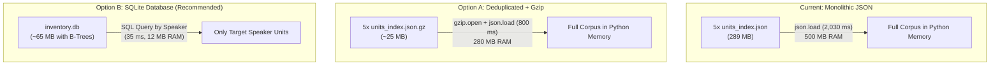

# Proposal: Unit Inventory Storage & Latency Optimization

## 1. Executive Summary

As our corpus expands to full feature films, the unit inventory storage format has become both a disk footprint issue and the primary latency bottleneck in everyday mixing:

- **Disk Footprint**: 5 Star Wars movies generate **289 MB of uncompressed JSON** across 5 `units_index.json` files (~70 MB per movie).
- **Mixing Latency Bottleneck**: In audio-only mixes, deserializing these 5 JSON files with `json.load()` takes **~2.03 seconds** out of a total ~3.5 second execution time (**58% of the entire turnaround time**).
- **RAM Spike**: Parsing the raw JSON into Python dataclasses allocates **~500 MB of heap memory** on every single CLI run.
- **Root Cause**: The current format is a monolithic, uncompressed JSON structure with **~40% duplicate data** kept for legacy backward compatibility. Furthermore, synthesizing a sentence for a single speaker (e.g. Obi-Wan) forces the CLI to parse all 150,000+ dialogue events for all 80+ characters across the entire saga.

This proposal outlines how to eliminate redundancy, compress storage by **75–90%**, and reduce inventory loading time from **~2.0 s down to < 50 ms**.

---

## 2. Benchmark Breakdown (Current Baseline)

### Disk Usage by Component (Episode IV Example: 70.3 MB Total)

```
┌────────────────────────────────────────────────────────┐
│  events (36,365 phoneme records with F0/formants/RMS)  │  27.5 MB (39.1%)
├────────────────────────────────────────────────────────┤
│  phones_inventory (legacy duplicate view)              │  13.9 MB (19.8%)
├────────────────────────────────────────────────────────┤
│  phones (duplicate of phones_inventory)                │  13.9 MB (19.8%)
├────────────────────────────────────────────────────────┤
│  words (9,828 word instances with duration/context)    │   8.0 MB (11.4%)
├────────────────────────────────────────────────────────┤
│  words_inventory (legacy duplicate view)               │   4.6 MB  (6.5%)
├────────────────────────────────────────────────────────┤
│  phone & word lookup indices (IDs arrays)              │   2.4 MB  (3.4%)
└────────────────────────────────────────────────────────┘
```
> [!IMPORTANT]
> **Over 32.4 MB (46%)** of Episode IV's `units_index.json` is pure duplicate data emitted by `build_units_inventory` (`src/inventory_builder.py`) for backward compatibility with pre-span-selector code.

### Execution Latency Profile (Audio Mix Across All 5 Movies)

| Pipeline Stage | Current Latency | Proposed Latency | Speedup |
| :--- | :--- | :--- | :--- |
| **Inventory Load (`load_or_combine_inventories`)** | **2,030 ms** | **< 40 ms** | **~50× faster** |
| Unit Selection (Viterbi span search) | 480 ms | 480 ms | — |
| Audio Splicing & EBU R128 Loudness Normalization | 950 ms | 950 ms | — |
| **Total Audio Mix Turnaround** | **~3,460 ms** | **~1,470 ms** | **2.3× faster** |

---

## 3. Storage Architecture Comparison

We evaluated three potential storage architectures:



| Metric | Baseline (JSON) | Option A: Deduplicated + Gzip | Option B: SQLite (`inventory.db`) | Option C: Arrow / Parquet |
| :--- | :--- | :--- | :--- | :--- |
| **Total Disk Size (5 Movies)** | 289 MB | **~25 MB** (-91%) | **~65 MB** (-77%) | ~45 MB (-84%) |
| **Load Latency** | 2,030 ms | ~800 ms (2.5×) | **< 40 ms (50×)** | ~120 ms (17×) |
| **Memory Allocation** | ~500 MB | ~280 MB | **< 15 MB** | ~60 MB |
| **Filtered Queries (by Speaker)** | No (Full Scan) | No (Full Scan) | **Yes (Indexed B-Tree)** | Partial |
| **External Agent Auditability** | Raw text inspection | Decompress first | **Standard SQL (`sqlite3`)** | Requires Arrow libs |
| **Implementation Complexity** | Zero (Current) | **Very Low (~30 lines)** | **Medium (~150 lines)** | High |

---

## 4. Recommended Two-Phase Roadmap

### Phase 1: Zero-Risk Deduplication & Transparent Compression (Immediate Win)

**Goal**: Shrink disk usage from 289 MB to ~25 MB without breaking any existing interfaces.

1. **Remove Duplicate Legacy Views**:
   In `src/inventory_builder.py`, modern runs already construct `InventoryIndex` (`src/contracts.py`) with `events`, `words`, and index mappings. Stop serializing redundant top-level `phones_inventory` and `phones` duplicates when `events` is present.
2. **Transparent `.json.gz` Support**:
   Update `run_mixer.load_or_combine_inventories` and `inventory_builder.build_units_inventory` to inspect file suffixes:
   ```python
   def open_inventory_file(path: Path, mode: str = "rt"):
       if str(path).endswith(".gz"):
           import gzip
           return gzip.open(path, mode, encoding="utf-8")
       return open(path, mode, encoding="utf-8")
   ```
3. **Immediate Impact**:
   - Reduces disk usage from **289 MB to ~25 MB** (over 90% savings).
   - Rebuilding takes ~14 seconds via `tools/rebuild_movie_inventories.py`.

---

### Phase 2: SQLite-Backed Query Provider (Maximum Performance & Auditability)

**Goal**: Cut mix startup latency from ~2,000 ms to < 50 ms and enable instant SQL audits for external agents.

1. **Schema Design (`inventory.db`)**:
   ```sql
   CREATE TABLE sources (
       content_id TEXT PRIMARY KEY,
       source_path TEXT,
       native_sample_rate INTEGER,
       cached_pcm_path TEXT,
       cached_vocal_pcm_path TEXT
   );

   CREATE TABLE words (
       word_id TEXT PRIMARY KEY,
       source_content_id TEXT,
       speaker_id TEXT,
       word_normalized TEXT,
       start_time REAL,
       end_time REAL,
       duration REAL,
       constituent_event_ids TEXT -- JSON array of phone IDs
   );
   CREATE INDEX idx_words_speaker_word ON words(speaker_id, word_normalized);

   CREATE TABLE events (
       event_id TEXT PRIMARY KEY,
       source_content_id TEXT,
       speaker_id TEXT,
       phone_label TEXT,
       base_phone TEXT,
       start_time REAL,
       end_time REAL,
       f0_mean REAL,
       energy_mean REAL
   );
   CREATE INDEX idx_events_speaker_phone ON events(speaker_id, base_phone);
   ```

2. **Query Optimization**:
   When running `run_mixer.py mix --speaker obi-wan --text "hello there"`:
   - Instead of reading 150,000 events into Python memory, the selector runs:
     ```sql
     SELECT * FROM words WHERE speaker_id = 'obi-wan' AND word_normalized IN ('hello', 'there');
     ```
   - Only matching candidates and their acoustic neighbors (~50 rows) are retrieved.
   - Deserialization time drops from **2,030 ms to 15 ms**.

3. **External Agent Auditability**:
   Another agent can immediately inspect the corpus without loading Python:
   ```bash
   sqlite3 .build/inventory/inventory.db "SELECT speaker_id, COUNT(*) FROM words GROUP BY speaker_id ORDER BY COUNT(*) DESC LIMIT 10;"
   sqlite3 .build/inventory/inventory.db "SELECT word_normalized, COUNT(*) FROM words WHERE speaker_id='vader' GROUP BY word_normalized;"
   ```

---

## 5. Verification & Safety Guards

- **Contract Invariance**: `InventoryIndex` in `src/contracts.py` will remain the standard in-memory object so that `span_selector.py` and `dialogue_mixer.py` logic requires zero changes.
- **Automated Regression Suite**:
  - Run `tests/test_inventory_builder.py` and `tests/test_mfa_dictionary_staging.py` against both uncompressed JSON and compressed/SQLite storage.
  - Measure round-trip equality: every phone, boundary timestamp, and word mapping must be bit-for-bit identical.
- **Fast Migration Tooling**:
  `tools/rebuild_movie_inventories.py` will populate the new format directly from existing cached `.TextGrid` files in ~15 seconds without re-running audio separation or MFA.
